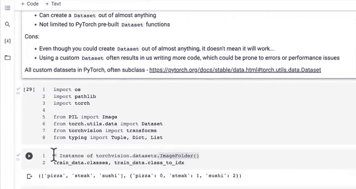
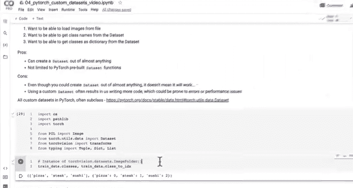

# mrdbourke《一天学会pytorch深度学习｜Learn PyTorch for deep learning in a day Literally》中英 - P82：137. Creating a custom dataset class (overview).zh_en - GPT中英字幕课程资源 - BV1kx4y1r79d

Welcome back So over the past few videos we've been working out how to get our data from our data folder。

 pizza steak and sushi， we've got images of different food data here and we're trying to get it into Tensor format。

 So we've seen how to do that with an existing data loader helper function or a data set function in image folder。

😊，However， what if image folder didn't exist and we need to write our own custom data loading function Now。

 the premise of this is， although it does exist， it's going to be good practice because you might come across a case where you're trying to use a data where a prebuilt function doesn't exist。

😡，So let's replicate the functionality of image folder by creating our own data loading class。😊。

So we want a few things， we want to be able to get the class names as a list from our loaded data and we want to be able to get our class names as a dictionary as well。

 so the whole goal of this video is to start writing a function or a class that's capable of loading data from here into Tensor format capable of being used with the Pytors data loader class like we've done here so we want to create a data set。

😊，Let's start it off。 We're going to create another heading here。 This is going to be number five。

 option 2。Loading image data with a custom data set。😡，So we want a few。Functionality steps here。

 number one is want to be able to load images。From file to want to be able to get class names from the data set。

And three want to be able to get classes as dictionary from the data set。

And so let's briefly discuss the pros and cons of creating your own custom data set。😊。

We saw option one was to use a pre existing data set loader helping function from Torch vision。

And it's going to be quite similar if we go torch vision data sets。

Quite similar if you're using other domain libraries here。

 there were going to be data loading utilities。But。

At the base level of pitorrch is torchutils dot data dot data。 Now， this is the base data set class。

 So we want to。Build on top of this to create our own image folder loading class。😡。

So what are the pros and cons of creating your own custom data？Well， let's discuss some pros。

So one pro would be you can create a。Data set。Out of almost anything。

As long as you write the right code to load it in。And。

Another pro is that you're not limited to high torch。😡，Prebuilt。Data set。Functions。

A couple of cons would be that even though this is to point number one。😡。

So even though you could create a data set。Out of almost anything。

It doesn't mean that it will automatically work。It will work。

 and of course you can verify this through extensive testing seeing if your model actually works if it actually loads data in the way that you want it。

And another con is that using a custom data set。Requires us to write more code。

 so often results in us writing more code。Which could？Be prone to errors。Or performance issues。

So typically if something makes it into the Pytorrch standard Library or the Pytorrch domain libraries。

If functionality makes it into here， it's generally been tested many。

 many times and it can kind of be verified that it works quite well with， or if you do use it。

 it works quite well whereas if we write our own code， sure we can test it ourselves。

 but it hasn't got the robustness to begin with that is， we could fix it over time。

 as something that's included in say the Pytorch standard library。😡，Nonetheless。

 it's important to be aware of how we could create such a custom data set。

So let's import a few things that we're going to use。

 we'll import OS because we're going to be working with Python's file system over here。

We're going to import Partthlib because we're going to be working with file paths。

We the import torch we don't need to again， but I'm just doing this for completeness。

We're going to import image from pill， the image class because we want to be opening images。

I'm going to import from Torchutils data， I'm going to import data which is the base data set and as I said over here we can go to datas。

 click on Torch Us data do data。 This is an abstract class representing a data set and you'll find that this data set links to itself。

 so this is the base data class many of the data sets in Ptorrch， the prebuilt functions。

Subclass this， So this is what we're going to be doing it。And there's a few notes here。

 all subclass should overwrite get item。😊，And you should optionally overwrite L these two methods。

 we're going to see this in a future video。 for now， we're just， we're just setting the scene here。

So from Torch vision。We're going to import transforms because we want to。Not only import our images。

 but we want to transform them into tensesors and from the Python'ons typing module。

 I'm going to import Tuple。Dickt and list so we can put T pins when we create our class and loading functions。

Wonderful。So。This is our instance of Torchvision。 datas image folder。😡，Toorwardgevision datas。

im folder。Let's have a look at the train data。So we want to write a function that can replicate getting the classes from a particular directory and also turning them into an index。

Or dictionary that is。So let's build a helper function to replicate this functionality here。

 In other words， I'd like to write a helper function that if we pass it in a file path。

Such as pizzaizz Stak sushi or this data folder。It's going to go in here。

 and it's going to return the class names as a list。

 and it's also going to turn them into a dictionary。

Because it's going to be helpful for later on when we'd like to access the classes and the class to IDX。

 and if we really want to completely recreate image folder while image folder has this functionality。

 so we'd like that too。😊，So this is just a little high level overview of what we're going to be doing。

 I might link in here that we're going to subclass this。So all custom data sets in Ptorrch。

Often subclass。This。So here's what we're going to be doing Over the next few videos。

 we want to be able to load images from a file now you could replace images with whatever data that you're working with the same premise will be here。

You want to be able to get the class names from the data set and want to be able to get classes a dictionary from the data set。

 So we're going to map our samples， our image samples。To their class name。

By just passing a file path。To a function。That we're about to rot。

And some pros and cons of creating a custom data set。😊，We've been through that。

 let's in the next video start coding up a helper function to retrieve these two things from our target directory。

In the last video， we discussed the exciting concept of creating a custom data。

 and we wrote down a few things that we want to get。

 We discussed some pros and cons and we learned that many custom datas inherit from torch。uts。

 data do data。 So that's what we'll be doing later on。😊，In this video。

 let's focus on writing a helper function to recreate this functionality。

 So I'm going to title this 5。1。Creating a helper function。To get class names。

I'm going to turn this into markdown。 And if I go into here， so we want to function to。

Let's write down some steps and then we'll code it out。So we'll get the class names。

 and we're going to use OS。cander， so it's going to scan a directory。To traverse a target directory。

And ideally， the directory is in standard image。Classification。Format。

So just like the image folder class。Our custom data class is going to require our data already be formatted。

In the standard image classification format such as train and test for training and test images。

 and then images for a particular class are in a particular directory。So let's keep going。

And number two， what else do we want it to do， We want it to raise an error if the class names。

Aren't found。So if this happens。There might be。We want this to hint at the fact that there might be something wrong with the directory structure。

😊，And number three， we also want to turn。The class names into are deck and a list and return them。

Beautiful， so let's get started。 Let's set up the par directory。For the target directory。

So our target directory is going to be what？The directory we want to load directory if I could spell。

 we want to load our data from let's start with the training there， just for an example， so target。

Diirectctory， what do we get？So we're just going to use the training folder as an example to begin with。

And we'll go print。Target di。 We'll put in the target directory。

 Just want to exemplify what we're doing。 and then we're going to。

Get the class names from the Ta directory。So I'll show you the functionality of OS scaner。

 of course you could look this up in the Python documentation。So class names found。

 let's set this to be sorted。And then we'll get the entry name， entry dot name for entry in list。

 so we're going to get OS list scaner。Of the image path， slash。Target directory。

Let's see what happens when we do this。Target directory， have we got the right brackets here？

Is this going to work， let's find out。Oh， image path slash target directory。What do we get wrong？Oh。

 we don't need the image path there。 Let's put， let's just put target directory there。There we go。

 beautiful， so we set up our target directory as been the training to。😊，And so if we just go。

 let's just do list。What happens if we just run this function here？O， scanander。Yeah， so there we go。

 so we have three directory entries， so this is where we're getting entry。t name。😊。

For everything in the training directory。So if we look in the training directory， what do we have。

 train and we have one entry for pizza， one entry for sushi， one entry for steak， wonderfulnder。

 So now we have a way to get a list of class names。

 and we could quite easily turn this into a dictionary， couldn't we。😊。

Which is exactly what we want to do。 We want to recreate this， which we've done。

 and we want to recreate this， which is also done。 So now let's take this functionality here。

And let's turn that into a function。All right， What could we do， What do we call this？

I'm going to call this deaf F classes。And I'm going to say that it takes in a directory。

 which is a string。 and it's going to return。 This is where I imported typing from Python typing。

 I imported tuple and I'm going to。Return a list， which is a list of strings and a dictionary。

 which is strings mapped to Integers。Beautiful， so let's keep going。 We want to。

We want this function to return given a target directory， we want it to return these two things。

 so we've seen how we can get a list of the directories in a target directory by using OS scanander。

 So let's write finds the classes are the class folder names in a target directory。Beautiful。

 and we know that it's going to return a list and a dictionary。So let's do step number one。

 We want to get the class names by scanning。The target directory。We'll go classes just。

 we're going to replicate the functionality we've done about。But for any given directory here。

So classes equals sorted。Entry。t name。For entry in OS scaner。

And we're going to pass it the target directory。If。

Entry dot is we're just going to make sure it's a directory as well。

And so if we just return classes and see what happens。So find classes。

 let's pass it in our target directory， which is our training directory， what do we get？Beautiful。

So we need to also return class to IDX。So let's keep going。

 so number two is let's go raise an error if class names could not be found。So if not classes。

Let's say raise file， we're going to raise a file not found error。And then let's just write in here。

Couldn't find any classes in directory， So we're just writing some error checking code here。

So if we can't find a class list within our target directory。

 we're going to raise this error and say couldn't find any classes in directory。Please check。

File structure。And there's another check up here that's going to help us as well to check if the entry is a directory。

So finally， let's do number three， what do we want to do。

 so we want to create a dictionary of index labels。So computers。

 why do we do this while computers prefer？Numbers rather than strings as labels。So we can do this。

 we've already got a list of classes， so let's just create class to IDX equals。Class name I for I。

 class name in。Enumerate。Classesses。Let's see what this looks like， hey？😊。

So we'll go class names and then class to IDX。Or we can just return it actually。😊。

Do we spell enumerate wrong， Yes， we did。 So what this is going to do is going to map a class name to an integer or to I for I class name in enumerate classes。

 So it's going to go through this， and it's going to go for I。 So the first one。

0 is going to be pizza。 Ily。 One will be steak 2 will be sushi。 Let's see how this goes。😊，Beautiful。

 look at that。 We've just replicated the functionality of。😊，Image folder。

So now we can use this helper function in our own custom data set。

 find classes to traverse through a target directory such as train。

 We could do the same for test if we wanted to， to。 And that way， we've got a list of。😊，Classes。

 and we've also got a dictionary mapping those classes to integers。So now let's in the next video。

 move towards。Subclassing。Torchuts do data dot data set。

 And we're going to fully replicate image folder。So I'll see you there。

