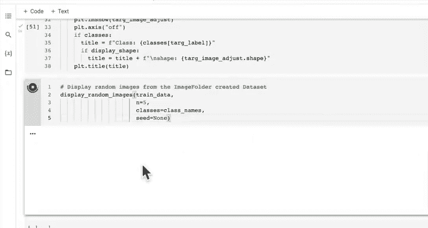

# mrdbourke《一天学会pytorch深度学习｜Learn PyTorch for deep learning in a day Literally》中英 - P83：139. Writing a custom dataset class from scratch.zh_en - GPT中英字幕课程资源 - BV1kx4y1r79d

In the last video， we wrote a great helper function called F classes that takes in a target directory and returns a list of classes and a dictionary mapping those class names to an integer。

😊，So let's move forward and this time we're going to create a custom data set。😊，To replicate。

Image folder Now we don't necessarily have to do this right because image folder already exists and if something already exists in the Pytorch library chances are it's going to be tested well。

 it's going to work efficiently and we should use it if we can。

 but if we needed some custom functionality we can always build up our own custom data by subclassingtorrch。

utils。 data data or if a prebuilt data function didn't exist well we're probably going to want to subclasstorrchutils data data anyway。

And if we go into the documentation here， there's a few things that we need to keep in mind when we're creating our own custom data set。

😊，All data sets that represent a map from keys to data samples， so that's what we want to do。

 We want to map keys， in other words， targets or labels to data samples。

 which in our case are food images。So we should subclass。This class here。Now， to note。

 all subclass should overrite get item。 So get item is a method in Python。

 which is going to get an item or get a sample， supporting fetching a data sample for a given key。

 So， for example， if we wanted to get sample number 100。 This is what get item should support。

 it should return us sample number 100。And subclass could also optionally override L。

 which is the length of a data set。 So return the size of the data set by many sampler implementations and the default options of data loader。

 because we want to。Use this custom data set with data loader later on。

 so we should keep this in mind when we're building our own custom subclasses of Torch UT's data data。

Let's see this hands on， we're going to break it down it's going to be a fair bit of code。

 but that's all right。😊，Nothing that we can't handle so。To create。Our own custom data set。We want to。

Number one， first things first is going to be going to subclass。Sumclass torch。uttails。da set。Two。

 what do we want to do， We want to init our subclass。With a target directory。

So the directory we'd like to get data from。As well as a transform。If we'd like to transform。

Our data， so just like when we used image folder， we could pass a transform to our data set。

So that we could transform the data that we were loading， we want to do the same thing。

And we want to create several。Attributes。Let's write them down here， we want paths。

 which will be the paths of our images。What else do we want We want transform。

 which will be the transform we'd like to use。We want classes。

 which is going to be a list of the target classes。And we want class to IDX。

 which is going to be a di of the target classes。Mat。To integrate labels。Now， of course。

 these attributes will differ depending on your data set， but we're replicating image folder here。

 So these are just some of the things that we've seen that come with image folder。

 but regardless of what data you're working with。 There are probably some things that you want to cross them universal you probably want all the paths of where your data is coming from。

 the transforms you'd like to perform on your data。

 what classes you're working with and a map of those classes to an index。

 So let's keep pushing forward， we want to create a function to load images because after all。

 we want to open some images， So this function will open an image。Number five。

 we want to overwrite the L method。To return。The length。Of our data。

 so just like it said in the documentation。If you subclass using taunch。

utils that dated the data set。You should overwrite get item and you should optionally overwrite La。

 so we're going to instead of optionally， we are going to overwrite length。And number six。

 we want to overrite。The get item。Method to return a given sample when passed an index。Excellent。

 so we've got a fair few steps here， but。If they don't make sense now， it's okay， let's code it out。

 Remember our motto if and down， code it out and if and down， run the code。

 So we're going to write a custom data set。 This is so exciting because。😊。

When you work with pre built data sets， it's pretty cool in machine learning。

 but when you can write code to create your own data sets and that's oh that's magic so number one is we're going to well number zero is we're going to import。

Torch Us data set。 We don't have to rewrite this。 We've already imported it。

 but we're going to do it anyway for completeness。 Now， step number one is to subclass it。

 subclass torch u data， the data set。So just like when we built a model。

We're going to subclass and in module， but in this time we're going to call us our class image folder custom and we're going to inherit from data set。

 this means that all the functionality that's contained within Torch U's data data set we're going to get for our own custom class。

😊，Number two， let's initialize， so we're going to initialize。Our custom data set。

There's a few things that we'd like a knit our subclass with the target directory。

 the directory we'd like to get data from， as well as a transform if we'd like to transform our data。

 So let's write a knit function。😊，Aette and we're going to go self。Tggeder。And。

Tg de is going to be a string and we're going to set a transform here， we'll set it equal to none。

Beautiful。So this way we can pass in a target directory of images that we'd like to load。

 and we can also pass in a transform just similar to the transforms that we've created previously。

So now we're up to number three， which is create several attributes。

 so let's see what this looks like， create class attributes。So we'll get all of the image parts。

So we can do this just like we've done before， self paths equals list， pathlibb。path。

 because what's our target directory going to be？Well， I'll give you a spoiler alert。

 It's going to be a part like the test directory， or it's going to be the train directory。

Because we're going to use this once for our test directory and our train directory。

 just like we use the original image folder。So we're going to go through the target directory and find out。

All of the paths。 So this is getting all of the image paths that support or that follow the file name convention of。

Star slashstar。jPG。 So if we have a look at this， we passed in the test folder。

So test is the folder star would mean any of these， one，2， three， pizza steak sushi。

 that's the first star。Then slash would go into the pizza directory。

The star here would mean any of the file combinations here that end in dot JPG。

So this is getting us a list of all of the image paths within a target directory。In other words。

 within the test directory and within the train directory， when we call these two separately。

So let's keep going。 We've got all of the image parts。 What else did we have to do。

 We want to create transforms。 So let's set up transforms。Self dot transforms equals transform。Oh。

 we'll just call that transform actually setup transform equals transform。

 so we're going to get this from here。And I put it as none because it transform can be optional。

So let's create classes and class to IDX attributes， which is the next one on our list。

 which is here classes and Class to IDX Now lucky us in the previous video we created a function to return just those things。

 so let's go self dot classes。And self dot class to IDX equals find classes。

And we're going to pass in the target D or the target D from here。Now， what's next。

 We've done step number 3， we need。Number four is create a function to load images Allright。

 let's see what this looks like。Number four， create a function to load。Images。

 so let's call it load image and we're going to pass in self and we'll also pass in an index。

 so the index of the image we'd like to load and this is going to return an image dot。Image。

So where does that come from Well previously we imported from P。

 so we're going to use Python image library or pillow to import our images。

So we're going to given a file path from here， such as pizza。

 we're going to import it with the image class and we can do that using。

 I believe it's image dot open。 So let's give that a try。 I'll just write a note in here。

 opens an image via a path and returns it。So let's write image path equals。Self。

 this is why we got all of the image paths above。So self dot paths and we're going to index it on the index。

Beautiful， and then let's return image dot open。Image path。

So we're going to get a particular image path and then we're just going to open it。😊。

So now we're up to step number five， override the land method to return the length of our data set。

This is optional， but we're going to do it anyway。So overr。Lin。

So this just wants to return how many samples we have in our data set。 So let's write that de L。

 So if we call L on our data set。Instance， it's going to return just how many numbers there are。

 So let's write this down。Returns the total number of samples。

And this is just going to be simply return length or then of self dot Hs。😊。

So for our target directory， if it was the training directory。

 we'd return the number of image paths that this code has found out here and same for the test directory。

So next， I'm going to go。Number six is we want to overrite。We put this up here， the get item method。

 So this is required if we want to subclass torch U's data data set。

 So this is in the documentation here， all subclasses should override get item。

 so we want get item to if we pass it in index to our data set。

 we want it to return that particular item， so let's see what this looks like override the get item。

Method to return are particular。Sample。And now this method is going to leverage。

Get item all of the code that we've created above。So this is going to go take in self。

 which is the class itself， and it's going to take in an index which will be of an integer and it's going to return a tuple of torch do tensor。

And an integer， which is the same thing that gets returned when we index on our training data。

 so if we have a look image label equals train data。0ero。Gett item is going to replicate this。

We pass it at index here。Let's check out the image and the label。This is what we have to replicate。

 so remember train data was created with image folder from Torchvision。 datas。

And so we will now get item to return an image and a label。

 which is a topple of a torch tensor where the image is of a tensor here。😊。

And the label is of an integer， which is the label here。

 the particular index as to which this image relates to。So let's keep pushing forward。

We're going to write down here。Returns。One sample of。Data。Data and label。X and well。

 we'll just go x Y。So we know that it's a tuple。Beautiful， so let's set up the image。😊。

What do we want the image to be？Well， this is where we're going to call on our self dot load image function。

 which is what we've created up here。Do you see the customization capabilities of creating your own class？

😊，So we've got a fair bit of code here， right， but essentially all we're doing is we're just creating functions that is going to help us load our images into some way。

 shape or form。😊，Now again， I can't stress this enough regardless of the data that you're working on。

The pattern here will be quite similar。You'll just have to change the different functions you use to load your data。

So let's load an image of a particular index。 So if we pass in an index here。

 it's going to load in that image。Then what do we do Well， we want to get the class name。

 which is going to be self。Dot paths and we'll get the index here。And we can go parent。t name。So。

 this expects。Path in format。Data。Folder， slash class name， slashimage。jPg。

That's just something to be aware of and the class IDX is going to be self。

 class to IDX and we will get the class name here。So now we have an image by loading in the image here。

 we have a class name。By because our data is going to be or our data is currently in standard image classification format。

 you may have to change this depending on the format your data is in。

 We can get the class name from that， and we can get the class I D X by indexing on。

I'll attribute up here。Our dictionary of class names to indexes。Now we have one small little step。

 this is transform if necessary。So remember our。Transform parameter up here if we want to transform our target image。

 well， let's put in if self dot transform， if the transform exists。

 let's pass the image through that transform。Transform image。And then we're going to。

Also return the class IDX。So do you notice how we've returned to tuple here。

 this is going to be a torch tensor。If our transform exists and the class IDX is also going to be returned。

Which is what we want here， x and Y， which is what gets returned here， image as a tensor。

 label as an integer。So， return。Data， label， X， Y。 And then if the transform doesn't exist。

 let's just return。Image， class IDX。Return。Untransformed image and label。Beautiful。

 so that is a fair bit of code there， so you can see the pro of subclassing Torch U's data that data set is that we could customize this in almost any way we wanted to to load whatever data that we're working with or almost any data。

😊，However， because we've written so much code， this may be prone to errors which we're going to find out in the next video to see if it actually works。

😊，But essentially all we've done is we've followed the documentation here Torch。

utTil's data data set。To replicate the functionality of an existing data loader function。

 namely image folder。 So if we scroll back up。Ideally， if we've done it right。

 we should be able to write code like this。😊，Passing in a route directory such as a training directory。

 a particular data transform。And we should get very similar instances as image folder。

 but using our own custom data set class。So let's try that out in the next video。😡。

So now we've got a custom image folder class。That replicates the functionality of the original image folder。

 data loader class or data set class that is。Let's test it out。

 Let's see if it works on our own custom data。 So we're going to create a transform here。😊。

So that we can transform our images。Raw JpeEG images into tensess。

Because that's the whole goal of importing data into Ptorrch。

 So let's set up a train transforms compose。We're going to set it to equal2 transformforms dotcompose and I'm going to pass in a list here that it's going to be transforms。

 we're going to resize it to 6464。😊，Whatever their image size will reduce it down to 64，64。

 Then we're going to go transforms dot random horizontal flip。

 We don't need to necessarily flip them， but we're going to do it anyway just to see if it works。

And then let's put in here， transformforms dot2 Tensor。

 because our images are getting opened as a pill image。Using image dot open。

 but now we're using the two transform transform from Pi torch or Torchvisions dot transforms。

 So I'll just put this here。From Torchvision。 transformforms is that way you know we're importing transforms there and let's create one for the test data set as well Test transforms We set this up Oh excuse me。

 Well need to just go import。Transforms。And let's go transformforms docompose and we'll pass in another list we're going to do the exact same as above。

 we'll set up resize and we'll set the size equal to 6464。😊。

And then transforms we're going to go dot to Tensor。

 we're going to skip the data augmentation for the test data because typically you don't manipulate your test data in terms of data augmentation。

 you just convert it into a tensor rather than manipulate its orientation， shape， size。

 etctera etc So let's run this。And now let's see how image folder custom class works。Test out。Image。

Folder， custom。Let's go， we'll set up the train data custom。Is equal to。Image folder custom。

 and then we'll set up the T de， which is equal to the training directory。

 and then we'll pass in the transform， which is equal to the train transforms。

 which we just created above train transforms。And then we're going to。I think that's all we need。

 actually， We only have two parameters there。 We're not going to use a target transform because our labels。

 we've got to help a function to transform our labels。

 So test data custom is going to be image folder custom。

 and I'm going to set up the tag dough to be equal to the test directory and the transform is going to be the test transforms from the cell above there。

😊，And what's coLab telling me there？We'm going to set that up。Didn't we spell something， oh。

 we spelled it wrong， train transforms， there we go。Beautiful。

 now let's have a look at our train data and test data custom。😊，See if it worked。What do we have？

Or we have an image folder custom， well it doesn't give us as much rich information as just checking it out as it does for the train data。

😊，But that's okay。 We can still inspect these。 So this is our original one made with image folder。

 and we've gotten our train data custom and test data custom。

 Let's see if we can get some information from these。

 So let's check the original length of the train data and see if we can use the land method on our train data custom。

 Did that work。😊，Wonderful， now how about we do it for the original test data made with image folder and our custom version made with test data or image folder custom。

😊，Beautiful， that's exactly what we want and now let's have a look at the train data custom。

 let's see if the class' attribute comes up。😊，Dot classes and。We'll just leave that there。

 We'll do the class dot I D X。 Yes， it is。 So this attribute here is， I wonder if we get。😊。

Information from group Co Lab loading， what do we get oh classes to IDX classes。

 load image paths transform。 So if we go back up here。😊，All these attributes are from here， paths。

 transform， classes， class to I D X， as well as load image。

 So this is all coming from the code that we wrote。 Our custom data set class。

 So let's keep pushing forward。 Let's have a look at the class to I D X。

 Do we get the same as what we wanted before。 Yes， we do。 beautiful。

 a dictionary containing our string names and their integer associations。

 So let's now check for a quality。😊，We can do this by going。Check for a quality between。

Original image folder。Data set and image folder。Custom data set。

 Now we've kind of already done that here。 but let's just try it out。 Let's go print。

Let's go train data custom dot classes is that equal to train， oh I don't want three equals。

 train data the original one dot classes and also print， let's do test data。Custom dot classes。

Is this equal to？Test data， the original one classes。True and true。 Now， you could try this out。

 In fact， it's a little exercise to try it out to compare the others， but。Congratulations to us。

 We have replicated the main functionality of the image folder data set class。

 And so the takeaways from this is that。😊，Whatever data you have。

Pytorch gives you a base data class to inherit from。

 and then you can write a function or a class that somehow interacts with whatever data you're working with。

 So in our case， we load in an image。 And then you as long as you override the land method and the get It method and return some sort of values。

 Well， you can create your own data set loading function。 How beautiful is that。

 So that's going to help you work with your own custom datas in Pytorch。

 So let's keep pushing forward。 we've seen analytically that our custom data is quite similar to the original pytorch Torchvision datas image folder data set。

 But you know what I like to do， I like to visualize things。

 So let's in the next video create a function to display some random images from our trained data custom class。

😊，It's time to follow the data Explorer's motto of visualize visualize visualize。

 so let's create another section I'm going to write here a title called Create a function。😊。

To display random images。 And sure we've we've had a look at the different attributes of our custom data set。

 We see that it gives back a list of different class names。

 We see that the lengths are similar to the original。

 but there's nothing quite like visualizing some data， so let's go in here。

 we're going to write a function， a helper function。😊，So step number one。

 we need to take in a data set， so one of the data sets that we just created。

 whether it be train data custom or train data。And a number of。Other parameters。

Such as class names and how many images？To visualize。And then step number two is。To prevent。

The display。Getting out of hand， let's cap the number of images to see at 10， because， look。

 if our data set is going to be thousands of images and we want to put in a number of images to look at。

 let's just make sure it's the maximum is 10。 That should be enough。 So we'll set the random seed。

For reproducibility。Number four is let's get a list of random samples。

 so we want random sample indexes let's just get rid of this S。

From what do we want it from from the target data set？

So we want to take in a data set and we want to count the number of images we're seeing。

 We want to set a random seed。 And do you see how much I use randomness here to really get an understanding of our data？

 I really， really， really love harnessing the power of randomness。

 So we want to get a random sample of indexes from all of our data set。😊。

And then we're going to set up a mappl Lib plot。Then we want to loop through。

The random sample images。And plot them。With Mattpotlib。And then as a side to this one。

 step seven is we need to make sure the dimensions of our images line up with Mapllib。

So Maplot Lib needs height width color channels。All right。Let's take it on， heh？So number one is。

Create a function。To take in a data set。So we're going to call this deaf。

 let's call it de display random images going to be one of our helper functions we've created a few type of functions like this。

But let's take in a data which is torch u of type that is of type dataset。

Then we're going to take in classes which is going to be a list of different strings。

 so this is going to be our class names for whichever data we're using。

 I'm going to set this equal to none。😊，And then we're going to take in n。

 which is the number of images we'd like to plot and I'm going to set this to 10 by default so we can see 10 images at a time。

10 random images that is Do we want to display the shape。

 Let's set that equal to true so that we can display what the shape of the images because were we're passing it through our transform as it goes into。

A data set， so we want to see what the shape of our images are just to make sure that that's okay。

And we can also， let's set up a seed， which is going to be an integer。

 and we'll set that to none to begin with as well。Okay， so step number two， what do we have above。

 We have to prevent the display getting out of hand。 Let's cap the number of images to see at 10。

 So we've got n is by default。 It's going to be 10。 But let's just make sure that it stays there。

 adjust just display if n is too high。So if n is greater than 10。Let's just readjust this。

 let's set n equal to 10 and display shape。 we'll turn off the display shape because if we have 10 images。

 our display may get out of hand， so just print out here for display purposes。N shouldn't be。

Larger than 10 setting to 10 and removing shape display。 Now。

 I only know this because I've had experience cooking this dish before。 In other words。

ve I've written this， this type of code before。 So you can customize the beautiful thing about python and py torches。

 You can customize these display functions in any way you see fit。 So step number 3。

 what are we doing， Se the random seed for reproducibility， okay。😊，Set the seed， so if seed。

 let's set random dot seed equal to that seed value， and then we can keep going。

So number four is let's get some random sample indexes so we can do that by going。

 get random sample indexes。Which is step number four here。

 So we've got a target data set that we want to inspect and we want to get some random samples from that。

 So let's create a random samples IDX list and I'm going to randomly sample from a length of our data or sorry。

 a range of the length of our data and I'll show you what this means in a second。And the K， oh。

 excuse me。Have we got enough brackets there， I always get confused with the brackets。

 The K is going to be M。 So in this case， I want to randomly sample 10 images from the length of our data set or 10 indexes。

So let's just have a look at what this looks like we'll put in here our train data custom here。😊。

So this is going to take a range of the length of our train data customer。

 which is what 225 we looked at that before， just up here。Length of this。 So between 0 and 2，55。

 we're going to get 10 indexes。 If we've done this correctly， Beai。

 So there's 10 random samples from our train data custom or 10 random indexes， that is。😊。

So we're up to step number five。Which was。Loop through the random sample images or indexes。

 let's count this to indexes。Indexes and plot them with mappl Lib。

 So this is going to give us a list here， So let's go loop through random indexes。And plot them。With。

Maappllib。Beautiful， so for I tag sample in enumerate。Let's enumerate through the random。

Random sample。ID X list。 And then we're going to go tag image and tag label。

 because all of the samples in our target data set are in the form of topples。

 So we're going to get the target image and the target label， which is going to be data set tag。

Sample will take the index， so it might be one of these values here。 We'll index on that。

 and the zeroth index will be the image， and then we'll go on the data set as well。

 We'll take the target sample index。 and then the index number one will be the label of our target sample。

 and then number 7。Oh， excusecus me， with Mr。 Stepb。That should be number6。Did you catch that？

Number5 is setup up plot so we can do this quite easily by going plot figure This is so that each time we we iterate through another sample we're going to have quite a big figure here。

 so we set up the plot outside the loop so that we can add a plot to this original plot here。

And now this is number 7， where we make sure the dimensions of our images line up with matpllib。

 So if we recall by default Pythr is going to turn our image dimensions into what color channels first。

 however， matpllib preferverse color channels last。 So let's go adjust tensor dimensions。

For plotting。So let's go tag image。Let's call this tag image adjust equals tag image dot permute。

 and we're going to alter the order of the indexes。

 So this is going to go from color channels or the dimensions that is height， width。

And we're going to change this width if I could spell。To height width color channels。Beautiful。

 that one will probably catch you off guard for a few times， but we've seen it a couple of times now。

 So you're going to keep going with this plot adjusted samples。

So now we can add a subplot to our mappl Lib plot and we want to create we want one row of n images。

 this will make a lot more sense until we visualize it and then for the index we're going to keep track of i plus1。

So let's keep going。 So then we're going to go plot in show and I'm going to go tag。Image adjust。

 so I'm going to plot this image here。And then let's turn off the axis。

And we can go if the classes' variable exists， which is up here。A list of classes。

 let's adjust the title of the plot to be the particular index in the class list。 So title equals F。

Class。And then we're going to put in here classes， and we're going to index on that with the target label index。

 which is going to come from here。Because that's going to be a numerical format。

 And then if display shape。Let's set the title equal to title plus F。🤢。

We're going to go new line shape， this is going to be the shape of the image T image。

 adjust dot shape。And then we'll set the title to Plt。 title。So you see how if we have display shape。

 we're just adjusting the title variable that we created here。

 And then we're putting the title onto the plot。 So let's see how this goes。

 That is quite a beautiful function。 Let's pass in one of our data sets and see what it looks like。

 Let's plot some random images。😊，So which one should we start with first， so let's display。

Random images from the image folder created data set， so this is the inbuilt Pitorrch image folder。

Let's go display random images， the function we just created above。

 we're going to pass in the train data and then we can pass in the number of images。

 let's have a look at five and the classes is going to be the class names which is just a list of our different class names and then we can set the seed。

 we want it to be random so we just set the seed to equal none。😊，Oh， doesn't that look good。

 So this is from our original train data made with image folder。 So option number one up here。

 option 1， There we go。😊，And we passed in the class name。 So this is sushi re size to 64，64，3。

 Sam with all of the others， but from different classes。 Let's set the seed to 42。 see what happens。

I get these images， we got a sushi， we got a pizza， we got pizza， sushi pizza。

 And then if we try a different one， we'll just go none。

We get random images again。 wonderfulful。 Now， let's write the same code。

 But this time using our train data custom data set。

 So display random images from the image folder custom data set， so。😊。

This is the one that we created。Display random images。 I'm going to pass in train data custom。

Our own data set is exciting， let's set n equal to 10 and just see how far we can go with our plot or maybe we set it to 20 and just see if our code for adjusting the plot makes sense。

😊，Class names and seed eagles I'm going to put in 42 this time。There we go for display purposes。

 and shouldn't be larger than 10 setting to 10 and removing shape display。 So we have a steak image。

 a pizza image， pizza， steak， pizza， pizza， pizza， pizza steak pizza。 If we turn off the random seed。

 we should get another 10 random images here。😊，Beautiful， look at that。 steak， steak， sushi， pizza。

 steak， sushi class， I'm reading out the different things here。 pizza， pizza， pizza， pizza。 Okay。

 so it looks like our custom data set is working from both a qualitative。😊，Standpoint。

 looking at the different images and a quantitative。

 how about we change it to5 and see what it looks like？Do we have a different shape， Yes。

 we do the same shape as above。Wonderful， okay， so we've got train data custom。😊。

And we've got train data which is made from image folder， but the premises remain。

 we've built up a lot of different ideas and we're looking at things from different points of view。

 we are getting our data from the folder structure here into Tensor format。😊。

So there's still one more step that we have to do and that's go from data set to data loader。

 So in the next video， let's see how we can turn our custom loaded images。

 train data custom and test data custom into data loaders。

So you might want to go ahead and give that a try yourself we've done it before up here。

Turn loaded images into data loaders， we're going to replicate the same thing as we did in here for our option number two。

 except this time we'll be using our custom data set。I'll see you in the next video。

