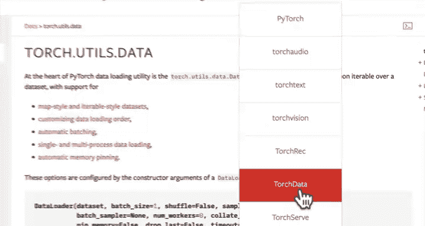

# mrdbourke《一天学会pytorch深度学习｜Learn PyTorch for deep learning in a day Literally》中英 - P84：142. Turning custom datasets into DataLoaders.zh_en - GPT中英字幕课程资源 - BV1kx4y1r79d

Aren't they some good looking images and even better that they're from our own custom data set？😊。

Now we've got one more step， we're going to turn our data set into a data loader。In other words。

 we're going to batchrify all of our images so that can be used with a model。

And I gave you the challenge of。Trying this out yourself in the last video。

 so I hope you gave that a go， but let's see what that might look like in here。So I'm going to go 5。

4。 Let's go， what shall we call this， So turn。Custom loaded images into data loaders。

 So this is just a goes to show that we can write our own custom data set class and we can still use it with Pi Torchs data loader。

 So let's go from U's。😊，Torch。utils that is us。data import data loader。We'll get that in here。

 We don't need to do that again， but I'm just doing it for completeness。

 So we're going to set this to train data loader custom。

 and I'm going to create an instance of data loader here。

And then inside I'm going to pass the data set which is going to be train data custom I'm just going to set a universal parameter here in capitals for batch size equals 32 because we can come down here we can set the batch size we're going to set this equal to 32。

Or in other words， the batch size parameter will be set up there。

 We can set the number of workers here as well。 If you set to 0， let's go see what the default is。

 actually， torch， us。Data loader。What's the default for number of workers？Zero okay。

 beautiful and recall that number of workers is going to set how many core load your data with a data loader and generally higher is better。

 but you can also experiment with this value and see what value suits your model and your hardware the best。

 So just keep in mind that number of workers is going to alter how much compute your hardware that you're running your code on Use to load your data。

😊，So by default， it's set to zero。And then we're going to shuffle the training data。

Wonderful and let's do the same for the test data loader。

 we'll create test data loader custom and I'm going to create a new instance so let me make a few code cells here。

😊，Of data loader I create a data set or passing the data parameter as the test data custom。

 so again these data sets are what we've created using our own custom data class。😊。

We're going to set the batch size， equal to batch size。

And let's set the nu workers equal to zero in a previous video we've also set it to CPU count。

You can also set it to。One， you can hard code it to4， all depends on what hard we're using。

 I like to use op OS。cpu count。And。Then we're not going to shuffle the test data。False。Beautiful。

 and let's have a look at what we get here， train data loader， custom and test。😊，Data loader custom。

 And actually， I'm just going to reset this instead of an O OS CPU count。

 I'm going to put it back to0 just so we've got it in line with the one above and of course。

 numb workers， we could also set this nu workers。😊，Equals 0 or O S dot CPU count。

And then we could come down here。And set this as nu workers。And。Now'm workers。

And let's have a look to see if it works。😊，A beautiful。

 So we've got two instances of us do data do data loader。 Now。

 let's just get a single sample from the train data loader here just to make sure the image shape and batch size is correct。

 Get image and label。😊，FromCustom data loader， we want image custom。

 and I'm going to go label custom equals next and I'm going to it over the train data loader custom。

😊，And then let's go print out。The shapes， we want image custom。Dot shape and label custom。

 do we get a shape here？Beautiful， there we go。 So we have shape here of 32 because that is our batch size。

 Then we have three color channels， 6464， which is in line with what。😊。

Which is in line with our transform that we set all the way up here。Transform。

 we transform our image。 You may want to change that to something different。

 depending on the model you're using， depending on how much data you want to be comprised within your image。

 recall generally a larger image size in codes more information and this is all coming from our original image folder custom data set class。

 So look at us go。 and I mean this is a lot of code here。 or a fair bit of code right。

 but you could think of this as like you write it once。

 and then if your data set continues to be in this format。 Well you can use this over and over again。

 So you might put this this image folder custom into a helper function file over here。

 such as data set do pi or something like that。 and then you could call it in future code instead of rewriting it all the time。

 And so that's just exactly what pitorrch is done with Torvision datas image folder。

So we've got some shapes here and if we wanted to change the batch size， what do we do。

 We just change it like that， 64。Remember， a good batch size is also a multiple of eight because that's going to help out computing and batch size equals one。

We get a batch size equal of one。we've been through a fair bit。

 but we've covered a very important thing and that is loading your own data with a custom data set。

 so generally you will be able to load your own data with an existing data loading function or data function from one of the torch domain libraries。

😊，Such as Torch audio， Torch text， Torch Vi， Torch rack， and later on when it's out of beta。

 torch data。

But if you need to create your own custom one， well you can subclass torch。utils。data。

data set and then add your own functionality to it。

So let's keep pushing forward previously we touched a little bit on transforming data and you may have heard me say that Torch vision transforms can be used for data augmentation and if you haven't。

That is。What the documentation says here， but data augmentation is manipulating our images in some way。

 shape or form so that we can artificially increase the diversity of our training data set So let's have a look at that more in the next video。

😊，I'll see you there。