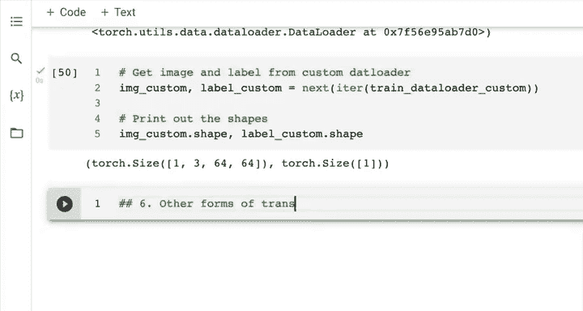
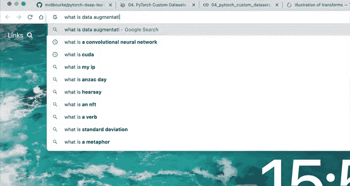
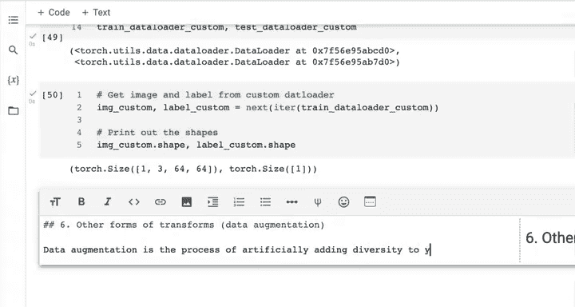
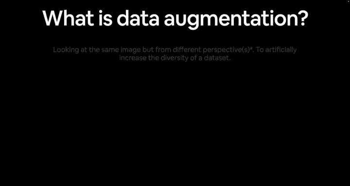
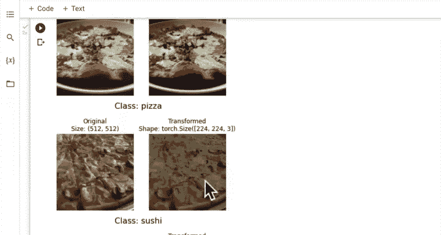
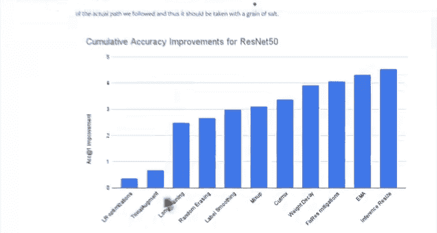

# mrdbourke《一天学会pytorch深度学习｜Learn PyTorch for deep learning in a day Literally》中英 - P85：143. Data augmentation.zh_en - GPT中英字幕课程资源 - BV1kx4y1r79d

Over the last few videos， we've created functions and classes to load in our own custom data。

 and we learned that one of the biggest steps in loading a custom data is transforming your data。

 particularly turning your target data into tenses。😊。

And we also had a brief look at the Torch Viion Transforms module。

 and we saw that there's a fair few different ways that we can transform our data。😊。

And that one of the ways that we can transform our image data is through augmentation。

 And so if we went into the illustration of transforms。

 let's have a look at all the different ways we can do it。 We've got ress。

 It's going to change the size of the original image。 We've got sent a crop， which will crop。

've got five crop。 We've got gray scale。 We've got random transforms。We've got gorgian blur。

 We've got random rotation， random affine， random crop。 We could keep going。 And， in fact。

 I'd encourage you to check out all of the different options here。😊，But oh， there's auto augment。

 wonderful。 there's random augment。 This is what I was hinting at。 data augmentation。

 Do you notice how the original image gets augmented in different ways here。

 So gets artificially changed。 So it gets rotated a little here。

 It gets darkened a little here or maybe brightened， depending how you look at it。

 it gets shifted up here， And then the the colors kind of changed here。

 And so this process is known as data augmentation。 as we've hinted at。

 And we're going to create another section here， which is。😊，Number six， other forms of transforms。

And this is data augmentation。So how could you find out about what data augmentation is where you could go here。

 what is data augmentation， and I'm sure there's going to be plenty of resources here。

Wikippedia there we go data augmentation in data analysis are techniques used to increase the amount of data by adding slightly modified copies of already existing data or newly created synthetic data from existing data。

So I'm going to write down here。Data augmentation is the process of artificially。

Adding diversity to your training data。

Now， in the case of。Image data， this may mean applying various image transformations。

To the training images。we saw a whole bunch of those in the Torch visionion Transform package。

 but now let's have a look at one type of data augmentation in particular and that is trivial augment。

 but just to illustrate this， I've got a slide here ready to go。

We've got what is data augmentation and it's looking at the same image but from different perspectives。

😊。

And we do this， as I said， to artificially increase the diversity of a data set。

So if we imagine our original image is over here on the left， and then if we wanted to rotate it。

 we could apply a rotation transform， and then if we wanted to shift it on the vertical and the horizontal axis。

 we could apply a shift transform。And if we wanted to zoom in on the image。

 we could apply a zoom transform， and there are many different types of transforms。

 as I've got a note here。 There are many different kinds of data augmentation， such as cropping。

 replacing， shear。 And this slide only demonstrates a few。

 but I'd like to highlight another type of data augmentation。 And that is one used。

To recently train Py tarch torch vision image models to state of the art levels。

 so let's take a look。At one particular type of data augmentation。

Used to train Pytorch vision models。To state of the art levels。Now。

 just in case you're not sure why we might do this。

 we would like to increase the diversity of our training data so that our images become harder for our model to learn。

 or it gets a chance to view the same image from different perspectives so that when you use your image classification model in practice。

 it's seen the same sort of images but from many different angles。😡。

So hopefully it learns patterns that are generalizable to those different angles。

 So this practice hopefully。Results in a model that's more generalizable。To unseen data。

And so if we go to Torch vision。😡，A state of the art。😡，Here we go。So。

This is a recent blog post by the Piytorch team， how to train state of the art models。

 which is what we want to do。 State of the art means best in the business， otherwise known as Sota。

 you might see this acronym quite often using Torchvis's latest primitives。

 So Torch vision is the package that we've been using to work with vision data and Torch vision has a bunch of primitives which are。

 in other words， functions that help us train really good performing models。 So blog post here。

And if we jump into this blog post。😊，And if we scroll down， we've got some improvements here。

 so there's an original Resnet 50 model。 Resnet 50 is a common computer vision architecture。

 So accuracy at one。 So what do we have？Well， let's just say they get a boost in what the previous results were。

 So if we scroll down。There is a type of data augmentation here。

 So if we add up all of the improvements that they used。 So there's a whole bunch here。 now。

 as your extra curriculum， I would encourage you to look at what the improvements are。

 you're not going get them all the first go， but that's all right。

 blog posts like this come out all the time。 and the recipes are continually changing。

 So even though I'm showing you this now。This may change in the future。

 So I just scrolled down to see if this table showed us what the previous results were。

 doesn't look like it does。 I know， there's the baseline。 So 76， and with all these little additions。

 it got right up to nearly 81。 So nearly a boost of 5% cent accuracy。That's pretty good。

 So what we're going to have a look at is trivial augment。

 So there's a bunch of different things such as learning rate optimization， training for longer。

 So these are ways you can improve your model， random erasing of image data， label smoothing。

 you can add that as a parameter to your loss functions， such as cross entropy loss。

 mix up and cut mix。😊，Weight， decay tuning， fix re mitigations， exponential moving average。

 which is EM A inference resize tuning。 So there's a whole bunch of different recipe items here。

 But we're going to focus on one。 We're going to break it down。 Let's have a look at trivial augment。

 So we'll come in here。Let's look at。Trivial or meant。

 So if we wanted to look at trivial augment meant， can we find it in here。 Oh， yes， we can。

 It's right here。Trivial augment。 So as you'll see， if you pass an image into trivial augment。

 it's going to change it in a few different ways。 So if we go into。Yeah， let's write that down。

 So let's see this in action on some of our own data。 So we'll import。From Torch Vi。

Import transforms。And we're going to create a train transform。Which is equal to transforms。

Dot composeose。Youll pass it inね。And this is going to be very similar to what we've done before in terms of composing a transform。

 What do we want to do Well， let's say we wanted to resize one of our images or an image going through this transform。

 let's change its size to 224224， which is a common size in image classification and then it's going to go through transforms。

 We're going to pass in trivial。Augment wide。 And there's a parameter here。

 which is number of magnitude bins， which is basically a number from 0 to 31。

31 being the max of how intense you want the augmentation to happen。 So say we， we only put this as。

five。Our augmentation would be of intensity from 0 to5 and so in that case the maximum wouldn't be too intense so if we put it to 31 it's going to be the max intensity and what I mean by intensity is say this rotation if we go on a scale of 0 to 31。

 this may be a 10， whereas 31 would be completely rotating。And same with all these others， right。

 so the lower this number。The less the maximum upper bound of the applied transform will be。😡。

Then if we go transforms dot to Tensor。Wonderful， so there we've just implemented trivial augment。

 How beautiful is that？😊，That is from the Ptorrch Torch vision transformforms library。

 We've got trivial augment wide， and it was used trivial augment to train the latest state of the art vision models in the Ptorrch Torch vision models library or Model repository。

 And if you wanted to look up trivial augment。 how could you find that， you could search it。

Here is the paper。 if you'd like to read it。 it's implemented。 It's actually a very， very。

 I would say， let's just say trivial augment。 I didn't want to say simple because I don't want to downplay it。

 trivialvi augment leverages the power of randomness quite beautifully。

 So I'll let you read more on there。 I would rather try it out on our data and visualize it first。😊。

Test transform。Let's go transforms compose， and you might have the question of which transforms should I use with my data。

 Well， that's the million dollar question， right， That's the same thing as asking which model should I use for my data There's a fair few different answers there and my best answer will be try out a few see what work for other people like we've done here by finding that trivial augment worked well for the Pytoch team and try that on your own problems if it works well。

 excellent if it doesn't work well Well you can always oh excuse me We've got a spelling mistake if it doesn't work well。

 well you can always set up an experiment to try something else。

So let's test out our augmentation pipeline。So we'll get all the image paths。

 we've already done this but we're going to do it anyway again just to reiterate。

 we've covered a fair bit here， so I might just rehash on a few things。

 we're going to get list image path which is our let me just show you。Our image path。

 we just want to get all of the images within this file。 So we'll go imagepath dot Gb。

WellGloob together all the files and folders that match this pattern。 And then if we check。

 what do we get， We'll check the first 10。Beautiful。

 and then we can leverage our function from the before to plot some random images。

Ploot random images。We'll pass in or plot transformed random transformed images。 That's what we want。

 Let's see what it looks like when it goes through our trivial augment。So image pads。

Equals image part list。This is a function that we've created before， by the way。

 transform equals train transform， which is the transform we just created above that contains trivial augment。

And then we're going to put n equals 3 for five images and we'll do seed equals none to plot or sorry。

 n equals 3 for three images， it's not five。Beautiful， and we'll set the seed equals none。

 by the way。 So look at this。 We've got class pizza。 Now trivial augment， it resized this。 Now。

 I'm not quite sure what it did to transform it， per se。 Maybe it got a little bit darker。

 This one looks like it's been the colorss have been manipulated in some way， shape or form。 and。😊。

This one looks like it's been resized and not too much has happened to that one from my perspective。

 So if we go again， let's have a look at another three images。 So trivialloggue meant works。

 And what I said before it harnesses the power of randomness。

It kind of selects randomly from all of these other augmentation types and applies them at some level of intensity。

So all of these ones here， trivial augment just going to select sumummit random and then apply them some random intensity from 0 to 31 because that's what we've set on our data and of course you can read a little bit more in the documentation or sorry in the paper here。

 but I like to see it happening。😊，So this one looks like it's been cut off over here a little bit。

 This one， again， the colours have been changed in some way， shape or form。 This one's been darkened。

And so do you see how we're artificially adding diversity to our training data set。

 So instead of all of our images being this one perspective like this。

 we're adding a bunch of different angles and telling our model hey。😊。

You've got to try and still learn these patterns， even if they've been manipulated。

So we'll try one more of these。So look at that one。 that's pretty manipulated there， isn't it。

But it's still an image of stake。 So that's what we're trying to get our model to do。

 is still recognize this image as an image of stake， even though it's been manipulated a bit。Now。

 will this work or not， Hey， it might， It might not。

 but that's all the the nature of experimentation is。 So play around。

 I would encourage you to go in the transforms documentation like we've just done illustrations。

Change this one out。 trivialvial augment wide for another type of augmentation that you can find in here。

 and see what it does to some of our images randomly。

 I've just highlighted trivial augment because it's what the Pytorch team have used in their most recent blog post for their training recipe to train state of the art vision models。

 So speaking of training models Let's let's move forward。 and we've got to build our first model。😊。

For this section， I'll see you in the next video。