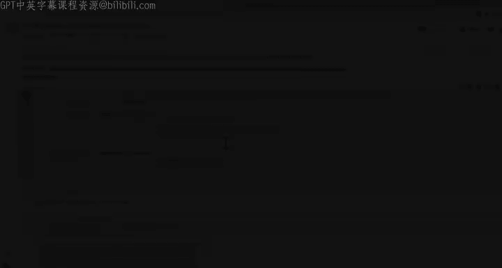
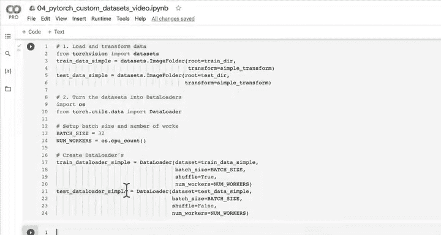
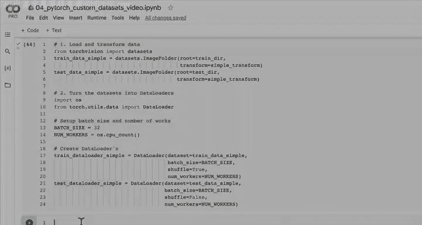
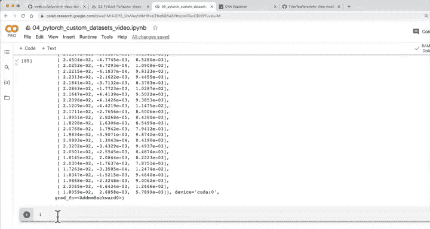

# mrdbourke《一天学会pytorch深度学习｜Learn PyTorch for deep learning in a day Literally》中英 - P86：144. Building a baseline model.zh_en - GPT中英字幕课程资源 - BV1kx4y1r79d

Welcome back In the last video we covered how the Pytoch team used trivialvi augment wide。

 which is the latest state of the art in data augmentation at the time of recording this video to train their latest state of the art computer vision models that are within Torchvision and we saw how easily we could apply trivial augment thanks to Torchvision。

 transforms。😊，And we'll just see one more of those in action just to highlight what's going on。

So it doesn't look like much happened to that image when we augmented。

 but we see this one has been moved over， we've got some black space there。

 this one has been rotated a little and now we've got some black space there。

But now's time for us to build our first computer vision model on our own custom data set。

 So let's get started。 we're going to go model 0。😊。

We're going to reuse the tiny VGG architecture which we covered in the computer vision section and the first experiment that we're going to do。

 we're going to build a baseline which is what we do with Model 0。

 We're going to build it without data augmentation so rather than use trivial augment。

 which we've got up here， which is what the Pytorch team used to train their state of the art computer vision models We're going to start by training our computer vision model without data augmentation and then so later on we can try one to see with data augmentation to see if it helps or doesn't So let me just put a link in here。

 Cn explainer。This is the model architecture that we covered in depth in the last section。

 so we're not going to go spend too much time here。

 all you have to know is that we're going to have an input of 64 64。

3 into multiple different layers such as convolutional layers， re layers， max pool layers。

 and then we're going to have some output layer that suits the number of classes that we have。😊。

In this case， there's 10 different classes， but in our case we have。Three different classes。

 one for pizza， steak and sushi。 So let's replicate the tiny VG G architecture。From。

The CNN explainer website。 and this is going to be good practice， right。

 We're not going to spend too much time referencing their architecture。

 We're going to spend more time coding here。But of course， before we can train a model。

 what do we have to do， well let's go 7。1。 we're going to create some transforms and loading data。

We're going to load data for Model 0。 Now， we could， of course。

 use some of the variables that we already have loaded。

 but we're going to recreate them just to practice。So let's create a simple transform。

And what is our whole premise of loading data for Model 0。

 We want to get our data from the data folder， from pizza St sushi。

 from the training and test folders， from their respective folders。

 We want to load these images and turn them into tensesors。Now we've done this a few times now。

 and one of the ways that we can do that is by creating a transform。

Equals transformforms dot composeose。And we're going to pass in， let's resize it。

So transforms dot resize， we're going to resize our images to be the same size as the tiny VGG architecture on the CNN explainer website。

64，64，3。 And then we're also going to pass in another transform to tensor so that our images get resized to 6464。

 and then they get converted into tensors， and particularly these values within that tensor are going to be between 0 and 1。

So there's our transform now we're going to load some data if you want to pause the video here and try to load it yourself。

 I'd encourage you to try out option1， loading image data using the image folder class and then turn that data。

 that image folder data set into a data loader so batchify it so that we can use it with a Pytorch model。

So give that a shot， otherwise， let's go ahead and do that together。😊，So one。

 we're going to load and transform data We've done this before。

 but let's just rehash on it what we doing So from Torch vision import data sets。

Then we're going to create the train data simple， and I call this simple because we're going to use at first a simple transform。

 one with no data augmentation， and then later on for another modeling experiment。

 we're going to create another transform one with data augmentation。😊，So let's put this here。

 data sets image folder。And let's go， the root equals the training directory。

And then the transform is going to be what It's going to be our simple transform that we've got above。

And then we can put in test data simple here。And we're going to create datas do image folder。

 and then we're going to pass in the route as the test directory and we'll pass in the transform is going to be the simple transform again above。

 So we're performing the same transformation here on our training data and on our testing data。

Then what's the next step we can do here？Well， we can two turn the data sets into data loaders。

 so let's try it out。 First we're going to import OS， then from Torch。uts。 data。

 we're going to import data loader。And then we're going to set up。Batge size and number of workers。

So let's go batch size， we're going to use a batch size of 32 for our first model。Numb workers。

 which will be the number of， oh excuse me， I've got to typo here， classic number of workers。

 which will be the what， the number of CPU cores that we dedicate towards loading our data。

So let's now create the data loaders。We're going to create train data loader simple。

Which will be equal to data loader。And the data set that goes in here will be train data simple。

 then we can set the batch size equal to the batch size parameter that we just created or hyperparameter that is。

😊，Recall the hyperparameter is something that you can set yourself。

 We would like to shuffle the training data， and we're going to set none workers equal to。

Numb workers。So in our case， how many core does Google Co Laab have， let's just run this。

Find out how many numb workers there are， I think there's going to be two CPUs。Wonderful。

 and then we're going to do the same thing for the test data loader。Test data loader， simple。

I'm going to go data loader， we'll pass in the data set here。

 which is going to be the test data simple。And then we're going to go batch size equals batch size。

We're not going to shuffle the test data set and then the numb workers will just set it to the same thing as we've got above。

Beautiful。So。I hope you gave that a shot。 But now do you see how quickly we can get our data loaded if it's in the right format。

 I know we spent a lot of time going through all of these steps over multiple videos and writing lots of code。

 But this is how quickly we can get set up to load our data。 We create a simple transform。

 and then we load in and transform our data at the same time。

 And then we turn the data sets into data loaders just like this。 Now。

 we're ready to use these data loaders with a model。😊，So speaking of models。

 how about we build the tiny VGG architecture in the next video and in fact we've already done this in notebook number three。

 so if you want to refer back to the model that we built there。Right down here。

 which was model number 2。 If you are on refer back to this section and give it a go yourself。

 I'd encourage you to do so， otherwise。

We'll build the tiny VGG architecture in the next video。

Welcome back in the last video we got set up starting to get ready to model our first custom data set。

 and I issued you the challenge to try and replicate the tiny VGG architecture from the CNN explainplainer website which we covered in notebook number3。

 but now let's see how fast we can do that together hey。😊，I'm going to write down here section 7。2。

And I know we've already coded this up before， but it's good practice to see what it's like to build Pyto models from scratch。

 create tiny VGG model class。So the model is going to come from here previously we created our model there would have been one big change from the model that we created in section number three。

 which is that our model in section number three used black and white images。

 but now the images that we have are going to be color images so there's going to be three color channels rather than one。

And there might be a little bit of a trick that we have to do to find out the shape later on in the classifier layer。

 But let's get started。 We've got class tiny VGG。 We're going to inherit from N N dot module。

 This is going to be。The model architecture copying。Tiny VGG from。CnN explainer。

And remember that it's quite a common practice in machine learning to find a model that works for a problem similar to yours and then copy it and try it on your own problem。

So only want two underscores there， we're going to initialize our class。

 we're going to give it an input shape。Which will be an int。

We're going to say how many hidden units do we want， which will also be an end。

 And we're going to have an output shape， which will be an end as well。 And it's going to return。

Something none of've type none。Then if we go down here。

 we can initialize it with super dot underscore anit。Beautiful。

 and now let's create the first Com block， so Com block1。

 which recall will be this section of layers here。So Com block1。

 let's do an Nn dot sequential to do so。 Now we need Com Reello Com Reello max pool。

 So let's try this out and then Com 2 D， the in channels is going to be。The input shape of our model。

The input shape parameter， the out channels is going to be the number of hidden units we have。

 which is from。Oh， I'm going to might just put enter down here， input shape， hidden units。

 we're just getting those to there。Let's set the kernel size to 3。

 which will be how big the convolving window will be over our image data。

 There's a stride of one and the padding equals one as well。

 So these are the similar parameters to what the。CNN Explainer website users。

And we're going to go Nn。Reello。And then we're going to go N N co 2 D。

 And I want to stress that even if someone else uses like certain values for these。

 you don't have to copy them exactly。 So just keep that in mind。

 You can try out various values of these。 These are all hyperpara that you can set yourself。

Hiing units， out channels。Egleles hidden units as well。Then we're going to go kernel size equals3。

 stride equals one， and we're going to put padding equals one as well。

 Then we're going to have another relu layer and I believe I've forgotten a comma up here。

Another re layer here。And we're going to finish it off。😊，With Nn dot max pull 2D。

 and we're going to put in the kernel size。Eles two。And the stride here equals two。Wonderful。So。Oh。

 by the way， for Max 42D， the default stride value is same as the kernel size。

So let's have a go here， what can we do now？😊，Well， we could just replicate this block as block 2。

 So how about we copy this。Down here。We've already had enough practice writing this sort of code。

 So we're going to go Com block 2， but we need to change the input shape here。

 The input shape of this block2 is going to receive the output shape here。

 So we need to line those up。 This is going to be hidden units。Heading units。

And I believe that's all we need to change there。😊，Beautiful， so let's create the classifier layer。

And the classifier layer recall is going to be this output layer here。

 so we need at some point to add a linear layer that's going to have a number of outputs equal to the number of classes that we're working with and in this case the number of classes is 10 but in our case our custom data set we have。

Three classes， pizza steak， sushi。So let's create a classifier layer which will be an end sequential。

And then we're going to pass in n end dot flatten to turn the outputs of our convolutional blocks into feature vector。

 into a feature vector sorry。😊，And then we're going to have Nn。 linearar。And the in features。

 do you remember my trick for calculating the shape for in features？😊。

I'm going to put hidden units here for the time being out features is going to be output shape。

So Ive put hidden units here for the time being because we don't quite yet know what the output shape of all of these operations is going to be。

 of course we could calculate them by hand by looking up the formula for input and output shapes of convolutional layers。

So the input and output shapes are here， but I prefer to just do it programmatically and let the errors tell me where I'm wrong。

 So we can do that by doing a forward pass。 And speaking of a forwardd pass。

 Let's create a forward method because every time we have to subclass N N dot module。

 We have to override the forwardd method。 We've done this a few times。 But as you can see。

 I'm picking up the page a little bit because you've got this。 So let's pass in the co block 1。

 we're going to go X。 Then we're going to print out x dot shape。😊。

And then we're going to reassign X to the self。com block。2。

 so we're passing it through our second block of convolutional layers。

 print x dot shape to check the shape here。 Now this is where our model will probably error is because the input shape here isn't going to line up in features hidden units because we've passed all of the output of what's going through Com block1 Com block2 to a flatten layer because we want to feature vector to go into our Nn dot linear layer。

 our output layer which has an out features size of output shape and then we're going to return X So I'm going to print x dot shape here。

 and I just want to let you in our one little secret as well， we haven't covered this before。

 but we could rewrite this entire forward method， this entire stack of code by going return self dot classifier and then going from the outside in so we could pass in co block2 here。

😊，Comm blocklock2 and then self Com block。1 and then X on the inside So that is essentially the exact same thing as what we've done here。

 except this is going to benefits from operator fusion Now this topic is beyond the scope of this course essentially all you need to know is that operator a fusion behind the scenes speeds up how your GPU performs computations so all of these are going to happen in one step rather than here we are reassigning X every time we make a computation through these layers。

 so we're spending time going from computation back to memory computation back to memory whereas this kind of just chunks it all together in one hit。

If you'd like to read more about this， I'd encourage you to look up the blog post how to make your GPUs go bur from first principles and B。

Maans fast。That's why I love this post， right because it's half satire。

 half legitimately like GPU computer science。 So if you go in here， yeah。

 here's what we want to avoid。 We want to avoid all of this transportation between memory and compute。

 And then if we look in here， we might have operator fusion。 There we go。 This is operator fusion。

 The most important optimization in deep learning compilers。 So I we will link this。

 making deep learning go be from first principles by Horace Ha， a great blog post that I really like。

😊，Right here， so if you'd like to read more on that。

 it's also going to be in the extracurricular section of the course so don't worry it'll be there。

Now we've got a model， oh， where do we forget a comma？Right here。 Of course， we did。

And we got another。We forgot another comma up here。 Did you notice these？😊，Beautiful， okay。

 so now we can create our model by going torch or an instance of the tiny VGG to see if our model holds up。

 let's create model 0 equals tiny VGG。😊，And I'm going to pass in the input shape。

 what is the input shape， it's going to be the number of colour channels of our image。

 so number of colour channels。In our image data， which is three because we have color images。

And then we're going to put in hidden units equals 10。

 which will be the same number of hidden units as the tiny VGG architecture，1，2，3，4，5，6，7，89。

10 Again， we could put in 10， we could put in 100。We could put in 64 which is a good multiple of 8。

 so let's just leave it at 10 for now， and then the output shape is going to be what it's going to be the length of our class names because we want one hidden unit or one output unit per class and then we're going to send it to the target device which is of course coa。

 and then we can check out our model0 here。Beautiful。

 so that took a few seconds as you saw there to move to the GPU memory。

 so that's just something to keep in mind for when you build large neural networks and you want to speed up their computation is to use operator a fusion where you can because as you saw it took a few seconds for our model to just move from the CPU。

 which is the default to the GPU。So we've got our architecture here， but of course。

 we know that this potentially is wrong and how would we find that out Well。

 we could find the right hidden unit shape or we could find that it's wrong by passing some dummy data through our model。

 So that's one of my favorite ways to troubleshoot a model。

 Let's in the next video Pass some dummy data through our model and see if we've implemented the forward pass correctly and also check the input and output shapes of each of our layers。

😊，I'll see you there。In the last video， we replicated the tiny VGG architecture from the CNN explainer website。

 very similar to the model that we built in Section 03。

 But this time we're using color images instead of grayscale images and we did it quite a bit faster than what we previously did because we've already covered it And you've had some experience now building pinetorch models from scratch。

 So we're going to pick up the pace when we build our models。

 but let's now go and try a dummy forwardd pass to check that our Ford method is working correctly and that our input and output shapes are correct。

 So let's create a new heading。😊，Try a For pass on a single image and this is one of my favorite ways to test the model。

So let's first get a single image。Get a single image。We want an image batch。

 maybe we get an image batch， get a single image batch because we've got images that are batches already。

Image batch， and then we'll get a label batch。And we'll go next。It a train data loader， simple。

 that's the data loader that we're working with for now。And then we'll check image batch。

 dot shape and label batch。Dot shape。Wonderful， and now let's see what happens。Try a forward pass。Oh。

 I felt single wrong up here。Try a For pass， we could try this on a single image。

 trying it on a same batch will result in similar results。

So let's go model zero and we're just going to pass it in the image batch and see what happens。Oh。

 no。Of course， we get that input type torch float tensor and weight type torch couda float tensor should be the same or input should be。

 So we've got tensors on a different device right So this is on the CPU。

 the image batch whereas our model is， of course， on the target device。

 So we've seen this error a number of times。 Let's see if this fixes it。Oh， we get another error。

 and we kind of expected this type of error。 We've got runtime error。

 M1 and mat 2 shapes cannot be multiplied。32， so that looks like the batch size。2，5，6，0 and 10。

 What is 10。 Well， recall that 10 is the number of hidden units that we have。

 So this is the size here。 That's 10 there。 So it's trying to multiply a matrix of this size by this size。

 So 10 has got something going on with it。 We need to get these two numbers。

 The middle numbers to satisfy the rules of matrix multiplication because that's what happens in our linear layer。

 We need to get these two numbers the same。😊，And so our hint and my trick is to look at the previous layer。

😊，So if that's our batch size， where does this value come from？Well， could it be the fact that。

A tensor of this size goes through the flatten layer。Recall that we have this layer up here。

So we've printed out the shape here of the conv block， the output of Comv block 1。Now。

 this shape here is the output of Comv block 2。 so we've got this number。The output of convlog 1。

 and then the output of conv V 2。So that must be the input to our classifier layer。

 so if we go 10 times 16 times 16。What do we get？2，560。😊，Beautiful。

 so we can multiply our hidden units 10 by 16 by 16， which is the。😊，The shape here， and we get 2560。

 let's see if that works。😊，go go up here啊。Time 16， time 16。 And let's see what happens。

 We'll rerun the model。 We'll rerun the image batch， and then we'll pass it。 Look at that。

 Our model works or the shapes at least line up。 We don't know if it works yet。

 We haven't started training yet。 But this is the output size。 We've got the output。

 It's on the couda device， Of course。 but we've got 32 samples with three numbers in each。 Now。

 these are going to be as good as random because we haven't trained our model yet We've only initialized it here with random weights。

 So we've got 32 or a batch worth of random predictions on 32 images。😊。

So you see how the output shape here 3 corresponds to the output shape we set up here。

Output shape equals length class names， which is exactly the number of classes that we're dealing with。

But I think our number is a little bit different to what's in the CNN explainer， 1616。

 how did they end up with 1313？You know what I think we got one of these numbers wrong。 Colonel size。

 stride padding。 Let's have a look。 jump into here if we wanted to truly replicate it。

Is there any padding here？I actually don't think there's any padding here。

 So what if we go back here and see if we can change this to0。And change this to0。0。

 I'm not sure if this will work， by the way。 If it doesn't， it's not too bad。

 but we're just trying to line up the shapes with the CNN explainer to truly replicate it。

 So the output of the con block 1 should be 3030，10。 What are we working with at the moment。

We've got 32， 3210， so let's see if removing the padding from our convolutional layers lines our shape up with the CNN explainer。

So I'm going to rerun this， rerun our model， I've set the padding to zero on all of our padding hyperparameter。

 oh when we get another error。We get another shape error。

 of course we do because we've now got different shapes。😊，Wow， do you see how。

 how often that these errors come up。Trust me， I spend a lot of time troubleshooting these shape errors。

 so we now have to line up these shapes so we've got 131310 Now does that equal 1690？😊。

Let's try it out， 13 13，10。1690 beautiful， and do our shapes line up with the CNN explainer？😊。

So we've got 30，3010。 Remember these in pytorch。 So color channels first。

 whereas this is color channels last。 So yep， we've got the output of our first co block is lining up here。

 That's correct。 And then say with the second block， how good is that。

 we've officially replicated the sand and explain a model。

 So we can take this value 131310 and bring it back up here。😊，13，1310。 remember hidden units is 10。

 So we're just going to multiply it by 1313。 You could calculate these shapes by hand。

 but my trick is， I like to let the error codes give me a hint of where to go。And boom， there we go。

 We get it working again。 some shape troubleshooting on the fly。

 So now we've done a single forwardd pass on the model。

 We can kind of verify that our data at least flows through it。What's next？Well。

 I'd like to show you another little package that I like to use to also have a look at the input and output shapes of my model。

 And that is called torch info。 So you might want to give this a shot before。

We go into the next video， but in the next video， we're going to see how we can use torch info to print out a summary of our model。

 so we're going to get something like this。😊，So， this is how。Beautifully easy torch info is to use。

 So give that a shot， install it into Google Coabab and run it in a cell here。

 See if you can get something similar to this output for our model 0。😊。

And I'll see you in the next video， we'll try that together。

