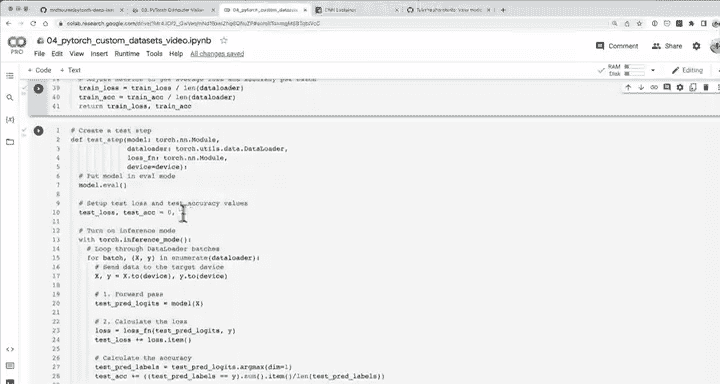
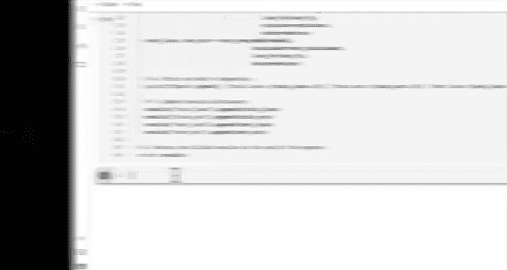
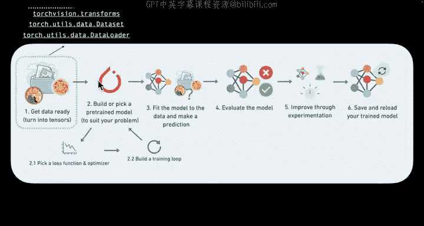
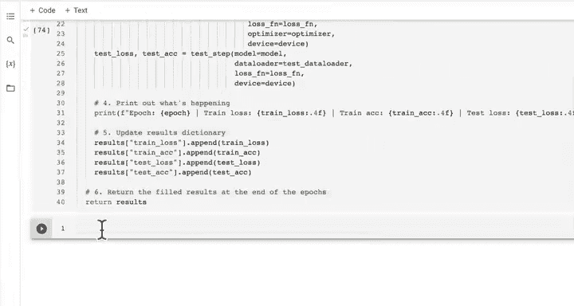
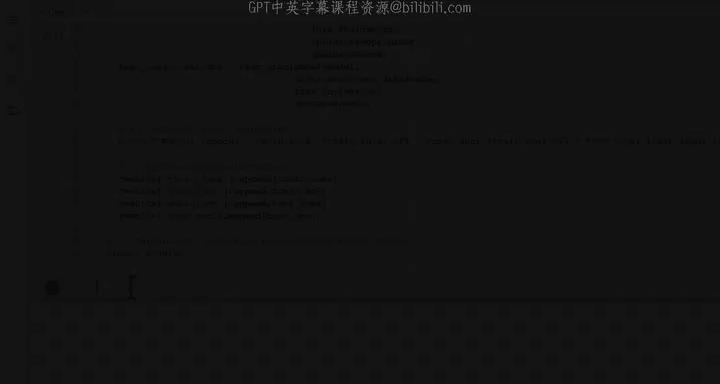
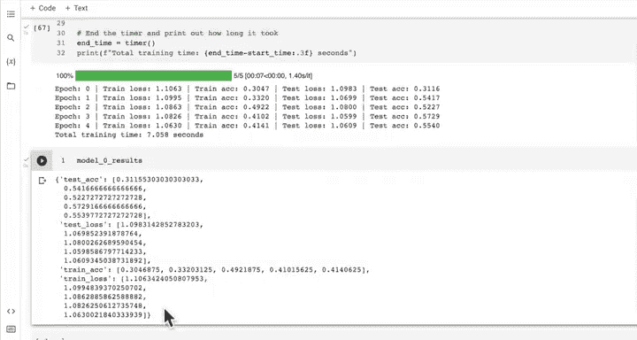

# mrdbourke《一天学会pytorch深度学习｜Learn PyTorch for deep learning in a day Literally》中英 - P88：148. Creating training and testing loop functions.zh_en - GPT中英字幕课程资源 - BV1kx4y1r79d

How'd you go。Did you give it a shot， Did you try replicating the train step and the test step function。

 I hope you did。 Otherwise， let's do that in this video。

 But this time we're going to do it for our custom data sets。

 And what you'll find is not much if anything changes because we've created our train and test loop functions。

In such a way that they're generic。 So we want to create a train step function。And by generic。

 I mean， they can be used with almost any model and data loader。

 So Traint is takes in a model and data loader and trains the model。On the data loader。

And we also want to create another function called Test app。

Wwhich takes in a model and a data loader and other things and evaluates the model on the data loader and of course。

 for the train step and for the test step， each of them respectively are going to take a training data loader I just might make this a third heading so that our outline looks nice and beautiful。

Section 7 is turning out to be quite a big section。 Of course。

 we want them to be respectively taken their own data loader。

 So train takes in the train data loader test takes in the test data loader。Without any further ado。

 let's create the train step function。Now we've seen this one in the computer vision section。

 so let's see what we can make here， so we need a train step which is going to take in a model which will be a torchnn。

t module。😊，And we wanted it also to take in a data loader， which will be a torch。 us。Dot data。

 data loader。And then it's going to take in a loss function。

 which is going to be a torchnn dot module as well。And then it's going to take in an optimizer。

Which is going to be torchopim。t optimizer。Wonderful， and then what do we do。

 what's the first thing that we do in a training step？😊，Well， we put the model in train mode。

So let's go model。trainin。Then what shall we do next？Well， let's set up some evaluation metrics。

 one of them being loss and one of them being accuracy， so set up train loss and train。😊。

Accuracy values。And we're going to accumulate these per batch because we're working with batches。

So we've got train loss and train act equals0 zero。Now we can loop through our data loader。

So let's right loop through。Data loader and we'll loop through each of the batches in this because we've batchrified our data loader。

 so for batch X Y in enumerate data loader。😊，We want to send the data to the target device。

So we could even put that device parameter up here。Devicice equals device。

 we'll set that to device by default。And then we can go X， Y。Equals x。2 device。And why dot2 device？

Beautiful， and now what do we do？ Well， remember the pie torch。😊。

The unofficial Pto optimization song we do the Ford Pass。So y pre equals model on x。

 and then number two is we calculate the last， so calculate the loss。

Let's go loss equals loss function and we're going to pass it in Ypre Y we've done this a few times now。

 so that's why we're doing it a little bit faster。 So I hope you notice that the things that we've covered before I'm stepping up the pace a bit so it might be a bit of a challenge。

 but that's all right。 You can handle it and then so that's accumulating the loss so we're starting from zero up here and then each batch we're doing a forward pass calculating the loss and then adding it to the overall train loss。

😊，And so we're going to optimizer zero grad， so zero the gradient of the optimizer。😊。

For each new batch。And then we're going to。Perform back propagation。So lost backwards and then five。

 what do we do， optimize a step， step， step。Wonderful， look at that。

 look at us coding a train loop in a minute or so。😊。

Now let's calculate the accuracy and accumulate it。Calculate the。

You notice that we don't have an accuracy function here， that's because accuracy is。Quite a。

Straightfor metric to calculate。 So we'll first get the the wide class because this is going to output model logits。

As we've seen before， the raw output of a model is Loit。

 so to get the class we're going to take the AG max。Torch dot softmax。

 so we'll get the prediction probabilities of Ypre。

 which is the raw logicit what we've got up here across dimension 1 and then also across dimension 1 here。

Beautiful， so that should give us the labels。 and then we can find out if this is wrong by checking it later on。

And then we're going to create the accuracy by taking the wine pre class。

 checking for a quality with。The right labels。 So this is going to give us how many of these values equal true。

 And we want to take the sum of that， take the item of that， which is just a single integer。

 And then we want to divide it by the length of y pre。

So we're just getting the total number that are right and dividing it by the length of samples。

 so that's the formula for accuracy。Now we can come down here outside of the batch loop。

 we know that because we've got this helpful line drawn here。And we can go adjust metrics。

To get the average。Loss and accuracy per batch。So we're going to set train loss is equal to train loss divided by the length of the data loader。

 So the number of batches in total and the train accuracy is the train Act divided by the length of the data loader as well。

 So that's going to give us the average loss and average accuracy。Per e parkRC across all batches。

So train act。Now， that's a pretty good looking function to me。For a train step。

Do you want to take on the test step， so pause the video。

 give it a shot and you'll get great inspiration from this notebook here otherwise we're going to do it together in three。

 two， one， let's do the test step so create a test step function。😊。

So we want to be able to call these functions in an epoch loop。And that way。

 instead of writing out training and test code for multiple different models。

 we just write it out once and we can call those functions。 So let's create de test step。

 We're going to do model。Which is going to be。If I could type Torch Nn module。

And then we're going to do data loader。😊，Which is torchutils。data。data loader。Capital L there。

And then we're going to just pass in a loss function here because we don't need an optimizer for。

The test function we're not trying to optimize anything。

 we're just trying to evaluate how our model did on the training data set and let's put in the device here why not。

That way we can change the device if we need to， so put model in a Valel mode because we're going to be evaluating or we're going to be testing。

Then we can sit up。Test loss and test accuracy values。So test loss and Test act。

We're going to make these zero。 we're going to accumulate them per batch。

 but before we go through the batch， let's turn on inference mode。So this is behind the scenes。

 going to take care of a lot of pieytorch functionality that we don't need。

 That's very helpful during training， such as track ingredients。 But during testing。

 we don't need that。 So loop through。Data loader or data batches。And we're going to go four batch X。

 Y。And enumerate。Data loader， you'll notice that above we didn't actually use this batch term。Here。

 and we probably won't use it here either。 but I just like to go through and have that there in case we wanted to use it anyway。

 So send data to。The target device。 So we're going to go X， Y equals。X dot2 device and same with Y。

t2 device。Beautiful， and then what do we do for an evaluation step or a test step？😊，Well， of course。

 we do the forward pass。Forward pass， and we're going to。

Let's call these test prelogitts and get the raw outputs of our model。

 and then we can calculate the loss on those raw outputs， calculate the loss。

We'll get the loss is equal to loss function on test prelogits versus y。

 and then we are going to accumulate the loss。 so test loss plus equals loss dot item。

Remember item just gets a single integer from whatever term you call it on。

And then we're going to calculate the accuracy。 Now we can do this exactly how we've done for the training data set or the training step。

 So test pre labels， we're going to you don't， I just want to highlight the fact that you actually don't need to take the softm here。

 you could just take the agmax directly from this。 The reason why we take the softmax。😊。

So you could do the same here， you could just directly take the argm of the logits。

The reason why we get the softmax is it just for completeness。

 So if you wanted the prediction probabilities， you could use torch dot softmax on the prediction logits。

 but it's not 100% necessary to get the same values and you can test this out yourself so try this with and without the softm and see if you get the same results。

So we're going to go test accuracy。Plus equals。 Now we'll just create our accuracy calculation on the fly test pre labels。

 We'll check for a quality on the y， and then we'll get the sum of that。 We'll get the item of that。

 and then we'll divide that by the length of the test pre labels。 beautiful。

 So it's going to give us accuracy per batch。 And so now we want to adjust the metrics to get average。

Loss and accuracy。Per batch。 So test loss equals test loss。Divided by length of the data loader。

 and then we're going to go test a equals test a divided by length of the data loader。

 and then finally we're going to return the test loss， not lost and test accuracy。 look at us go。😊。

Now， in previous videos， that took us or in previous sections， that took us a fairly long time。

 but now we've done it in about 10 minutes or so。So give yourself a pat in the back for all the progress you've been making。

 But now， let's in the next video。 We did this in the computer vision section as well。 We created。

 do we create a train function， Oh， no， we didn't。😊，But we could。

 So let's create a function to functionise this。 We want to train our model。 I think we did。

 actually， deaf train。 We've done so much。 I'm not sure what we've done。 Okay。

 So looks like we might not have。 But in the next video， give yourself this challenge。

 create a function called train that combines these two functions。😊，And loops through them both。

With an epoch range。 So just like we've done here in the previous notebook。Can you functionise this。

So just this step here。So you'll need to take in a number of epochs。

 you'll need to take in a train data loader and a test data loader， a model。

 a loss function and optimizer， and maybe a device。

And I think you should be pretty on your way to all the steps we need for train， so give that a shot。

 but in the next video we're going to create a function that combines train step and test step to train a model。

I'll see you there。How'd you go。In the last video， I issued you the challenge to combine our train step function。

 as well as our test step function together in their own function so that we could just call one function that calls both of these and train a model and evaluate it。

 of course。 So let's now do that together。 I hope you gave it a shot。😊，That's what it's all about。

So we're going to create a train function。 Now， the role of this function is going to， as I said。

 combine train step。And test step。 Now， we're doing all of this on purpose， right。

 because we want to not have to rewrite all of our code all the time。

 So we want to be functionizing as many things as possible so that we can just import these later on。

 if we wanted to train more models and just leverage the code that we've written before as long as it works。

 So let's see if it does。 We're going to create a train function。

 I'm going to first import T QDm T QDm dot auto because I'd like to get a progress bar while our model is training。

 There's nothing quite like watching neural network train So step number one is we need to。

Create a train function that takes。In various model parameters。Plus Opr plus data loaders。Plus。

 a loss function。A whole bunch of different things。

 so let's create deaf train and I'm going to pass in a model here。Which is going to be torch and N。

module， you'll notice that the inputs of this are going to be quite similar to our train step and test step。

I don't actually need that there。So we also want a train data loader for the training data。Toorch。

utts。data。data loader。And we also want a test data loader， which is going to be torch。utts。Dot data。

 dot data loader。And then we want an optimizer， so the optimizer will only be used with our training data set。

 but that's okay， we can take it as an input。Optimizer， and then we want a loss function。

 This will generally be used for both our training and testing step because that's what we're combining here。

 Now， since we're working with multipl classification。

 I'm going to set our loss function to be a default of an end dot cross entropy loss。

Then I'm going to get epochs， I set five， we'll train5 epochs by default。

 and then finally I'm going to set the device equal to the device。So。What do we get wrong here？

That's all right， we'll just keep coding， we'll ignore these little red lines。If they stay around。

 we'll come back to them。 So step number two， I'm going to create。

 this is a step you might not have seen， but I'm going to create an empty results dictionary。

 Now this is going to help us track our results。 Do you recall in a previous notebook。

 We outputted a model dictionary for how a model went。😊，So if we look at Model 1 results， yeah。

 we've got a dictionary like this。 So I'd like to create one of these on the fly。

 but keep track of the result every epoch。 So what was the loss on epoch number 0。

 What was the accuracy on epoch number 3。 So we'll show you how I'll do that We can use a dictionary and just update that Well our model trains。

So results， I want to keep track of the train loss。

So I'm going to set that equal to an empty list and just append to it。

 I also want to keep track of the train accuracy。😊，We'll set that as an empty list as well。

 I also want to keep track of the test loss。And I also want to keep track of the test accuracy now you'll notice over time that these。

 what you can track is actually very flexible and what your functions can do is also very flexible。

So this is not the gold standard of doing anything by any means， it's just one way that works。

And you'll probably find in the future that you need different functionality and of course。

You can code that out。 So let's now loop through。Our epochs。 So for epoch in TQDm。

 let's create a range of our epochs above。And then we can set the train loss。

 Have I missed a comma up here somewhere。Type annotation， not supported for that type of expression。

 Okay， that's all right。 We'll just leave that there。 So we're going to go train loss and train act。

 recall that our train step function。That we created in the previous video。

 Tra step returns our train loss and Tra Act。 So as I said。

 I want to keep track of these throughout our training。So I'm going to get them。From train step。

 then。For each epoch in our range of epochs， we're going to pass in our model and perform a training step。

 So the data loader here is， of course， going to be the train data loader。

 The loss function is just going to be the loss function that we pass into the train function。

 and then the optimizer is going to be the optimizer。And then the device is going to be device。

 beautiful。 Look at that。 We just performed a training step in five lines of code。

 So let's keep pushing forward。 It's telling us we've got a whole bunch of different things here。

 Epoch is not defined。 Maybe we just have to get rid of this。😊。

We can't have the type annotation here。And'll that'll stop。

That'll stop Google CoLab getting angry at us。If it does any， I'm just going to ignore it for now。

 epoch。Anyway， we'll leave it at that。 We'll find out if there's an error later on。 Test loss。

 you might be able to find it before I do。 So test step， we're going to pass in the model。

 We're going to pass in a data loader。 Now， this is going to be the test data loader。

 look at us go creating training and test step functions， Los function。

 And then we don't need an optimizer。 We're just going to pass in the device and then behind the scenes。

😊，Both of these functions are going to train and test our model。 How cool is that。

 So still within the loop。RightThis is important within the loop。

 we're going to have number four is we're going to print out， let's print out what's happening。😊。

Print out what's happening， we can go print and we'll do a fancy little print statement here。

 we'll get the epoch。😊，And then we will get the train loss。Which will be equal to the train loss。

 We'll get that to。 Let's go four decimal places。 How about that。 and then we'll get the train。

Accuracy， which is going to be the train Act。 We'll get that to。For。

Maybe three decimal or four just for just so it looks nice， looks aesthetic。

 and then we'll go test loss， we'll get that coming out here。And we'll pass into the test loss。

 we'll get that to four decimal places as well。And then finally， we'll get the test accuracy。

 so fairly long print statement here， but that's all right。😊。

We'd like to see how our model is doing while it's training。Beautiful， and so again。

 still within the Epoch， we want to update our results dictionary so that we can keep track of how our model performed over time。

 So let's pass in results。 We want to update the train loss。😊，And so this is going to be this。

And then， we can append。Our train loss value。So this is just going to expend the list in here with the train loss value every epoch。

And then we'll do the same thing on the train accuracy。Append train act。

And then we'll do the same thing again。With test loss。Dot append。Test loss。

And then we will finally do the same thing with the test accuracy。Test accuracy。

 Now this is a pretty big function， but。This is why we write the code now so that we can use it multiple times later on。

 so return the filled results at the end of the epoch so outside the epos loop。So our loop。

 we're outside it now， let's return results。Now I've probably got an error somewhere here and you might be able to spot it。

 okay train data loader， where do we get that invalid syntax？😊，Maybe up here。

 We don't have a comma here。 I was up the issue the whole time。Wonderful， you might have seen that。

 I'm completely missed that， but we now have a train function to train our model。

 and the train function， of course， is going to call out our train step function and our test step function。

😊，So what's left to do？Well， nothing less than train and evaluate Model 0。

So our model is way back up here。How about in the next video we leverage our functions namely just the train function because it's going to call our train step function and our test step function and train our model so I'm going to encourage you to give that a go you're going to have to go back to the workflow maybe or maybe you already know this。

So what have we done， We've got our data ready and we turned it into tensess using a combination of these functions。

😊，We've built and picked model while we've built a model， which is the tiny VGG architecture。

 Have we created a loss function yet？I don't think we have or an optimizer。

I don't think we've done that yet。We've definitely built a training loop， though。

We aren't using torch metrics。 We're just using accuracy， but we could use this if we want。

 We haven't improved through its experimentation yet， but we're going to try this later on。

 and then save and reload the model。 We've seen this before。

 So I think we're up to picking a loss function in an optimizer。So give that a shot。

In the next video， we're going to create a loss function and an optimizer and then leverage the functions we've spent the last two videos creating to train our first model。

 Model 0 on our own custom data set。 This is super exciting。 I'll see you in the next video。😊。

Who's ready to train and evaluate Model 0， Put your hand up。I definitely am， so let's do it together。

😊，We're going to start off section 7。7， and we're going to put in train and evaluate Model0 our baseline model on our custom data set。

 Now， if we refer back to the Pytorch workflow I issued you the challenge in the last video to try and create a loss function and an optimizer。

 I hope you gave that a go。 but we've already built a training loop So we're going to leverage our training loop functions namely train train step and test step all we need to do now is instantiate a model Choose a loss function and an optimizer and pass those values to our training function so let's do that。

Allright， this is so exciting， let's set the random seeds。😊。

I we're going to set torch manual seed 42。And torch ka manual seed 42 now。 remember。

 I just want to highlight something。 I read an article the other day about not using random seeds。

 The reason why we are using random seeds is for educational purposes。

 So to try and get our numbers on my screen and your screen as close as possible。 But in practice。

 you quite often don't use random seeds all the time。

 The reason why is because you want your model's performance to be similar。

 regardless of the random seed that you use。 So just keep that in mind going forward。

 We're using random seeds to just。Exemplify how we can get similar numbers on our page， but ideally。

 no matter what the random seed was， our models would go in the same direction。

That's where we want our models to eventually go， but we're going to train for five epochs and now let's create a recreate an instance of tiny VGG。

We can do so because we've created a tiny VDG class。So tiny VGG， which is our model0。

 we don't have to do this but we're going to do it any just so we've got all the code in one place tiny VGG what is our input shape going to be that is the number of colour channels。

Of our target images。And because we're dealing with color images。

 we have an input shape of three previously we used an input shape of one to deal with grayscale images I'm going to set hidden units to 10 in line with the CNN explainer website。

And the output shape is going to be the number of classes in our training data set。And then。

 of course， we're going to。Send the target model to the target device。So what do we do now？ Well。

 we set up a loss function and an optimizer。Loss function and Opr。

So our loss function is going to be because we're dealing with multiclass classification and then cross enroppy if I could spell。

😊，Cross entropy loss。 and then we're going to have an optimizer this time。

 How about we mix things up， How about we try the atom optimizer Now， of course。

 the optimizer is one of the hyperparameters that you can set for your model and a hyperparameter being a value that you can set yourself。

 So the parameters that we want to optimize are our model zero parameters。😊。

And we're going to set a learning rate of 0。001。 Now， recall that you can tweet this。

 this learning rate， if you like， But I believe did I just see that the default learning rate of atom is。

Zero，01。Yeah， there we go， So Adam's default learning rate is one to the power of 10 to the negative 3。

And so that is the default learning rate for Adam and as I said。

 oftentimes different variables in the Pytodge library。

 such as optimizers have good default values that work across a wide range of problems。

 So we're just going to stick with the default。 if you want to。

 you can experiment with different values of this。But now let's start the timer because we want to time our models。

We're going to import from timeit。We want to get the default timer。Class。

 and I'm going to import that as timer just so we don't have to type out default timer。

So the start time is going to be timer， this is going to just put a。

A line in the sand of what the start time is at this particular line of code。

 It's going to measure that。 And then we're going to train model 0。 Now， this is using， of course。

 our train function。 So let's write model0 results And then the wrote Model 1。

 but we're not up to there yet。 So let's go train。Model equals model zero。

 and this is just the training function that we wrote in a previous video。

And the train data is going to be our train data loader。

 and we've got train data loader simple because we're not using data augmentation for Model1。

And then our test data loader is going to be our test data loader simple。

And then we're going to set our Opr， which is equal to the optimizer we just created。

The friendly atom optimizer and the loss function is going to be the loss function that we just created。

 which is NN cross entropy loss Finally we can send in epochs is going to be nu epochs which is what we set at the start of this video to five and of course we could train our model for longer if we wanted to but the whole idea of when you first start training a model is to keep your experiments quick so that's why we're only training for5 maybe later on you train for 1020 tweak the learning rate do a whole bunch of different things。

But let's go down here， let's end the timer， see how long our models took to train。

 end the timer and print out。How long it took。So in a previous section。

 we created a helper function for this。We're just going to simplify it in this section and we're just going to print out how long the training time was。

Total training time， let's go end time， minus start time， and then we're going to go point。

 we'll take it to three decimal places， hey。Second， you're ready to train our first model。

 our first convolutional neural network on our own custom data set。On pizza steakak and sushi images。

Let's do it， You ready， three， two， one， no errors。Oh， there we go， okay。

 should this be trained data loader， did you notice that？😊，What does our train data take as input？Oh。

 we're not getting a doctoring。Oh there we go， we want Tra data loader。

Data loader and same with this， I believe， let's try again。Beautiful， oh。

 look at that lovely progress bar。 Okay， how's our， our model is training quite fast， okay。😊。

All right， What do we get， So we get an accuracy on the training data set of about 40%。

 and we get an accuracy on the test data set of about 50%。Now， what's that telling us？

It's telling us that about 50% of the time， our model is getting the prediction correct。

 but we've only got three classes。 So even if our model was guessing， it would get things right。

33% of the time。So even if you just guessed pizza every single time。

 because we only have three classes。If you guessed pizza every single time。

 you get a baseline accuracy of 33%。 So our model isn't doing too much better than our baseline accuracy。

 Of course， we'd like this number to go higher， and maybe it would if it trained for longer。

So I'll let you experiment with that。 But if you'd like to see some different methods of improving a model。

 recall back in section number02。We had an improving a model section， improving a model。Here we go。

 so here's some things you might want to try。We can improve a model by。Adding more layers。

 so if we come back to our 20 VGG architecture。Right up here。

We're only using two convolutional blocks。Perhaps you wanted to add in a convolutional block3。

You can also add more hidden units right now we're using 10 hidden units。

 you might want to double that and see what happens。Fitting for longer。

 this is what we just spoke about。 So right now we're only fitting for5 epos。

 So if you maybe wanted to try double that again and then even double that again。

Changing the activation functions， So maybe ReLou is not the ideal activation function for our specific use case。

Change the learning rate we've spoken about that before。 So right now our learning rate is 0。

001 for atom， which is the default， but perhaps there's a better learning rate out there。

Change the loss function。 This is probably not。In our case。

 not going to help too much because cross entropy loss is a pretty good loss for multiclass classification。

But these are some things that you could try these first three， especially。

 you could try quite quickly， you could try doubling the layers。

 you could try adding more hidden units and you could try fitting for longer so I'd give that a shot。

But in the next video， we're going to take our。Model 0 results。Which is a dictionary。

 or at least it should be。 And we're going to plot some loss curvebs。

So this is a good way to inspect how our model is training， Yes so we've got some values here。

 let's plot these in the next video。😊。

I'll see you there。