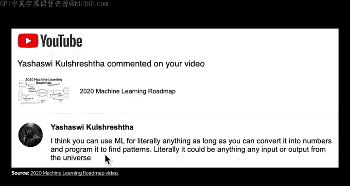
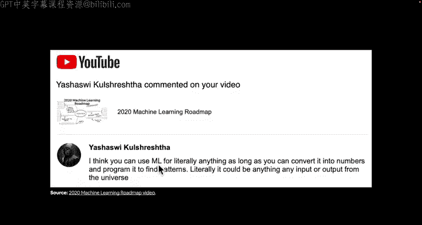
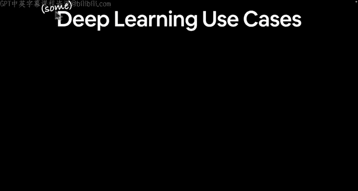
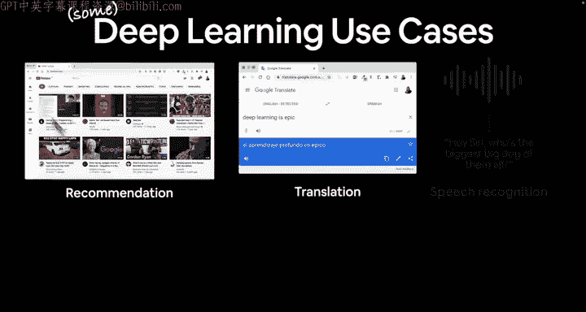
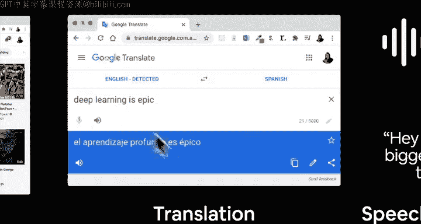
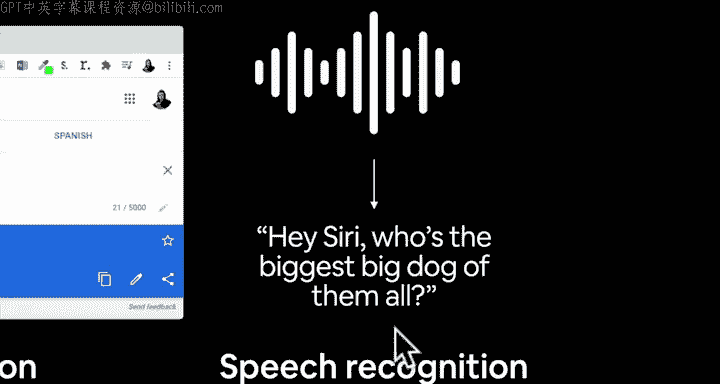
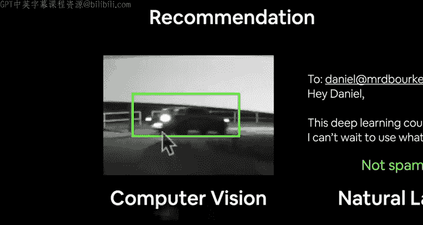
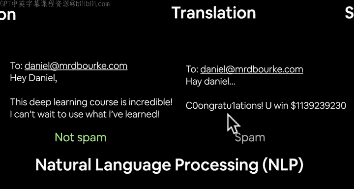
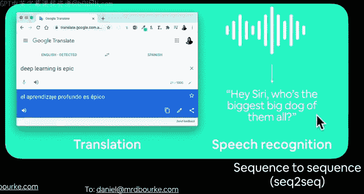

# mrdbourke《一天学会pytorch深度学习｜Learn PyTorch for deep learning in a day Literally》中英 - P8：6. What can deep learning be used for.zh_en - GPT中英字幕课程资源 - BV1kx4y1r79d

Ha'd you go， Did you do some research， Did you find out what deep learning is actually used for。

 I bet you found a treasure trail of things。 And， hey， I mean， if you're in this course。

 chances are that you probably already know some use cases for deep learning。 You're like， Daniel。

 hurry up and get to the code。 Well， we're gonna get there， don't you worry。

But let's have a look at some things that deep learning can be used for。 But before。

 I just want to remind you of this comment。 This is from Yasha Sui on the 2020 machine learning roadmap video。

I think you can use M L and remember Ml as machine learning and remember deep learning as a part of M for literally anything as long as you can convert it into numbers and program it to find patterns。

 Liter， it could be anything。 any input or output from the universe。

 So that's a beautiful thing about machine learning is that if you can encode it something into numbers。

 chances are you can build a machine learning algorithm to find patterns in those numbers。

 Will it work。 Well， again， that's the reason machine learning and deep learning is part art。

 part science。 A scientist would love to know that their experiments would work。

 But an artist is kind of excited about the fact that I don't know， this might work It might not。

 And so that's something to keep in mind。 along with the rule number one of machine learning is if you don't need it。

 you don't use it， but if you do use it， it can be used for almost anything。😊。

And let's get a little bit specific and find out some deep learning use cases。

 And I've put some up there for a reason， because there are lots。

 These are just some that I interact with in my day to day life， such as recommendation。

 Weve got a programming video。 We've got a programming podcast。 We got some jujitsu videos。

 We've got some Runscape videos， a soundtrack from my favorite movie。😊。

Have you noticed whenever you go to YouTube， you don't really search for things anymore more。 Well。

 sometimes you might。 but the recommendation page is pretty darn good。

 That's all powered by deep learning。 And in the last 10 years。

 have you noticed that translation has got。Pretty good， too。 Well。

 that's powered by deep learning as well。 Now， I don't have much hands on experience with this。

 I did use it when I was in Japan。 I speak a very little amount of Japanese and an even smaller amount of mandarin。

 But if I wanted to translate deep learning as epic to Spanish， it might come out as。😊。

E Apprendigege Proffodo S。 Ipicco。 Now， all of the native Spanish speakers watching this video can laugh at me because that was a very Australian version of saying deep learning is epic in Spanish。

 But that's so cool。 All the Google transl is now powered by deep learning。 and the beautiful thing。

 if I， if I couldn't say it myself， I could click this speaker。 And it would say it for me。

 So that speech recognition that's powered by deep learning。

 So if you would ask your voice assistant， who's the biggest big dog over the mall。 Of course。

 they're going to say you， which is what I've set up my voice assistant to say That's part of speech recognition。

 And in computer vision。 look at this。 You see this。 Where is this photo from。

 This photo is from this person driving this car。 Did it hit and run on my car out the front of my house。

 My apartment building。 My car was parked on the street， This car， the trailer came off。

 ran into the back of my car basically destroyed it。 And then they drove off。 However。

 my next door neighbours。😊。

Security camera picked up on this car。 Now， I became a detective for a week。And I thought。

 if there was a computer vision algorithm built into that camera。

 it could have detected when the car hit。 I mean， it took a lot of searching to find。

 it turns out the car hit about 3，30 a in the morning。 So I was pitch black。 And of course。

 we didn't get the license plate。 So this person is out there somewhere in the world After doing a hit and run。

 So if you're watching this video。 Just remember， computer vision might catch you one day。

 So this is called object detection。 where you would place a box around the area where the pixels most represent the object that you're looking for。

 So for computer vision we could train an object detector to capture cars that drive past a certain camera。

 And then if someone does a hit and run on you， you could capture it。

 and then fingers crossed is not too dark that you can read the license plate and go， hey， excuse me。

 please， this person has hit my car and wrecked it。

 So that's a very close to home story of where computer vision could be used。 And then finally。

 natural language processing。 have you noticed as well。

 your spam detector on your email inbox is pretty darn good。 Well。

 some a powered by deep learning some night， it's hard to tell。😊。

These days， what is powered by deep learning what isn't But natural language processing is the process of looking at natural language text。

 So unstructured text So whatever you'd write an email in a story in a Wikipedia document and deciding or getting your algorithm to find patterns in that。

 So for this example you would find that this email is not spam this deep learning course is incredible。

 I can't wait to use what I've learned thank you so much。 and by the way， that is my real email。

 So if you want to email me you can and then this is spam hey Daniel。

 congratulations you win a lot of money。 Well， I really like that a lot of money。

 but some reason I don't think that this is real。 So that would probably go to my spam inbox now。😊。

With that being said。If we wanted to put these problems in a little bit more of a classification。

 this is known as sequence to sequence because you put one sequence in and get one sequence out。

Same as this。 you have a sequence of audio waves and you get some text out。 So sequence to sequence。

 sec to sec。This is classification s regression。 In this case， the regression is predicting a number。

 That's what a regression problem is。 You would predict the coordinates of where these box corners should be。

 So say this should be at however many pixels in from the X angle and however many pixels down from the Y angle that's that corner。

 and then you would draw in between the corners and then the classification part would go hey。

 this is that car that did a hit and run on us。 And in this case。

 this is classification classification is predicting whether something is one thing or another or perhaps more than one thing or another in the class of multiclass classification。

 So this email is not spanm。 That's a class and this email is spanm。 So that's also a class。😊，So。

I think we've only got one direction to go now that we've sort of laid the foundation for the course。

 and that is。

Let's start talking about pieytorrch。I'll see you in the next video。

