# mrdbourke《一天学会pytorch深度学习｜Learn PyTorch for deep learning in a day Literally》中英 - P90：152. Overfitting and underfitting.zh_en - GPT中英字幕课程资源 - BV1kx4y1r79d

In the last video we looked at our models loss curves and also the accuracy curves and a loss curve is a way to evaluate a model's performance over time。

 such as how long it was training for and as you'll see if you Google some images of loss curves。

 you'll see many different types of loss curves。😊，They come in all different shapes and sizes。

 and there's many different ways to interpret loss curvebs。

 So this is Google's testing and debugging and machine learning guide。

 So I'm going to set this as extra curriculum for this section。So we're up to number eight。😡。

Let's have a look at what should an ideal loss curve。Look like。So we'll just link that in there。Now。

 loss curve， I'll just rewrite here is a loss curve is。I to make some space。

A loss curve is one of the most helpful。Ways to troubleshoot。按 model。

So the trend of a loss curve you want it to go down over time and the trend typically of an evaluation metric like accuracy。

 you want it to go up over time。

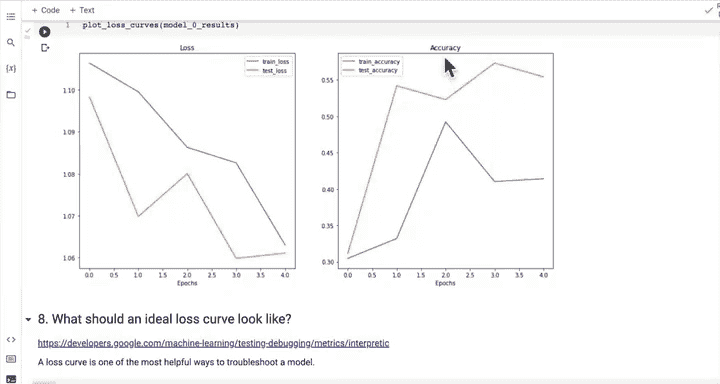

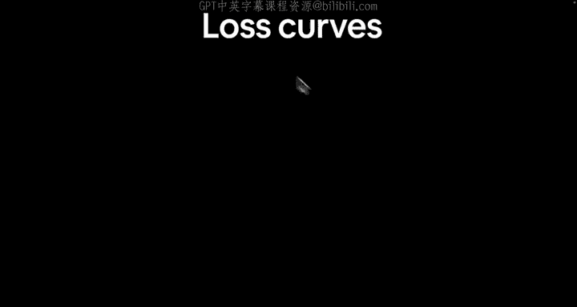

So let's go into the keynote。Loss curves。So way to evaluate your model's performance over time。

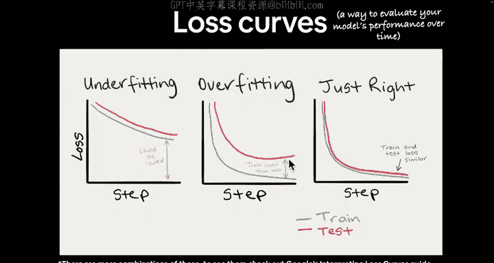

These are three of the main different forms of loss curve that you'll face。 But again。

 there's many different types， as mentioned in here， interpreting loss curves。

 Sometimes you get it going all over the place。 Sometimes your loss will explode。

Sometimes your metrics will be contradictory。

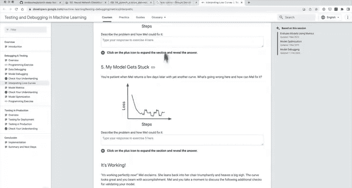

Sometimes your testing loss will be higher than your training loss。 We' have a look at what that is。

 Sometimes your model gets stuck that in other words， the loss doesn't reduce。

 Let's have a look at some。

Loss curvebs here in the case of underfitting， overfitting and just right。

 so this is the Goldilock zone。Underfitting is when your model's loss on the training and test data sets could be lower。

😡，So in our case。If we go back to our loss curves， of course we want this to be lower and we want our accuracy to be higher。

So from our perspective， it looks like our model is underfitting。

 and we would probably want to train it for longer， say，1020 epochs to see if this train continues。

 If it keeps going down， it may stop underfitting。 So underfitting is when your loss could be lower。

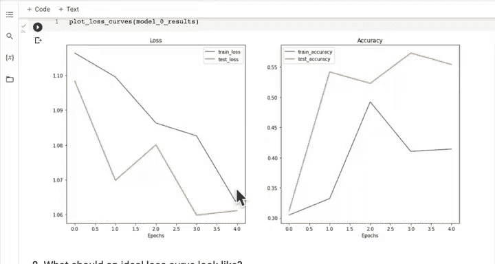

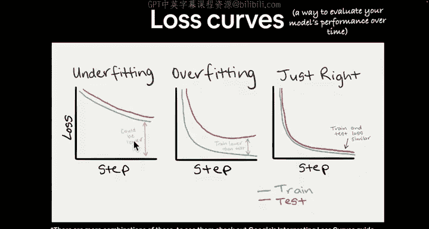

Now， the inverse of underfitting is called overfitting And so two of the biggest problems in machine learning is trying to reduce underfitting。

 So in other words， make your loss lower and also reduce overfitting。

 These are both active areas of research because you always want your model to perform better。

 but you also want it to perform pretty much the same on the training set as it does the test set。

And so overfitting would be when your training loss is lower than your testing loss。😡。

And why would this be overfitting So it means overfitting because your model is essentially learning the training data too well。

 and that means the loss goes down on the training dataset， which is typically a good thing。 However。

 this learning is not reflected in the testing dataset。

 So your model is essentially memorizing patterns in the training dataset that don't generalize well to the test dataset。

😡，So this is where we come to the just right curve is that we want ideally our training loss to reduce as much as our test loss。

And quite often you'll find that the loss is slightly lower on the training set than it is on the test set。

 and that's just because the model is exposed to the training data and it's never seen the test data before。

 so it might be a little bit lower on the training data set than on the test data set。

So under fittingtting， the model's loss could be lower。😡。

Overfitting the model is learning the training data too well。 Now。

 this would be equivalent to say you were studying for a final exam and you just memorize the course materials。

 the training said， And when it came time to the final exam because you'd only memorize the course materials you couldn't adapt those skills to questions you hadn't seen before。

 So the final exam would be the test set So that's overfitting the train loss is lower than the test loss。

 And just right， ideally you probably won't see loss curves this exact smooth。 I mean。

 they might be a little bit jumpy。

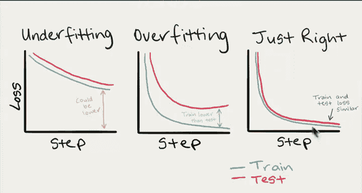

Ideally， your training loss and test loss go down at a similar rate。 And of course。

 there's more combinations of these。 If you'd like to see them。

 check out the Google's loss curve guide that you can check that out up there。

 That's some extra curriculum。 Now， you probably want to know。

 how do you deal with underfitting and overfitting。

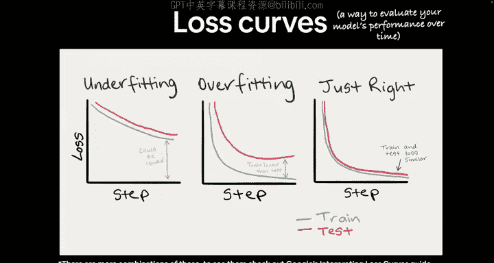

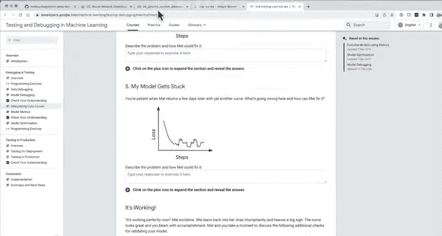

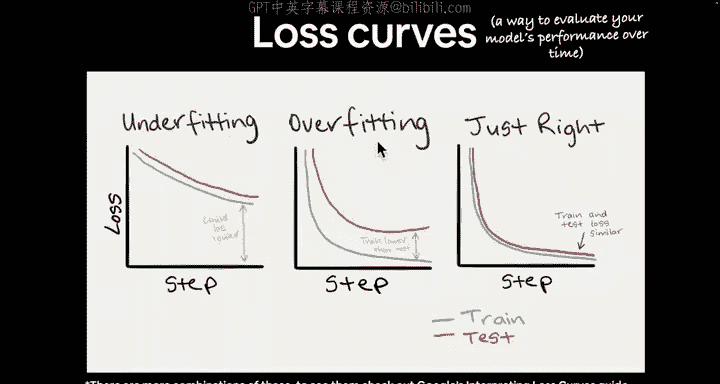

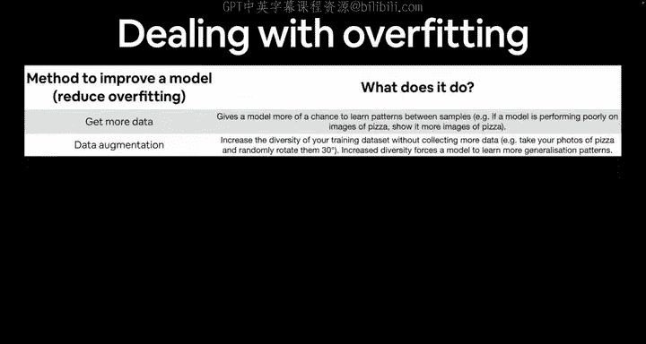

Let's look at a few ways。We'll start with overfitting。

So we want to reduce overfitting in other words， we want our model to perform just as well on the training data set as it does on a test data set。

So one of the best ways to reduce overfitting is to get more data。

 So this means that our training data set will be larger。 Our model will be exposed to more examples。

 and will thus。In theory， it doesn't always work。 These all come with a caveat， right。

 They don't always work， as with many things in machine learning。 So get more data。

 give your model more chance to learn patterns， generalizable patterns in a data set。

You can use data augmentation， so make your models's training data set harder to learn。

 So we've seen a few examples of data augmentation。 You can get better data。 So not only more data。

 perhaps the data that you're using isn't that the quality isn't that good。

 So if you enhance the quality of your data set， your model may be able to learn better。

 more generalizable patterns and in turn， reduce overfitting。😊，Use transfer learning。

 So we're going to cover this in a later section of the course。

 but transfer learning is taking one models that works。

 taking its patterns that it's learned and applying it to your own data set。 So， for example。

 I'll just go into the Torch Viion models library。 many of these models in here in Torchvision。

 the models module have already been trained on a certain data set and such as Inet。

And you can take the weights or the patterns that these models have learned。

 And if they work well on an image net dataset set， which is millions of different images。

 you can adjust those patterns to your own problem。 And oftentimes that will help with overfitting。

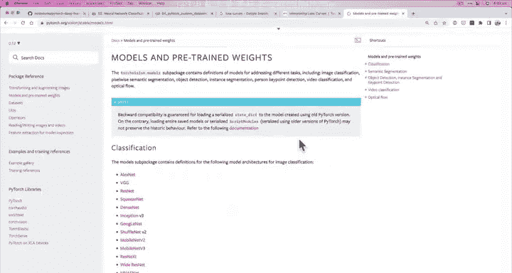

If you're still overfitting， you can try to simplify your model。

 usually this means taking away things like extra layers， taking away more hidden units。

 So say you had 10 layers， you might reduce it to five layers。 Why does this。

 what's the theory behind this。 Well if you simplify your model and take away complexity from your model。

 you're kind of telling your model， hey， use what you've got。

 and you're going to have to because you've only got five layers now。

 you're going to have to make sure that those five layers work really well because you've no longer got 10 and the same for hidden units。

 say you started with 100 hidden units per layer， you might reduce that to 50 and say， hey。

 you had 100 before。 Now use those 50 and make your patent generalizable。Use learning rate decay。

 So the learning rate is how much your optimizer updates its or your optimizer updates your model's weights。

Every step。 So learning rate decay is to。Dey the learning rate over time。 So you might look this up。

 You can look this up， go pie torch。

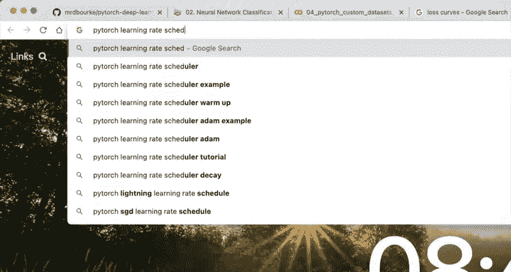

Learning rate scheduling。So what this means is you want to decrease your learning rate over time。

 Now， I know I'm giving you a lot of different things here， but。

You've got this keynote as a reference， so you can come across these over time。

 So learning rate scheduling。So we might look into here。 Do we have schedule。Schedler， beautiful。

 So this is going to adjust the learning rate over time。 So for example。

 at the start of when a model is training， you might want a higher learning rate。

 And then as the model starts to learn patterns more and more and more。

 you might want to reduce that learning rate over time so that your model doesn't update its patterns too much in later epochs。

So that's the concept of learning rate scheduling at the closer you get to convergence。

 the lower you might want to set your learning rate。 Think of it like this。

 If you're reaching for a coin at the back of a couch。

 Can we get an image of that coin at back of couch。😊。

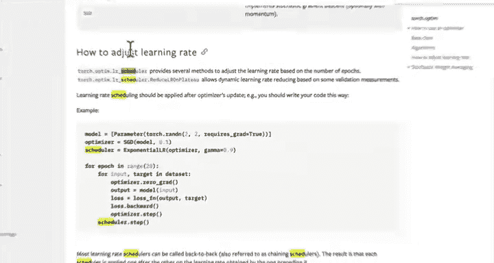

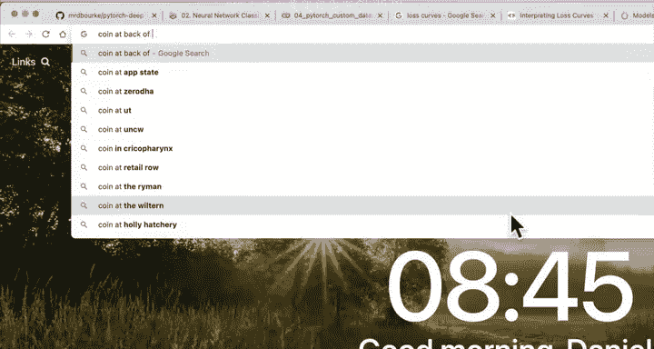

Images。So if you're trying to reach a coin。In the cushions here。 So the closer you get to that coin。

 at the beginning， you might take big steps， but then the closer you get to that coin。

 the smaller the step you might take to pick that coin out。

 because if you take a big step when you're really close to the coin here。

 The coin might fall down the couch。 The same thing with learning rate decay。

 at the start of your model training， you might take bigger steps。

 as your model works its way down the loss curve。 But then you get closer and closer to the ideal position on the loss curve。

 you might start to lower and lower that learning rate until you get right very close to the end and you can pick up the coin。

 or in other words， your model can converge。And then finally， use early stopping。

 So if we go into an image is there early stopping here？Early stopping。Loss curbs， early stopping。

So what this means is that you stop。😡，Yeah， there we go。

So there's heaps of different guides early stopping with pytorch beautiful。

 So what this means is before your testing error starts to go up。

 you keep track of your model's testing error and then you stop your model from training or you save the weights or you save the patterns where your model's loss was the lowest so then you could just set your model to train for an infinite amount of training steps and as soon as the testing error starts to increase for say 10 steps in a row you go back to this point here and you go。

 I think that was where our model was the best and the testing error started to increase after that So we're going to save that model there instead of the model here So that's the concept of early stopping。

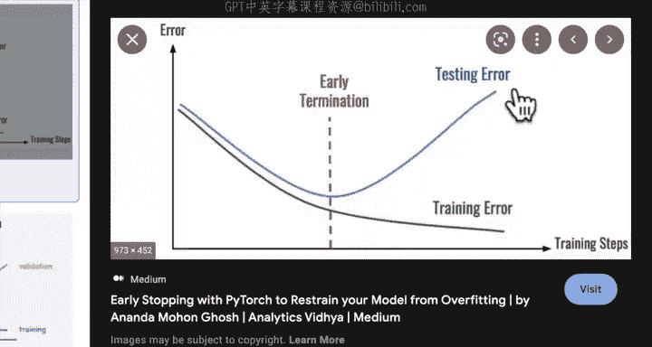

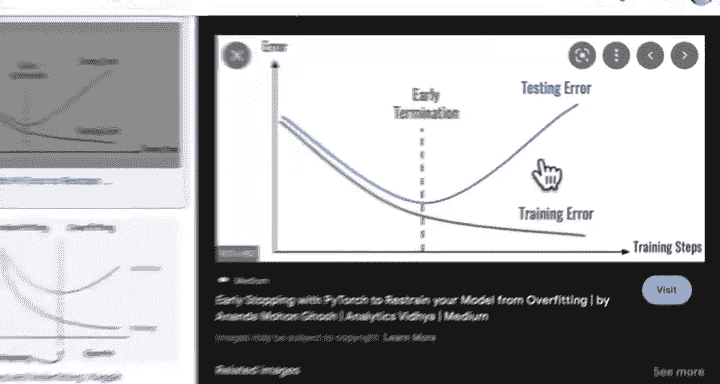

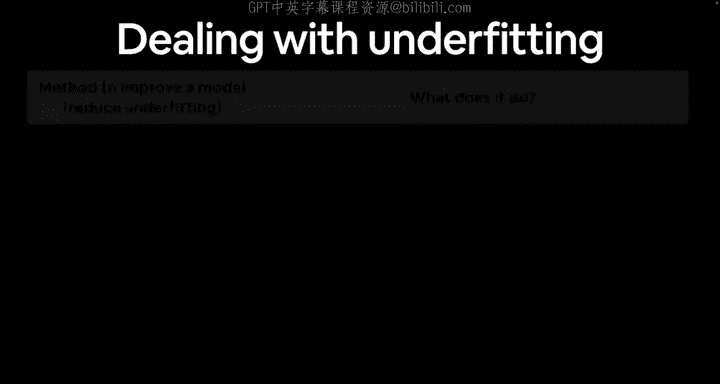

So that's dealing with overfitting。There are other methods to deal with underfitting。

 so recall underfitting is when we have a loss that isn't as low as we'd like it to be。

 Our model is not fitting the data very well， so it's underfitting。So to reduce underfitting。

 you can add more layers slash units to your model you're trying to increase your model's ability to learn by adding more layers or units。

 You can again tweak the learning rate。 Perhaps your learning rate is too high to begin with and your model doesn't learn very well。

 So you can adjust the learning rate again， just like we discussed with reaching for that coin at the back of account。

If your model is still underfitting， you can train for longer。

 So that means giving your model more opportunities to look at the data。 So more epochs。

 that just means it's got looking at the training set over and over and over and over again and trying to learn those patterns。

 however， you might find again， if you try to train for too long。

 your testing error will start to go up。 your model might start overfitting if you train too long。

 So machine learning is all about a balance between underfitting and overfitting。

 You want your model to fit quite well。 and。😊。

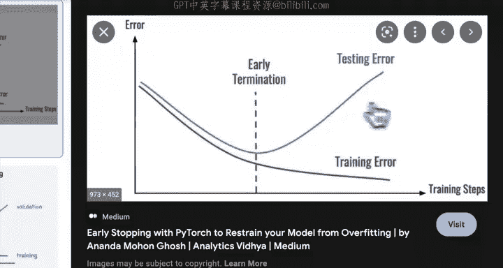

So this is a great one。 So you want your model to start fitting quite well。

 But then if you try to reduce underfitting too much， you might start to overfit and then vice versa。

 right， if you try to reduce overfitting too much， your model might underfi。

 So this is one of the most fun dances in machine learning。

 the balance between overfitting and underfitting。😊，Finally， you might use transfer learning。

 so transfer learning helps with overfitting and underfitting recall transfer learning is using a model's learned patterns fromron problem and adjusting them to your own we're going to see this later on in the course and then finally use less regularization So regularization is holding your model back。

 So it's trying to prevent overfitting So if you do too much preventing of overfitting in other words。

 regularizing your model you might end up underfitting。So if we go back。

 we have a look at the ideal curves。Underfitting， if you try to prevent underfitting too much。

 So increasing your model's capability to learn， you might end up overfitting。

 And if you try to prevent overfitting too much， you might end up underfitting。

 We are going for the just right section。 And this is going to be a balance between these two throughout your entire machine learning and career。

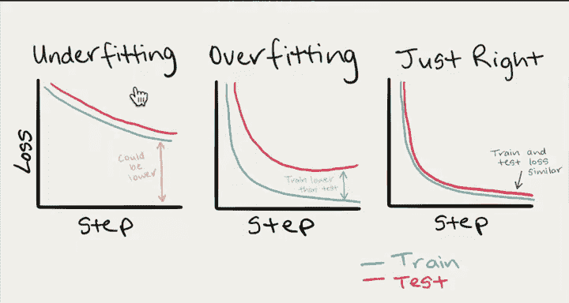

In fact， it's probably the most prevalent。Area of research is trying to get models not to underfi。

 but also not to overfit。So keep that in mind， a loss curve is a great way to evaluate your model's performance over time and a lot of what we do with the loss curves is try to work out whether our model is underfitting or overfitting and we're trying to get to this just right curve。

 we might not get exactly there but we want to keep trying getting as close as we can。

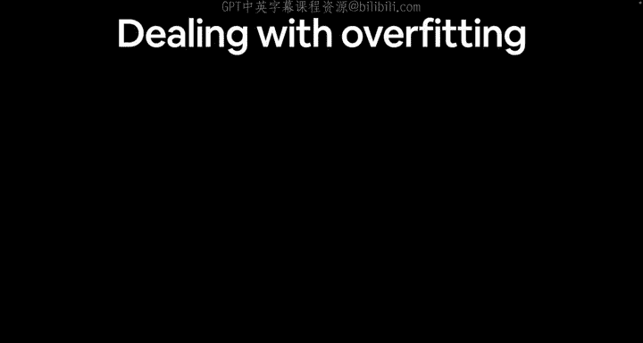

So with that being said， let's now build another model in the next video and we're going to try a method to try and see if we can use data augmentation to prevent our model from overfitting。

 although that experiment doesn't sound like the most ideal one we could do right now because it looks like our model is underfitting So with your knowledge of what you've just learned in the previous video。

 how to prevent underfitting。😊，What would you do to increase this model's capability of learning patterns in the training dataset set。

 Would you train it for longer， Would you add more layers， Would you add more hitting units。

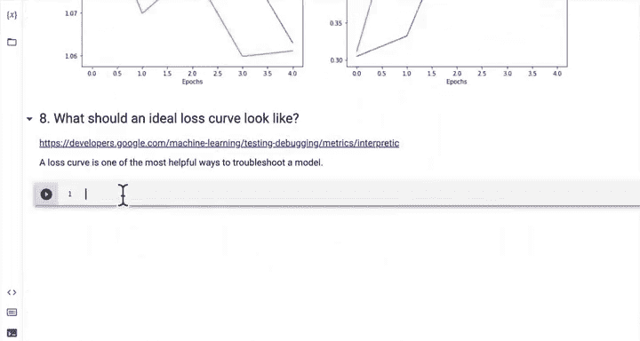

Have a think and we'll start building another model in the next video。😊。

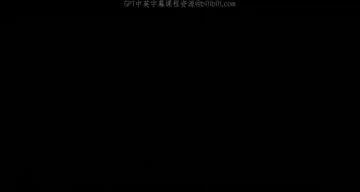

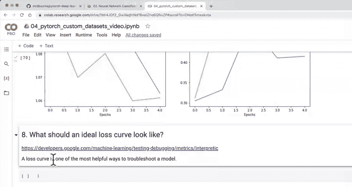

Welcome back In the last video， we covered the important concept of a loss curve and how it can give us information about whether our model is underfitting。

 In other words， our model's loss could be lower or whether it's overfitting In other words。

 the training loss is lower than the test loss or far lower than the validation loss That's another thing to note here is that I've put training in test sets here you could also do this with a validation data set。

😊。

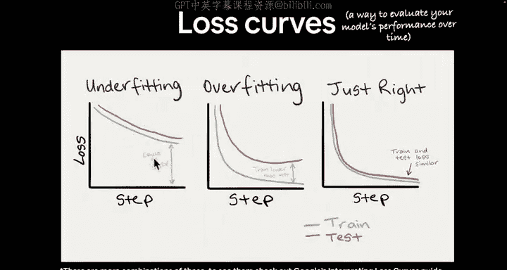

And that the just right， the Goldilockone is when our training and test loss are quite similar over time。

Now， there was a fair bit of information in that last video。

 So I just wanted to highlight that you can get this all in Section 04。

 which is the notebook that we're working on。 And then if you come down over here。😊。

If we come to section 8， what should an ideal loss curve look like we've got underfitting overfitting just right。

 how to deal with overfitting， we've got a few options here， we've got how to deal with underfitting。

 and then we've got a few options there， and then if we wanted to look for more how to deal with overfitting。

😊，You can find a bunch of resources here and then how to deal with underfitting。

You could find a bunch of resources here as well， So that is a very fine line。

 very fine balance that you're going to experience throughout all of your machine learning career。

 but it's time now to move on。 We're going to move on to creating another model which is tiny VGG with data augmentation this time。

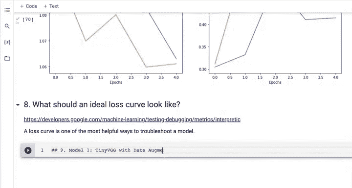

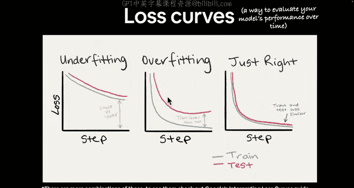

So if we go back to the slide， data augmentation is one way of dealing with overfitting。

 Now it's probably not the most ideal experiment that we could take because our model 0。

 our baseline model looks like it's underfitting but data augmentation as we've seen before is a way of manipulating images to artificially increase the diversity of your training data set without collecting more data So we could take our photos of pizza。

 a sushi and steak and randomly rotate them 30 degrees and increased diversity forces a model to learn or hopefully learn again。

 all of these come with a caveat of not always been the silver bullet to learn more generalizable patterns Now I should have spelled generalizable here rather than generalization but similar thing。

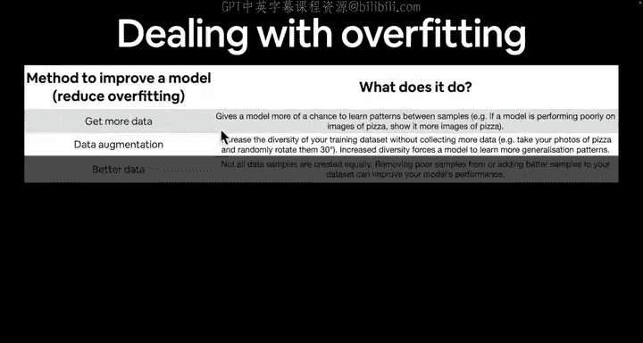

Let's go here。 Let's create to start off with。We'll just write down。Now， let's try another modeling。

Experiment， so this is in line with our Pitoch workflow。

 trying a model then trying another one and trying another one so and so over again。This time。

 using the same model as before， but with。Some slight data augmentation。Oh maybe we want not slight。

 that's really not the best word， we'll just say with some data augmentation。

And if we come down here， we're going to write section 9。1。

We need to first create a transform with data augmentation。So we've seen what this looks like before。

 we're going to use the trivial augment。Data augmentation， create training transform， which is。

 as we saw in a previous video， what Pitorrch the Piytorrch team have recently used to train their state of the art computer vision models。

So train transform trivial。This is what I'm going to call my transform。And I'm just going to。

From Torch vision import transforms， we've done this before， we don't have to reimport it。

 but I'm going to do it anyway just to show you that we're re-importing or we're using transforms and we're going to compose a transform here。

 recall that transforms help us manipulate our data。

So we're going to transform our images into size 64 by 64。

Then we're going to set up a trivial augment transforms， just like we did before。Trivial。

Augment wide。 And we're going to set the number of magnitude bins here to be 31。

 which is the default here， which means we'll randomly use some data augmentation on each one of our images。

 and it will be applied at a magnitude of 0 to 31， also randomly selected。

 So if we lowered this to 5， the upper bound of intensity of how much that data augmentation is applied to a certain image will be less than if we set it to say 31。

Now our final transform here is going to be too tensor because we want our images in tensor format for our model。

And then I'm going to create a test transform， I'm going to call this simple。

 which is just going to be transforms dot compose and all that it's going to have。

 oh I should put a list here， all that it's going to have。😊，Make some space over here。

Is going to be transforms all we want to do is resize the image。Size equals 6464。

 Now we don't apply data augmentation to the test data set because we only just want to evaluate our models on the test data set。

 our models aren't going to be learning any generalizable patterns on the test dataset set。

 which is why we focus our data augmentations on the training data set。

 and I've just readjusted that。 I don't want to do that beautiful。So we've got a transform ready。

 Now， let's load some data using those transforms。So we'll create。Train and test。Data sets。

And data loaders。With data augmentation。So we've done this before。

 you might want to try it out on your own， so pause the video if you'd like to test it out。

 create a data set and a data loader using these transforms here。

And recall that our data is going to be creating a data set from pizzaa steakak and sushi for the train and test folders。

And that our data loader is going to be batchrifying our data set。

 so let's turn our image folders into data sets。Dataets beautiful and I'm going to write here train data augmented just so we know that it's been augmented。

We've got a few of similar variable names throughout this notebook。

 so I just want to be as clear as possible and I'm going to use。

 I'll just reimport Torch vision datas。We've seen this before the image folder。

 so rather than now use our own custom class， we're going to use the existing image folder class that's within Torch Vi datas。

😊，And we have to pass in here a route。So I'll just get the dock string there。Root。

 which is going to be equal to our trainer。Which recall is the path to our training directory。

We've got that saved， and then I'm going to pass in here the transform is going to be train transform trivial。

 So our training data is going to be augmented。Thanks to this transform here and transforms trivial augment wide。

 you know where you can find more about trivial augment wide， of course。

 in the Pytorch documentation or just searching transforms trivial augment wide。And。

Did I spell this wrong。Trivial。Oh， train， train transform。 I felt that wrong。 Of course I did。

 So test data。 let's create this as test data simple equals data sets dot image folder。

 And the root di is going to be here。 The test directory。 And the transform is just going to be what。

😊，The test transform simple。Beautiful。So now let's turn these data sets into data loaders。

So turn our。Data sets into。Data loaders。We're going to import OS。

I'm going to set the batch size here equal to 32。The number of workers that are going to load our data loaders。

 I'm going to set this to OS。cpu count， so there'll be one worker per CPU on our machine。

I'm going to set here the torch manual seed。To 42 because we're going to shuffle our training data。

Train data loader， I'm going to call this augmented。

Equals data loader now I just want to I don't need to reimport this。

 but I just want to show you again。From torch。utils。You can never have enough practice， right。

 do data， let's import。Data loader。So that's where we got the data loader class from。

 Now let's go train data augmented。 we'll pass in that as the data set。

And I'll just put in here the parameter name for completeness。 That's our data set。

 and then we want to set the batch size， which is equal to batch size。

I'm going to set shuffle equal to true， and I'm going to set numb workers equal to nu workers。

Beautiful。And now let's do that again with the test data load that this time。Test data loader。

 I'm going to call this test data loader simple， we're not using any data augmentation on the test data set just turning our images。

 our test images into tensesors。The data set here is going to be test data simple。

I'm going to pass in the batch size equal to batch size。

 so both our data loaders will have a batch size of 32。

I'm going to keep shuffle on false and numb workers I'm going to set to numb。Workers。Look at us go。

 We've already got a data set and a data loader。 This time our data loader is going to be augmented for the training data set。

 and it's going to be nice and simple for the test data set。 So this is really similar。

 this data loader to the previous one we made the only difference in this modeling experiment is that we're going to be adding data augmentation。

😊，Namely trivial augment wide。So with that being said， we've got a data set。

 We've got a data loader in the next video， let's construct and train Model 1。 In fact。

 you might want to give that a go so you can use our tiny VGG class。To make Model one。

 and then you can use our train function to train a new tiny VGG instance。

With our training data loader augmented and our test data loader simple。

So give that a go and we'll do it together in the next video。😊，I'll see you there。

Now that we've got our data sets and data loaders with data augmentation ready。

 let's now create another model。 So 9。3， we're going to construct。And train Model one。😡。

And this time。Just going to write what we're going to doing， going to be doing， sorry。

 this time we'll be using。The same model architecture， but we're changing the data here。

Except this time。We've augmented the training data。😡。

So we'd like to see how this performs compared to a model with no data augmentation。

So that was our baseline up here， and that's what you'll generally do with your experiments。

 you'll start as simple as possible and introduce complexity when required。

So create Model1 and send it to the target device that is to the target device。

 and because of our helpful selves previously， we can create a manual seed here， torchdo manual seed。

And we can create Model one， leveraging the class that we created before。

So although we built tiny VGG from scratch in this video， in this section， sorry。In subsequent。

Coding sessions because we've built it from scratch once and we know that it works。

 we can just recreate it by calling the class and passing in different variables here so let's get the number of classes that we have in our train data augmented。

Classes and we're going to send it to device。 and then if we inspect Model one， let's have a look。

Wonderful。Now， let's keep going。 We can also leverage our training function that we did。

 You might have tried this before， so let's now train our model。 She're going to put here wonderful。

Now we've got a model and data loaders， let's create what do we have to do。

 we have to create a loss function and an optimizer and call upon our train function that we created earlier。

To train and evaluate our model。Beautiful。So I'm going to set the random seeds。Torch dot manual。

Saint。And torch。 kuda because we're going to be using kuda， let's set the manual seed here， 42。

I'm going to set the number of epochs， we're going to keep many of the parameters the same。

 set the number of epochs。Num epochs equals5。We could， of course。

 train this model for longer if we really wanted to by increasing the number of epochs。

 but now let's set up the loss function。So loss Fn equals Nn。Cross entropy loss。 Don't forget。

 This has just came into mind。 Los function often as well in Pytorch is called criterion。

 So the criterion you're trying to reduce。 But I just like to call it loss function。

And then we're going to have optimizer。😊，Let's use the same optimizer we used before， torch。opim。

adom。Recall SGD and Atma two of the most popular optimizers， so Model 1 dot parameters。

They're the parameters we're going to optimize， we're going to set the learning rate to 001。

 which is the default for the atom optimizer in Pytorch。😊，Then we're going to start the timer。

 so from time it。Let's import the default timer。As timer， I we'll go start time equals timer。

And then let's go train Model one。How can we do this Well we're going to get a results dictionary as Model one results we're going to call upon our train function inside our train function will'll pass the model parameter as model one。

For the train data loader parameter， we're going to pass in Tra Data loader augmented。

 so our augmented training data loader。😊，And for the test data loader， we can pass in here。

 test data loader simpleple。Then we can write our Opr， which will be the atom optimizer。

 our loss function is going to be NN cross entropy loss， what we've created above。

 and then we can set the number of epochs is going to be equal to nu。

Epochs and then if we really wanted to， we could set the device equal to device。

 which will be our target device and now let's end the timer and print out how long it took。Took。

En time equals timer and we'll go print。茶로。Training time for Model one。

Is going to be end time minus start time。And oh。It would help if I could spell we'll get that to three decimal places and that'll be seconds so you're ready we look how quickly we built a training pipeline for Model one。

😊，And look how big easily we created it。So go ask for coding all of that stuff up before。

 let's train our second model， our first model using data augmentation。😊，You're ready， three， two。

 one， oh let's go。No errors。 beautiful。 We're going nice and quick here。So oh。

 about just over7 seconds。 so what GPU do I have currently？

Just keep this in mind that I'm using Google coab Pro so I get preference in terms of allocating a faster GPU。

 your model training time may be longer than what I've got， depending on the GPU。

 it also may be faster again， depending on the GPU， but we get about7 seconds。

 but it looks like our model with data augmentation didn't perform as well as our model without data augmentation。

H。😊，So how long did our model before without data augmentation take the train。

 just over 7 seconds as well， but we got better results in terms of accuracy on the training and test data sets for Model 0。

 So maybe data augmentation doesn't help in our case。

And we kind of hinted at that because the loss here was already going down。

 we weren't really overfitting yet， so recall that data augmentation is a way to help with overfitting generally。

😊，So maybe that wasn't the best step to try and improve our model。

 but let's nonetheless keep evaluating our model。 In the next video。

 we're going to plot the loss curves of Model 1。 So in fact， you might want to give that a go。

 So we've got a function plot loss curves and we've got some results in a dictionary format。

 So try that out， plot the loss curves and see what you see。

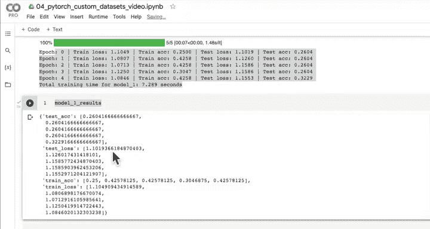

Let's do it together in the next video。I'll see you there。

