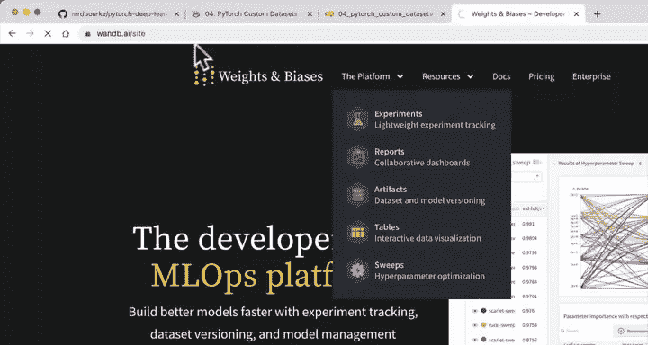
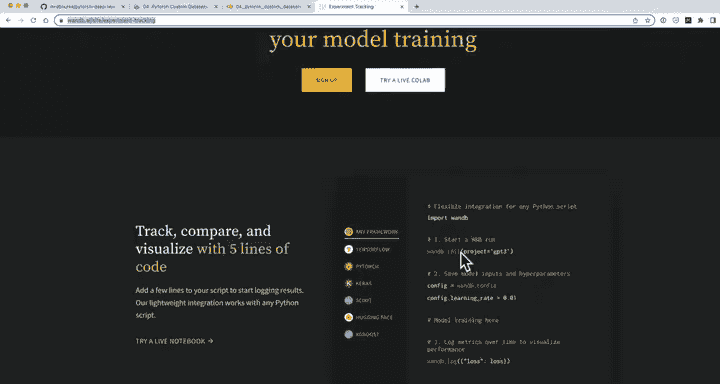
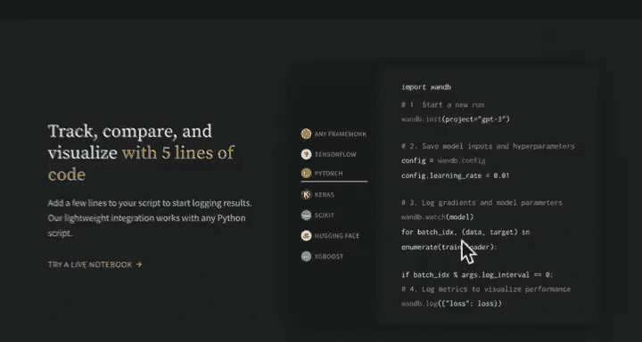
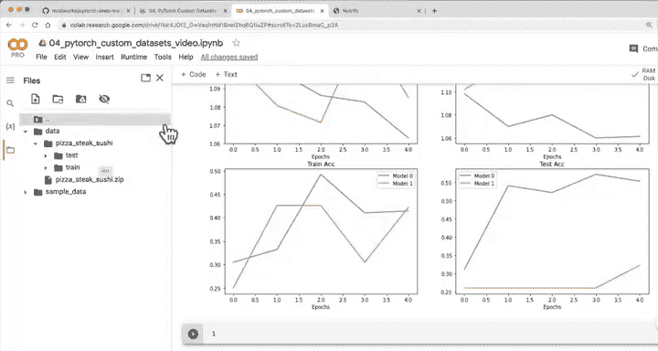

# mrdbourke《一天学会pytorch深度学习｜Learn PyTorch for deep learning in a day Literally》中英 - P92：156. Plotting all the loss curves.zh_en - GPT中英字幕课程资源 - BV1kx4y1r79d

Now that we've compared our models loss curves on their own individually。

 how about we compare our model results to each other。

 So let's have a look at comparing our model results。

And so I'm going to write a little note here that。After evaluating our modeling。Experiments。

On their own。It's important to compare them。🤢，To each other。

And there's a few different ways to do this。😊，There's a few different ways。To do this。

 number one is hard coding。So like we've done， we've written functions。

 we've written helper functions。And whatnot and manually plotted things。

 so I'm just going to write in here this is what we're doing。Then of course。

 there are tools to do this， such as Ptorrch+ Tensorboard。

And so I'll link to this Ptorch Tensor board， we're going to see this in a later section of the course。

😊，Tensor board is a great resource for tracking your experiments。

 If you'd like to jump forward and have a look at what that is in the Pto documentation。

 I'd encourage you to do so。😊，Then another one of my favorite tools is weights and biases。

So these are all going to involve some code as well。

 but they help out with automatically tracking different experiments。😡。

So weights and biases is one of my favorite， and you've got platform for experiments。

 That's what you'll be looking at。 So if you run multiple experiments。

 you can set out weights and biases pretty easy。😊。

To track your different model hub parameters。 So pytorch， There we go。 I weights and biases。

 start a new run on weights and biases。 You can save the learning rate value and whatnot。

 go through your data and just log everything there。 So this is not a course about different tools。

 We're going to focus on just pure pietorrch。 But I thought I'd leave these here anyway。

 because you're going to come across them eventually。

 and Ml flow is another one of my favorites as well。 We have Ml tracking projects， models， registry。

 all that sort of stuff。 If you'd likeking to look into more ways to track your experiments。

There are some extensions， but for now we're going to stick with hard coding。

 We're just going to do it as simple as possible to begin with。

 And if we wanted to add other tools later on， we can sure do that。

So let's create a data frame for each of our model results。

 we can do this because our model results recall in the form of dictionaries。😊，So Model zero results。

But you can see what we're doing now by hard coding this， it's quite cumbersome。

 can you imagine if we had say 10 models or even just five models we'd have to really are。😊。

Write a fair bit of code here for all of our dictionaries and whatnot。

 whereas these tools here help you to track everything automatically。So we've got a data frame here。

 Model0 results over time。 These are our number of epochs。

 we can notice that the training loss starts to go down。

 the testing loss also starts to go down and the accuracy on the training and test dataset starts to go up Now those are the trends that we're looking for So an experiment you could try would be to train this model0 for longer to see if it improved。

But we're currently just interested in comparing results。 So let's set up a plot。

 I want to plot model 0 results and model 1 results on the same plot。

 So we'll need a plot for training loss。 we'll need a plot for training accuracy。

 Test loss and test accuracy， and then we want two separate lines on each of them。

 one for model 0 and one for model 1。 and this particular pattern would be similar。

 regardless if we had 10 different experiments， Or if we had 10 different metrics we wanted to compare。

 you generally want to plot them all against each other to make them visual。

 And that's what tools such as weights and biases。 What tensor board and what Ml flow can help you to do。

 So I'm just going to get out of that， clean up our browser。So let's set up a plot here。

I'm going to use mapplot Lib， going to put in a figure。

 I'm going to make it quite large because we want four subplots。

 one for each of the metrics we want to compare across our different models。

Now let's get number of epochs。So epochs is going to be。Length or we' turn it into a range actually。

Range of L model 0 Df。 So that's going to give us five。Beautiful range between 0 and 5。

 Now let's create a plot for the train loss。We want to compare the train loss across Model0 and the train loss across Model1。

So we can go plt。subplot。Let's create a plot with two rows and two columns。

 and this is going to be index number one will be the training loss。 We'll go Plt dot plot。

 I'm going to put in here epochs and then Model 0 Df inside here。

 I'm going to put train loss for our first metric and then I'm going to label it with model。0。

So we're comparing the train loss on each of our modeling experiments。

 recall that Model Ze was our baseline model and that was tiny VGG without data augmentation and then we tried out Model1。

 which was the same model but all we did was we added a data augmentation transform to our training data。

So PLT， and we'll go Xla， they both used the same test data set。And Plt。 legend。

 let's see what this looks like。Wonderful， so there's our training loss across two different models。

So we noticed that Model 0 is trending in the right way。

 Model 1 kind of exploded on epoch number that would be 0，1，2 or1， depending how you're counting。

 let's just say epoch number two because that's easier。 The loss went up。

 but then it started to go back down。 So again， if we continued training these models we might notice that the overall trend of the loss is going down on the training data。

 which is exactly what we'd like。So let's now plot， we'll go the test loss。

 So I'm going to go test loss here。And then I'm going to change this。

 I believe if I hold control or command， maybe。Nope or option on my Mac keyboard yeah。

 so it might be a different key on Windows but for me I can press option and I can get a multicursor here。

 so I'm just going to come back in here and that way I can backspace there and just turn this into test loss。

Wonderful。So I'm going to put this as test loss as the title， and I need to change the index。

 So this will be index1， index 2， index 3， index 4。 Let's see what this looks like。

 Do we get the test loss。Beautiful， that's what we get。 however。

 we noticed that Model 1 is probably overfitting at this stage。

 so maybe the data augmentation wasn't the best change to make to our model。😊。

Recall that even if you make a change to your model， such as preventing overfitting or underfitting。

 it won't always guarantee that the change takes your model's evaluation metrics in the right direction。

 Idely， loss is going from top left to bottom right over time。

So looks like Model zero is winning out here at the moment on the loss front。

So now let's plot the accuracy for both training and test。 So I'm going to change this to train。

I'm going to put this as accuracy。And this is going to be index number three on the plot and do we save it as。

 yeah， just a， wonderful， So I'm going to option click here on my Mac。😊。

This is going to be train and this is going to be accuracy here。

And then I'll change this one to accuracy。And then I'm going to change this to accuracy。😊。

And this is going to be plot number four， two rows， two columns index number four。

 and I'm going to option click here to have two curs。Test a， and then I'll change this to test a。

And I'm going to get rid of the legend here， takes a little bit to plot because we're doing four graphs in one hit。

Wonderful， so that's comparing our models。 But do you see how we could potentially functionise this to plot。

 however many model results that we have。 But if we had， say another five models。

 we did another five experiments， which is actually not too many experiments on a problem。

 You might find that sometimes you do over a dozen experiments for a single modelling problem。

 maybe even more。 these graphs can get pretty outlandish with all the lines going through。 So that's。

 again， what tools like tensor board weights and biases and M L flow will help with。😊。

But if we have a look at the accuracy， it seems that both of our models are heading in the right direction。

 We want to go from the bottom left up in the case of accuracy。

 But the test accuracy that's training。 Oh， excuse me。 Is this not training accuracy。

 I messed up that。 Did you catch that one。So training accuracy， we're heading in the right direction。

 but it looks like Model1 is yeah still overfitting。

 so the results we're getting on the training data set aren't coming over to the testing data and that's what we really want our models to shine is on the test data set。

So metrics on the training data set are good， but ideally we want our models to perform well on the test data set data it hasn't seen before。

So that's just something to keep in mind。 whenever you do a series of modeling experiments。

 it's always good to not only evaluate them individually， evaluate them against each other。

 So that way you can go back through your experiments， see what worked and what didn't。

 If you were to ask me what I would do for both of these models。

 I would probably train them for longer and maybe add some more hidden units to each of the layers and see where the results go from there。

 So give that a shot。 in the next video， let's see how we can use our trained models to make a prediction on our own custom image of food。

 So， yes， we used a custom data set of pizza steak and sushi images。

 But what if we had our own What if we finish this model training and we decided， you know what。

 this is a good enough model and then we deployed it to an app like nurrify。😊，Dot app。

 which is a food recognition app that I'm personally working on。

 and we wanted to upload an image and have it be classified by our Pytorch model。😊。

So let's give that a shot， see how we can use our trained model to predict on an image that's not in our training data and not in our testing data。

I'll see you in the next video。

