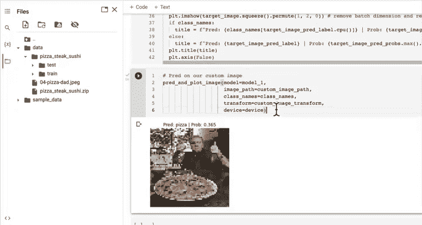
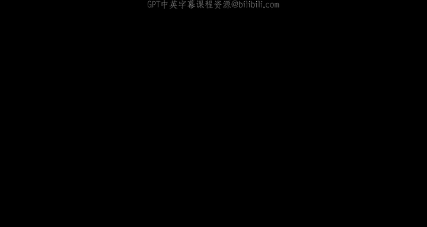
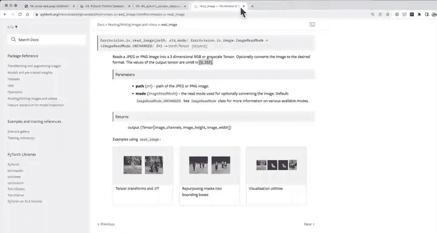
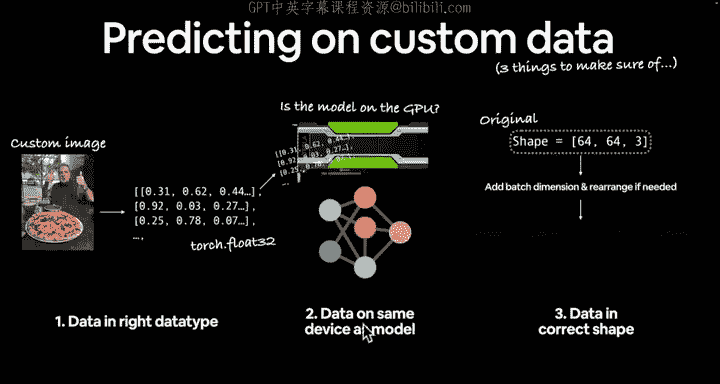
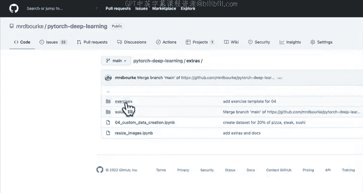
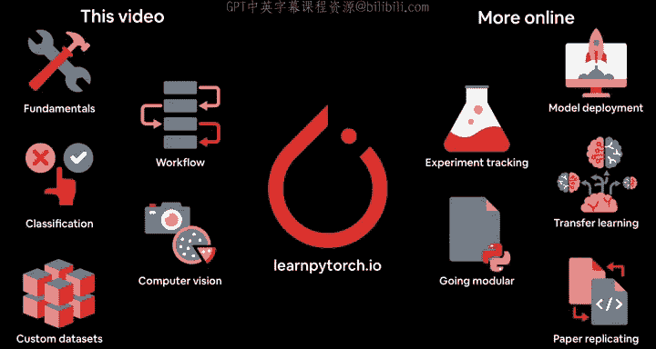

# mrdbourke《一天学会pytorch深度学习｜Learn PyTorch for deep learning in a day Literally》中英 - P93：157. Predicting on custom data.zh_en - GPT中英字幕课程资源 - BV1kx4y1r79d

Welcome back。 In the last video， we compared our modelling experiments。 Now。

 we're going to move on to one of the most exciting parts of deep learning。

 and that is making a prediction。😊，On a custom image。 So although。

We've trained a model on custom data。How do you make a prediction？

On a sample slash image in our case。That's not in either the training or testing data set。

 So let's say you are building。😡，A food recognition app such as nuutrify。

 Take a photo of food and learn about it。 And you wanted to use computer vision to essentially turn foods into QR codes。

 So I'll just show you the workflow here。 If we were to upload this image of my dad giving two thumbs up for a delicious pizza。

😊，And what is nur5 predicted as pizza， beautiful。 So macronutrientency。

 you get some nutrition information and then the time taken。

 So we could replicate a similar process to this using our trained pieytorch model albeit it。

 it's not going to be too great of results or performance because we've seen that we could improve our models based on the accuracy here。

 and based on the loss and what not。 But let's just see what it's like the workflow。

 So the first thing we're going to do is get a custom image。 Now， we could upload one here。😊。

s as clicking the upload button in Google Coabab， choosing an image， and then importing it like that。

 but I'm going to do so programmatically as you've seen before。

 So let's write some code in this video to download a custom image。I'm going to do so using requests。

And like all good cooking shows， I've prepared a custom image for us。So custom image path。

 but again you could use this process that we're going to go through with any of your own images of pizza。

 steak or sushi and if you wanted to train your own model on another set of custom data。

 the workflow will be quite similar。So I'm going to download a photo calledP Dad。Which is of my dad。

 two big thumbs up。😊，And so I'm going to download it from Github。

 So this image is on the course Github， and let's write some code to download the image if it doesn't already exist in our。

Collab。Instance， so if you wanted to upload a single image， you could click with this button。

 just beware that like all of our other data， it's going to disappear if coabab disconnects。

 So that's why I like to write code so we don't have to re upload it every time。So if not。

 custom imagepath dot is file。Let's open a request here or open a file。

Going to open up the custom image path with right binary permissions as F short for file。

 and then when downloading。This is because our image is stored on Github when downloading an image。

Or when downloading from Gitthub in general， you typically want the raw link need to use the raw。

File link。So let's write a request here equals request。get。

 so if we go to the Pytorch deep learning repo， then if we go into I believe it might be extras。

Not in extras， it's going to be in images that would make a lot more sense， wouldn't it Daniel？

Let's get04 P dad。😊，So if we have a look， this is Pytoj deep learning I O for Pizza dadad。

There's a big version of the image there。 And then if we click download。

 it' just going to give us the raw link。 Yeah， there we go。 So that's the image。 Hey， dad。

 how you doing。 Is that pizza delicious， It looks like it。😊。

Let's see if our model can get this right。What do you think， will it？So of course。

 we want our model to predict pizza for this image because it's got a pizza in it。

So custom image path， we're going to download that。I've just put in the raw URL above。

 so notice the raw GitHub user content。That's from the course Gitthub。

 Then I'm going to go F dot right， So file。Right， the request content。

 so the content from the request， in other words， the raw file from GitHub here。

Similar workflow for if you are getting another image from somewhere else on the Internet。 And else。

 if it is already downloaded， let's just not download it。 So print F custom image path。

Already exists， skipping。downownload。And let's see if this works or run the code。

So downloading data 04pizzada。jpeEg。And if we go into here， we refresh。There we go。 beautiful。

 So our data。Or our custom image story is now in our data folder。 So if we click on this。

 this is inside Google Coab now。Beautiful， we got a big， nice。

 big image there and there's a nice big pizza there。

So we're going to be writing some code over the next few videos to do the exact same process as what we've been doing to import our custom data set for our custom image。

 What do we still have to do， We still have to turn it into tensors。

 And then we have to pass it through our model。 So let's see what that looks like over the next few videos。

😊，We are up to one of the most exciting parts of building deep learning models。

 and that is predicting on custom data， In our case， a custom image of。😊。

A photo of my dad eating pizza。 So， of course， we're training a computer vision model on here on pizza steak and sushi。

 So hopefully， the ideal result for our model to predict on this image will be pizza。

 So let's keep going。 Let's figure out how we can get our image， our custom image。

 our singular image into tensor form。😊，Loading in a custom image with pie torch。

 creating another section here。 So I'm just going to write down here。

 We have to make sure our custom image is in the same format。As the data our model was trained on。😡。

So namely that was intensor form。With data type。Torch， F 32。😡，And then of shape 64 by 64。By three。

 so we might need to change the shape of our image and then we need to make sure that it's on the right device。

Command M。Beautiful， so let's see what this looks like， hey。😊，So if I'm going to import Torch vision。

Now， the package you use to load your data will depend on the domain you're in。

 so let's open up the torch vision documentation。We can go to models that's okay。

So if we're working with text， you might want to look in here for some input and output functions so some loading functions。

Torch audio， Sam thing。 Torch vision is what we're working with。 Let's click into Torch vision。 Now。

 we want to look into reading and writing images and videos because we want to read in an image。

 right？ We've got a custom image。 We want to read it in。So this is part of your extra curricula。

 by the way， to go through these for at least 10 minutes each。

 so spend an hour if you're going through Torch vision， you can do the same across these other ones。

 it will just really help you familiarize yourself with all the functions of Pytorrch domain libraries。

😊，So we want to look， here's some options for video。 We're not working with video。

 here's some options for images。 Now， what do we want to do， We want to read in an image。

So we've got a few things here。 Decode image。 Oh， I've skipped over one。

 We can write a Jpeg if we wanted to。 We can encode a P And G。 Let's， let's jump into this one。

 read image。 What does it do， reads a Jpeg or P And G into a three dimensional RGB or gray scale tensor。

 That is what we want。 And then optionally converts the image to the desired format。

 The values of the output tensor are U in 8。 Okay， beautiful。 So let's see what this looks like， ay。

😊，Moode， the read mode used optionally for converting the image。 Lets。

 Let's see what we can do with this。 I'm going to copy this in， so。We write this down。

 We can read an image into pie torch using。We'll go with that。

So let's see what this looks like in practice。Read in custom image I can't explain to you how much I love using deep learning models to predict on custom data so custom image we're going to call it U int 8 because as we read from the documentation here it reads it in U int 8 format so let's have a look at what that looks like rather than just talking about it。

😊，Torchvision do I O read image。 What's our target image path Well we've got custom image path up here。

 This is why I like to do things programmatically。 So if our coabab notebook reset。

 we could just run this cell again， get our custom image and then we've got it here。

So custom image U and A， let's see what this looks like。Oh， what did we get wrong。

Unable to cast Python instance， oh。Does it need to be a string expected a value type of string or but found Possicks path。

 So this， the path needs to be a string。 Okay， if we have a look at our custom image path。

 what did we get wrong。Oh， we've got a Possix path。

 so let's convert this custom image path into a string and see what happens。Oh， look at that。

That's how image in integer form。 I wonder if this is plotable。

 Let's go P LT dot M show custom image U int 8。 Maybe well get a dimensionality problem here in valid shape。

 Okay， let's arm permute it。Permute and we'll go  one，2，0。 is this going to plot？

It's a fairly big image。 There we go。 Two thumbs up。 Ha Look at us。

 So that is the power of Torchvision dot I O。 I O stands for input output。

 We were just able to read in our custom image。 Now， how about we get some metadata about this。

 Let's go。 We'll print it up here， actually， I'll keep that there because that's fun to plot it。😊。

Let's find the shape of our data， the data type and yeah we've got an intensor format。

 but it's U int8 right now so we might have to convert that to F 32。

 we want to find out its shape and we need to make sure that if we're predicting on a custom image the data that we're predict on the custom image needs to be on the same device as our model so let's print out some info print let's go custom image tensor and this is going to be a new line and then we will go custom image U in 8。

😊，Wonderful， and then let's go custom image shape。 We will get the shape parameter， custom image。

 shape or attribute， sorry， and then we also want to know the data type custom image data type。

 but we have a kind of an inkling because the documentation said it would be U in 8 U in 8 and we'll go D type。

😊，Let's have a look。What do we have， So there's our image Tensa。And it's quite a big image。

 so custom image shape。 So what was our model trained on。

 Our model was trained on images of 64 by 64。 So this image encodes a lot more information than what our model was trained on。

So we're going to have to change that shape to pass it through our model。

And then we've got an image data type here or tensor data type of torch Uent 8。

 so maybe that's going be some errors for us later on。

 So if you want to go ahead and see if you can resize this tensor to 6464 using a torch transform or torch vision transform。

 I'd encourage you to try that out， and if you know how to change a torch tensor from UNent 8 to torch float 32。

 give that a shot as well。So let's try and make a prediction on our image in the next video。

I'll see you there。In the last video we loaded in our own custom image and got two big thumbs up from my dad and we turned it into a tensor so we've got a custom image tensor here it's quite big though and we looked at a few things of what we have to do before we pass it round model so we need to make sure it's in the data type torch float 32 shape 64643 and on the right device so let's make another section here we'll go 11。

2 and we'll call it making a prediction on a custom image with a high torch。😊。

Model or with a trained pytorch model。 and albeit our models aren't quite the level we would like them at yet。

 I think it's important just to see what it's like to make a prediction end to end on some custom data because that's the fun part。

 right。So try to make。A prediction on an image。Now I want to just highlight something about the importance of different data types and shapes and whatnot。

 and devices， three of the biggest errors in deep learning in let's see what happens if we try to predict on U in 8。

Format。So we'll go model 1。avval and with torch。inence mode， let's make a prediction。

 we'll pass it through our model 1。 We could use Model0 if we wanted to here。

 they're both form pretty poorly anyway。Let's send it to the device and see what happens。Oh， no。

 what did we get wrong here， Runtime error input type。 So we've got U into8。

 So this is one of our first errors that we talked about。

 We need to make sure that our custom data is of the same data type that our model was originally trained on。

 So we've got torch couda float tensor。😊，So we've got an issue here。 we've got a U into8。

Image data or image tensor， trying to be predicted on by a model with its data type of torch coter float tensor。

So let's try fix this by loading the custom image and convert to torch dot floatat 32。

So one of the ways we can do this is we'll just recreate the custom image Tensor。

 and I'm going to use torchvision。o。read image。We don't have to fully reload our image。

 but I'm going to do it anyway for completeness and a little bit of practice。

And then I'm going to set the type here with the type method to torch Fat 32。And then。

Let's just see what happens。We'll go custom image， let's see what this looks like。

I wonder if our model will work on this。Let's just try again， we'll bring this up。

Copy this down to make a prediction and custom image dot2 device。 Our image is in Torch floatat 32。

 Now。 Let's see what happens。Oh， we get an issue。 Oh， my goodness。 That's a big matrix。 Now。

 I have a feeling that that might be because our image。

 our custom image is of a shape that's far too large。 Custom image， not shape。What do we get。

 Oh my gosh，403024。 And do you notice as well that our values here aren't between 0 and 1。

 whereas our previous images， do we have an image。There we go that our model was trained on were between 0 and 1。

 So how could we get these values to be between 0 and1。Well。

 one of the ways to do so is by dividing by 255。Now， why would we divide by 255？Well。

 because that's a standard image format is to store the image tensor values in values from 0 to 255 for red。

 green and blue color channels。So if we want to scale them， so this is what I meant by 0 to 255。

 if we wanted to scale these values to be between 0 and1， we can divide them by 255。

Because that is the maximum value that there can be。 So let's see what happens if we do that。Okay。

 we get out image values between zero and one。 Can we plot this image So PLt。m show。

 let's plot our custom image， weve got to commmute it so it works nicely with Matpl Lib。

What do we get here？Beautiful， we get the same image， right， but it's still quite big。 Look at that。

 We've got a pixel height of or image height of almost 4000 pixels and a width of over 3000 pixels。

 So we need to do some adjustments further on。 So let's keep going。 We've got custom image to device。

 We've got an error here。 So this is a shape error。😊。

So what can we do to transform our image shape and you might have already tried this？Well。

 let's create a transform pipeline to transform L image shape， so create transform pipeline。

Or composition to resize the image because remember what are we trying to do。

 we're trying to get our model to predict on the same type of data it was trained on。😡。

So let's go custom image transform。Is transformforms dotcompose。And we're just going to。

 since our image is already of a tensor， let's do transformforms。

 re's size and we'll set the size to the same shape that our model was trained on。

All the same size that is So let's go from torch vision。 We don't have to rewrite this。

 It's already imported， but I just want to highlight that we're using the transforms package。

We'll run that。There we go。 We've got a transform pipeline。 Now。

 let's see what happens when we transform our target image。 Trans target image。 What happens。

Custom image transformed。 I love printing the inputs and outputs of our different pipelines here。

 So let's pass our。😊，Custom image that we've just imported。

 so custom image transform our custom image is recall。Ob shape。Quite large。

We're going to pass it through our transformation pipeline and let's print out the shapes。

Let's go original shape。And then we'll go custom image dot shape。And then we'll go print。

Transformed shape。Is going to be custom image underscore transformed。Dot shape。我' see。

The transformation。Oh， would you look at that， how good we've gone from quite a large image to a transformed image here。

So it's going to be squished and squashed a little， so let's what happens。

 let's see what happens when we plot our。😊，Transformed image。

 we've gone from 4000 pixels on the height to 64， and we've gone from 3000 pixels on the height to 64。

 so this is what our model is going to see。Let's go custom image transformed and we're going to permute it to be one。

2，0。Okay， so quite pixelated。 Do you see how this might affect the accuracy of our model。

 Because we've gone from custom image。 Is this going to， Oh yeah， we need to plot dot M show。

 We've gone from this high definition image。To。An image that's of far lower quality here。

 And I can kind of see myself that this is still a pizza， but I know that it's a pizza。

 So just keep this in mind going forward is that another way that we could potentially improve our model's performance if we increased at the size of the training image data。

 So instead of 64，64， we might want to upgrade our models' capability to deal with images that are of 2。

2，4，2，24。😊，So if we have a look at what this looks like， 224，224。Wow。

 that looks a lot better than 6464。 so that's something that you might want to try out later on。

 but we're going to stick in line with the CNN explainer model。

How about we try to make another prediction So since we've transformed our。

Image to be the same size as the data our model was trained on。 So with torch inference mode。

 let's go custom image pre equals Model one on custom image underscore transformed。Does it work now？

Oh my goodness， still not working， Exp all tenses on the same device。 Of course。

 that's what we forgot here。Let's go to device or actually let's leave that  error there and we'll just copy this code down here and let's put this custom image transform back on the right device and see if we finally get a prediction to happen with our model。

😊，Oh， we still get an error。 Oh my goodness。 What's going on here。 Oh。

 we need to add a batch size to it。 So I'm just gonna write up here。 This will error。No batch size。

And。This will error。Image not on right device。And then let's try again。😊。

We need to add a batch size to our image。 So if we look at custom image transformed。Dot shape。

Recall that our images that passed through our model had a batch dimension。

 So this is another place where we get shape mismatch issues I if our model。

 because what's going on in neural network is a lot of tenor manipulation。

 If the dimensions don't line up， we want to perform matrix multiplication and the rules。

If we don't play to the rules， the matrix multiplication will fail。

 So let's fix this by adding a batch dimension so we can do this by going a custom image transformed。

 Let's unsqueze it on the first dimension and then check the shape。There we go。

 We add a single batch。 So that's what we want to do when we make a prediction on a single custom image。

 We want to pass it to our model as an image or a batch of one sample。

So let's finally see if this will work。Let's just not comment what well do this。

 or maybe we'll try anyway， this should work。Added a batch size。

So do you see the steps we've been through so far and we're going to unsqueeze this？

UnSze on the zeroth dimension to add a batch size。Oh， it didn't error。 Oh my goodness。

 It didn't error。 Have a look at that。Yes， that's what we want。

 We get a prediction Loit because the raw outputs of our model。

 We get a logit value for each of our custom classes。 So this could be pizza。 This could be steak。

 and this could be sushi， depending on the order of our classes。 Let's just have a look。😊。

Class to IDX。Did we not get that？Class names。Beautiful so pizza steak， sushi。

 we've still got a ways to go to convert this into that。

 but I just want to highlight what we've done so note。😊，To make a prediction on a custom image。

We had to。This is something you'll have to keep in mind for almost all of your custom data。

 it needs to be formatted in the same way that your model was trained on。

 so we had to load the image。😡，And turn it into a tensor。We had to make sure the image was the same。

Data type。As the model， so that was torch Fat 32。And then we had to make sure the image was the same shape as the data the model was trained on。

Which was 64，64，3。With a batch size。 So that was 1，3，64。64 and excuse me。

 this should actually be the other way around。 This should be colour channels first because we're dealing with pie torch here。

64。 and then finally we had to make sure the image was on the same device as our model。So。

They are three of the big ones that we've talked about so much。

 same data type or data type mismatch will result in a bunch of issues。

Shape mismat will result in a bunch of issues， and device M match will also result in a bunch of issues。

 If you want these to be highlighted， they are in。The Learnpytouch。 Ao resource we have。

Putting things together。Where do we have it。 Oh， yeah， No， it's in the main takeaway section。 Sorry。

 predicticing on your own custom data with a train model is possible。

 as long as you format the data into a similar format to what the model was trained on。

 So make sure you take care of the three big pieytorch and deep learning errors， wrong data types。

 wrong data shapes and wrong devices。 regardless of whether that's images or audio or text。

 These three will follow you around。 So just keep them in mind。

 But now we've got some code to predict on custom images。 But it's kind of all over the place。

 Like we've got about 10 coding cells here just to make a prediction on a custom image。

 How about we functionize this and see if it works on our pizza dad image。

I'll see you in the next video。Welcome back。 We're now well on our way to making custom predictions on our own custom image data。

 Let's keep pushing forward in the last video we finished off getting some raw model logits so the raw outputs from our model。

 Now let's see how we can convert these logits into prediction labels。 Let's write some code。

 So convert logits to prediction labels or let's go convert logits let's first convert them to prediction probabilities。

😊，Probabilities。So how do we do that， let's go custom image pre probs equals torch。oftmax。

To convert our custom image pre across the first dimension。

So the first dimension of this tensor will be the inner brackets， of course。

So just this little section here， let's see what these look like。

 this will be prediction probabilities。Wonderful， so you'll notice that these are quite spread out。😊。

Now this is not ideal， ideally we'd like our model to assign a fairly large prediction probability to the target class。

 the right target class that is， however， since our model when we trained it isn't actually performing that all that well。

 the prediction probabilities are quite spread out across all of the classes。But nonetheless。

 we're just highlighting what it's like to predict on custom data。

 so now let's convert the prediction probabilities。Two prediction labels。

Now you'll notice that we used Softmax because why we are working with multiclass classification data。

 and so we can get the custom image pre labels。The integers by taking the arg max of the prediction probabilities。

Custom image pre pros across the first dimension as well。So let's go custom image。Pread las。

 let's see what they look like。0， so the index here with the highest value is index number 0。

 And you'll notice that it's still on the coer device。

 So what would happen if we tried to index on our class names。With the custom image pre labels。

Or maybe that doesn't need to be a plural。Oh， there we go。 We get pizza。

 but you might also have to change this to the CPU later on。

 Otherwise you might run into some errors。 So just be aware of that。

 So you notice how we just put it to the CPU。 So we get pizza。 We got a correct prediction。

 but this is as good as guessing in my opinion because these are kind of spread out。 Ily。

 this value would be higher， maybe something like 0。8 or above for our pizza dad image。

 But nonetheless our model is getting two thumbs up even on this。64 by 64 image。

 but that's a lot of code that we've written。 Let's functionise it so we can just pass in a file path and get a custom prediction from it。

😊，So putting custom image prediction together。Let's go building a function。

So we want the ideal outcome is。Let's plot our image as well。Ideal outcome。Is。A function。

Where we plot or where we pass an image path。two。And have our model predict on that image and plot the image plus the prediction。

So this is our ideal outcome。 and I think I'm going to issue this as a challenge。 So give that a go。

 put all of our code above together and you'll just have to import the image。

 you'll have to process it and whatnot。 I know I said we were going to build a function in this video。

 but we're going to save that to the next video。 I'd like you to give that a go。

 So start from way back up here。😊，Import the image。Via Torch Vi IO Read image。

 format it using what we've done， change the data type， change the shape。

Change the device and then plot the image。With its prediction as the title。

So give that a go and we'll do it together in the next video。😊，How'd you go。

I just realized I had a typo in the previous cell， but that's all right。😊，Did you give it a shot。

 Did you put together the custom image prediction in a function format， I'd love it if you did。

 but if not， that's okay， let's keep going。 Let's see what that might look like。

 And there are many different ways that you could do this。

 but here's one of the ways that I've thought of。 So we want to function that's going to pre and plot a target image。

 We wanted to take in a torch model。😊，And so that's going to be ideally a trained model。

We wanted to also take in an image path， which will be of a string。

🎼It can take in a class names list so that we can index it and get the prediction label in string format so let's put this as a list of strings and by default this can equal none just in case we just wanted the prediction。

😊，It wants to take in a transform so that we can pass it in some form of transform to transform the image。

 and then it's going to take in a device which will be by default the target device So let's write a little doc string here makes a prediction on a target image。

With a。Trained model and plots the image and prediction。Beautiful。Now， what do we have to do first。

Let's load in the image。Load in the image just like we did before with torch vision。

 so target image equals torchvision。ioo。read image。And we'll go string on the image path。

 which will be the image path here， and we convert it to a string just in case it doesn't get passed in as a string。

And then let's change it into type。Torch float 32， because we want to make sure that our。

Custom image or our custom data is in the same type as what we trained our model on。

 So now let's divide。The image pixel values。By 255。

To get them between0 or to get them between 01 as a range so we can just do this by target image equals target image divider by 255 and we could also just do this in one step up here。

255， but I've just put it out there just to let you know that hey。

 read image imports image data as between 0 and 255。 So our model prefers numbers between 0 on1。

 so let's just scale it there。Now we want to transform our data if necessary， in our case it is。

 but it won't always be， so we want this function to be pretty generic pre and plot image。

So if the transform exists， let's。Set the target image to the transform or we'll pass it through the transform that is。

Wonderful， and the transform we're going to get from here。Now what's left to do？Well。

 let's make sure the model。Is on the target device。It might be by default。

 but if we're passing in a device parameter， we may as well make sure the model is there too。

 and then we can make a prediction。So let's turn on aV slash inference mode and make a prediction with our model。

 so model we call aVal mode and then with torch dot inference mode。

 because we're making a prediction we want to turn our model into inference mode or put it in inference mode context。

Let's add an extra dimension。😊，To the image。Let's go target image。

 we could do this step above actually， but we're just going to do it here。

 I'm kind of remembering things on the fly here of what we need to do。 We're adding a。This is。

 let's write this down。 This is the batch dimension。EG， our model will predict on batches of。

One x image。So we're just unsqueezing it to add an extra dimension at the zeroth dimension space。

 just like we did in a previous video。😊，Now let's make a prediction。

On the image with an extra dimension， otherwise if we don't have that extra dimension。

 we saw that we get a shape issue。So right down here， target image pre， and remember。

 this is going to be the raw model outputs， raw Loit outputs。We'll go target image pre and。Yeah。

 I believe that's all we need。For the prediction， oh wait， there was one more thing。

 two device me to also make sure their target image is on the right device。😊，Beautiful。

 so a fair few steps here， but nothing we can't handle。

 all we're really doing is replicating what we've done for matches of images。

 but we want to make sure that if someone passed any image to our pre and plot image function that we've got functionality in here to handle that image。

😊，And do we get this， oh， we want just target image to device。 Did you catch that error？

So let's keep going Now let's convert the logits。Our models raw logits。

 let's convert those to prediction probabilities。This is so exciting。

 we're getting so close to making a function to predict on custom data。

 so we'll set this to target image pre pros， which is going to be torch。 softmax。😊。

And we will pass in the target image pre here， and we want to get the softm of the first dimension。

Now let's convert our prediction probabilities， which is what we get in the line above。

AndWe want to convert those to prediction。Lbels。So let's get the target image pre labels。

Equals torch。 arg max， we want to get the arg max of or in other words， the index。

 which is the maximum value from the pre probs of the first dimension as well。 Now。

 what should we return here？😊，Well we don't really need to return anything。 We want to create a plot。

 so let's plot the image。Alongside the prediction。And prediction probability。Beautiful。

 so plot dot M show。 What are we going to pass in here， We're going to pass in here。

 our target image。 Now， we have to squeeze this， I believe。

 because we've added an extra dimension up here。 So we'll squeeze it to remove that batch size。

 and then we still have to permute it because map plot Lib likes。😊。

Images in the format color channels last，1，2，0。 So remove batch dimension。And rearrange。Shape 2 B。

 H C， H WC， that is colour channels last。 Now， if the class names parameter exists。

 So we've passed in a list of class names， this function is really just replicating everything we've done in the past 10 cells。

 by the way。 So right back up here， we're replicating all of this stuff in one function。

 So pretty large function。 But once we've written it， we can pass in our images as much as we like。

 So。If class names exist， let's set the title to showcase that class name so the pre is going to be class names。

 let's index on that pre image or target image pre label and this is where we'll have to put it to the CPU because if we're using a title with Mapllootlib Maplotlibb can handle things that are on the GPU。

 this is why we have to put it to the CPU。And then I believe that should be enough for that。

 Let's add a little line in here so that we can have it， Oh， I've missed something。

An outside bracket there。🤢，Wonderful， let's add the prediction probability because that's always fun to see。

So we want target image pre pros and we want to get the maximum pre prob from that and we'll also put that on the CPU。

And I think we might get this three decimal places。Now， this is saying。All prayed libels。

 We don't need that。 We need just non plural。Beautiful， now， if the class names doesn't exist。

 let's just set the title equal to。F F string we'll go pre。Target image， pre label。

Is Google Col Lab still telling me this is wrong？Target image pre label。 on no。

 we've still got the same thing。 It just hasn't caught up with me。 yet I'm coding a bit fast here。

 and then we'll pass in the prob。Which will be just the same as above。I could even copy this in。

Beautiful。And let's now。Set the title to the title。

And we will turn the axes off PLT axes false Fair bit code there。

 But this is going to be a super exciting moment。 Let's see what this looks like When we pass it in。

 a target image and a target model， some class names and a transform。 Are you ready。😊。

We've got our transform ready， by the way， it's back up here。

Custom image transform is just going to resize our image。So let's see， oh。

 this file was updated remotely on another tab。Sometimes this happens and usually Google Collab sorts itself out。

 but that's all right， doesn't affect our code for now。Pre on our custom image， are you ready？

Save failed。 Would you like to override， Yes， I would。So you might see that in Google CoLab。

Usually it fixes itself there we go save successfully， pre and plot image。

I was going to say Google Colla， don't fail me now， we're about to predict on our own custom data。😊。

Using a model trained on our own custom data。Image path， let's pass in custom image path。

 which is going to be the path to our pizza dad image。Let's go class names equals class names。

 which is pizza steakak and sushi， we'll pass in our transform to convert our image to the right shape and size。

 custom image。😊，Transform， and then finally， the target device is going to be device。 Are you ready。

 Let's make a prediction on custom data。 One of my favorite things。

 one of the most fun things to do when building deep learning models，3，2，1。😊，How did it go， Oh no。

 What did we get wrong， CPU。Okay， such a so close， but yet so far has no attribute CPU。Oh。

 maybe we need to put this to CPU。 That's where I got the square bracket wrong。

So that's what we needed to change。 We needed to， because this is going to be potentially on the GPU T image pre label。

 We need to put it on the CPU。 We need to do that Y。

 because this is going to be the title of our mappl Lib plot and mappllib doesn't interface too well with data on a GPU。

 Let's try it again，3，2，1， running。look at that prediction on a custom image and it gets it right。

 Two thumbs up。 I didn't plan this。 Our model is performing actually quite poorly。

 So this is as good as a guess to me。 You might want to try this on your own image。 And in fact。

 if you do， please share it with me。 I would love to see it。😊。

But you could potentially try this with another model， see what happens。Stake， okay， there we go。

 So even though Model 1 performs worse， quantitatively， it performs better， qualitatively。

 So that's the power of visualize， visualize， visualize。

 And if we use model 0 also which isn't performing too well。

 It gets it wrong with a prediction probability of 0。368， which isn't too high either。

 So we've talked about a couple of different ways to improve our models。

 Now we've even got a way to make predictions on our own custom images。 So give that a shot。

 I'd love to see your custom predictions， upload an image here if you want or download it into Google coab using code that we've used before。

 but。😊。

We've come a fairly long way。I feel like we've covered enough for custom data sets。

 Let's sum what we've covered in the next video and I've got a bunch of exercises and extra curriculum for you。

 So this is exciting stuff。 I'll see you in the next video。😊。

In the last video， we did the very exciting thing of making a prediction on our own custom image。

 although it's quite pixelated， and although our model's performance quantitatively didn't turn out to be too good qualitatively。

 it happened to work out。 But of course， there are a fair few ways that we could improve our model's performance。

 But the main takeaway here is that we had to do a bunch of preprocessing to make sure our custom image was in the same format as what our model expected。

 And this is quite a lot of what I do behind the scenes for nurify， if you upload an image here。

 it gets preprocessed in a similar way to go through a image classification model to output a label like this。

😊。

So let's get out of this。To summarize， I've got a colorful slide here。

 but we've already covered this， predicting on custom data。 These are three things to make sure of。

 regardless of whether you're using images， text or audio。

 make sure your data is in the right data type。 In our case， it was torch floatloat 32。

Make sure your data is on the same device as the model， so we had to put our custom image to the GPU。

 which was where our model also lived and then we had to make sure our data was in the correct shape So the original shape was 64643 actually this should be reversed because it was color channels first but the same principle remains here We had to add a batch dimension and rearrange if we needed。

 So in our case we used images of this shape。Btches first， color channels first， height width。

But depending on your problem will depend on your shape。

 depending on the device you're using will depend on where your data and your model lives。

 and depending on the data type you're using will depend on what you're using for torch Float 32 or something else。

So let's summarize。😊，If we go here。Mainine takeaways。You can read through these。

 but some of the big ones are Pytorch has many built in functions to deal with all kinds of data。

 from vision to text to audio to recommendation systems， so if we look at the Pytorch docs。

You're going to become very familiar with these over time。 We've got torch audio data。

 Torch text Torch vision is what we practiced with。

 and we've got a whole bunch of things here for transforming and augmenting images， data sets。

 utilities， operators and torch data is currently in beta。

 but this is just something to be aware of later on So it's a prototype library right now but by the time you watch this it might be available but it's another way of loading data。

 So just be aware of this for later on。And if we come back。To up here。

If Ptch built in data loading functions， don't suit your requirements。

 you can write your own custom data set classes by subclassing， torch。uts。 data data set。

 and we saw that way back up here in option number2。Option2， here we go。

 loading image data with a custom data set wrote plenty of code to do that。

And then a lot of machine learning is dealing with the balance between overfitting and underfitting。

 We've got a whole section in the book here to check out what an ideal loss curve should look like and how to deal with overfitting。

 how to deal with underfitting。 It's， it is a fine line。

 So much of the research and machine learning is actually dedicated towards this balance。

 And then three big things for。Been aware of when you're predicting on your own custom data。

 wrong data types， wrong data shapes and wrong devices。 This will follow you around， as I said。

 And we saw that in practice to get our own custom image ready for a trained model。Now。

 we have some exercises here。 If you'd like the link to it。

 you can go to Lne Pytorch dot I O Section number 4 exercises and， of course， extra curriculum。

 A lot of the things I've mentioned throughout the course that would be a good resource to check out。

 containedtain in here。 But the exercises。 This is， this is your time to shine。

 your time to practice。 Let's go back to this notebook。 Sc right down to the bottom。

 Look how much code we've written。😊，Goodness me exercises。😊，For all exercises and extra curriculum。

See here。Turn that into markdown。 Wo。 And so if we go in here， you've got a couple of resources。

 there's an exercise template notebook for number4 and example solutions for notebook number four。

 which is what we're working on now。 So of course， I'd encourage you to go through the Pytorch custom datas。

 exercises template first， try to fill out all of the code here on your own。

 So we've got some questions here， we've got some dummy code， we've got some comments。

 So give that a go， go through this， use this book resource to reference。

 use all the code we've written， use the documentation， whatever you want。

 but try to go through this on your own。 And then if you get stuck somewhere。

 you can look at an example solution that I created， which is here。

 Pytorch custom datas exercise solutions and just be aware that this is just one way of doing things。

 It's not necessarily the best。 It's just a way to reference what you're writing to what I would do。

 and there's actually now live walkthroughs of the solutions， errors and all on YouTube。😊。

So if you go to this video， you's going to mute。So this is me live streaming the whole thing。

Writing a bunch of pytorrch code。 If you just keep going through all of that。

 you'll see me writing all of the solutions， running into errors， trying different things， et cetera。

 et cea。 But that's on YouTube。 You can check that out on your own time。

But I feel like we've covered enough。Exercises， oh， by the way。

 this is in the extras Excis tab of the Pytorch deep learninging repo。

 So extras exercises and solutions that are contained in there。

Far out。We've covered a lot。 Look at all that。So that has been Pytorch custom data sets。

 I will see you in the next section。😊，Holy smokes。That was a lot upon to code。

But if you're still hungry for more， there is five more chapters available at learn Pytorch。Ao。

 which cover transfer learning， my favorite topic， Pytorch model experiment tracking。

 Pytorch paper replicating and Pytorch model deployment。

 how do you get your model into the hands of others and if you like to learn in this video style。

 the videos for those chapters are available at zero to mastery。 AO。😊。

But otherwise， I machine learning， and I'll see you next time。😊。

