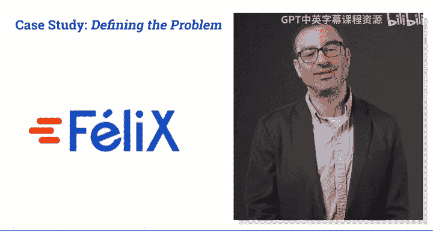
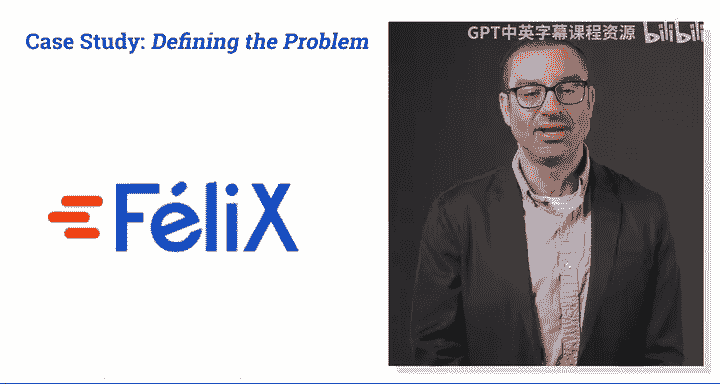
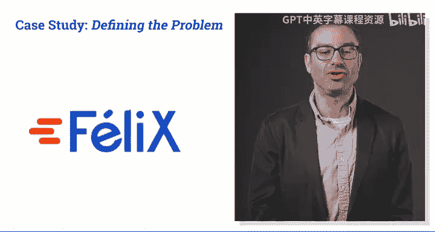
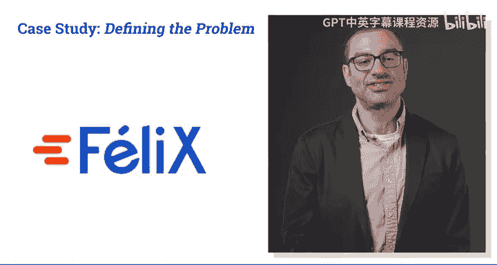
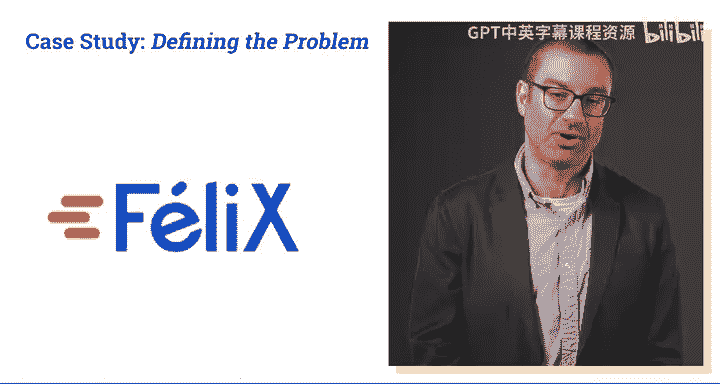
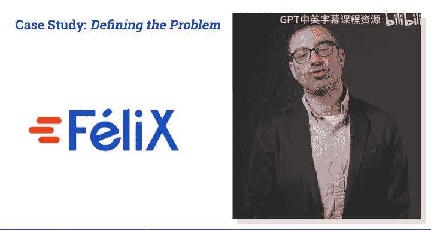
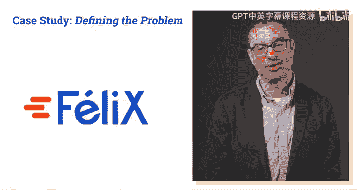
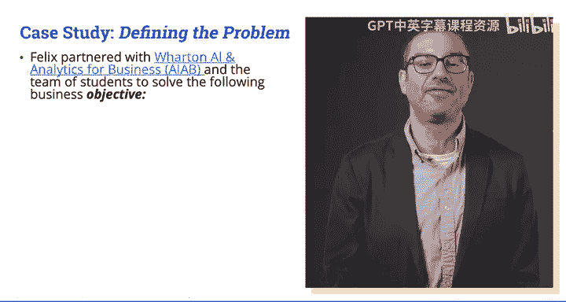
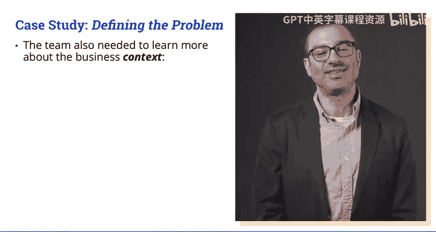

# uPenn《如何运用数据1（Python数据分析、SQL、EDA）｜How to Use Data》中英字幕 - P10：9_Felix案例研究：问题定义.zh_en - GPT中英字幕课程资源 - BV1wKxJz3EFB

Here's another real world example of how a team of student data analysts and data scientists worked with a company to solve a real world business problem。

For this specific case， we want to look at the process of defining the problem in more detail。

The company is Felix， a chat based platform for sending money from the US to Mexico。

Felix Technologies is a technology company with the mission to make cross border payments to Latin America as easy as sending a message on WhatsApp。

Felix partnered with AIAB and the team of students to solve the following business objective。

To predict fraud on their platform by detecting bad actors before the attempt a fraudulent charge。

The team developed the following project scope with specific goals to be addressed。

Explore customer transactional data and identify overall fraud trends and develop a new fraud detection model that would identify fraud early in the transaction process。

 and for this project， it was important for the team to really understand the business context。

Felix already had a third party fraud detection mechanism in place。

 but was hit with charge backs every time it identified a fraudulent transaction。

They wanted to develop their own new agent for fraud detection to make it more robust and to prevent these chargebacks。

 The team also needed to learn more about Felix's current fraud detection model。

 What features were currently being used for flagging fraud。

 Are these features provided in the data set and could they be used as part of the new fraud detection model。

Also， what were the rules that were in place now for detecting fraud？

