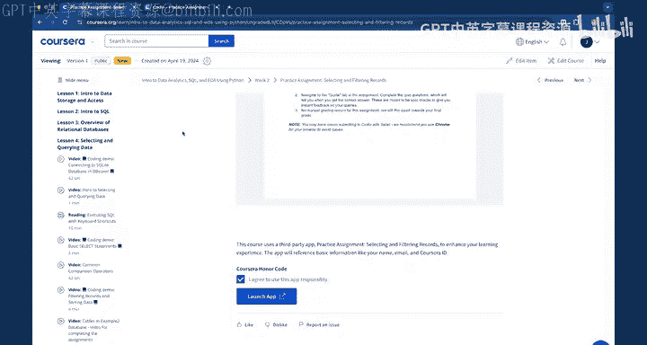
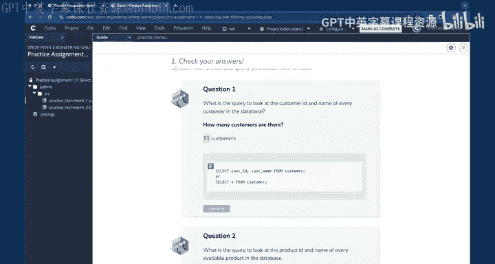

# uPenn《如何运用数据1（Python数据分析、SQL、EDA）｜How to Use Data》中英字幕 - P11：10_Codio演示：SQL实践.zh_en - GPT中英字幕课程资源 - BV1wKxJz3EFB

Hi， welcome to this walk through on how to work with assignments within Koio for this course。

 Kodio is an excellent online platform that provides you with pre installed environments to run your code seamlessly。

 No matter if you're on Mac， Windows or Linux。😊，What you see here is a homework assignment that doesn't require Jupiter notebook。

 This type of assignment is similar to a quiz， but involves operating external software like D Beaaver and SQL Light。

Download the files listed on this page and load them into D Beaaver following the P Df instructions and coding demo provided earlier in this course。

 Sc down and check the check box at the bottom。 If this is your first time。

 enter your legal name and click launch app。The setup typically takes 20 seconds to a minute。

 If nothing happens， refresh the page。on launching。

 you'll see a guide page with additional instructions。 On the left， there's a file manager。

 If you're unfamiliar with loading D B files in D Beaaver。 revisit the coding demo for each question。

 read the statement and formulate a query in D Beaaver。 copypy the query to the SQL file in Kodio。

 Remember， you can't run queries directly in Kodio。 Sc to the guide page to check your answers。

Enter an incorrect answer to test the system， and you'll see no response。Now。

 input the correct answer and click check it。 If correct， you'll see a text box with the solution。

There may be multiple solutions， so we encourage you to explore alternative approaches。

Once you finish up all the questions on the guide page and you copy and paste all of the queries from your local workspace into Kodio。

 you can mark it as complete。 Your score will sync automatically to Kodio and Cosera。

