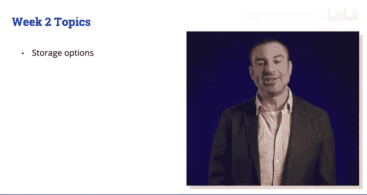
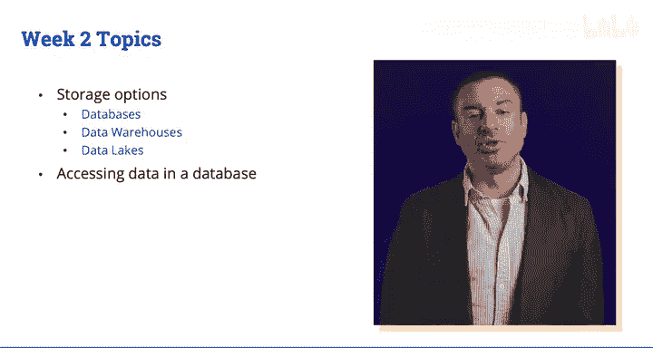
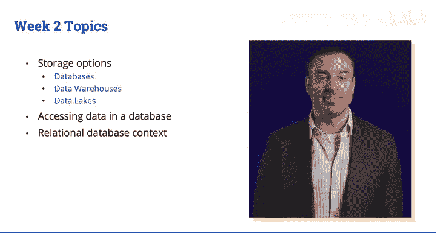
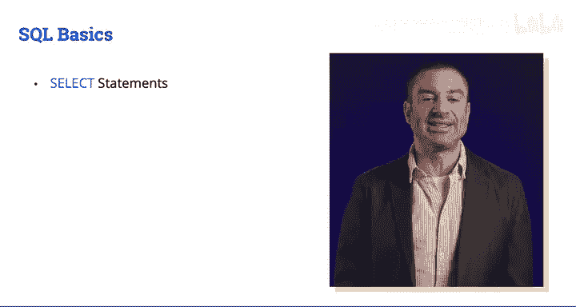
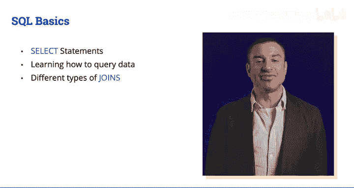

# uPenn《如何运用数据1（Python数据分析、SQL、EDA）｜How to Use Data》中英字幕 - P12：11_模块二导论：SQL数据预处理.zh_en - GPT中英字幕课程资源 - BV1wKxJz3EFB

There are multiple ways of storing and accessing data with a variety of deployment strategies and storage options。

 including databases， data warehouses， and data lakes。😡。

In this module， we'll look at accessing data in a database。

 we'll provide some context around relational databases and then do a deep dive into SQL。

 which is a query language used for accessing and updating databases。😡。

You'll learn the basics of SQL， starting with select statements and learn how to query data in a database。

 You'll also learn about the different types of joins and advantages of each。

 how to manipulate data with single row or scalar functions and group or aggregate functions。

 how to create a database and tables， and then how to insert， update and delete data。😡。

To maximize hands on experience with the material， this module contains multiple short SQL exercises。

 ensuring that you gain practical proficiency。