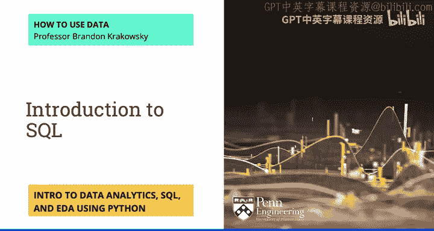
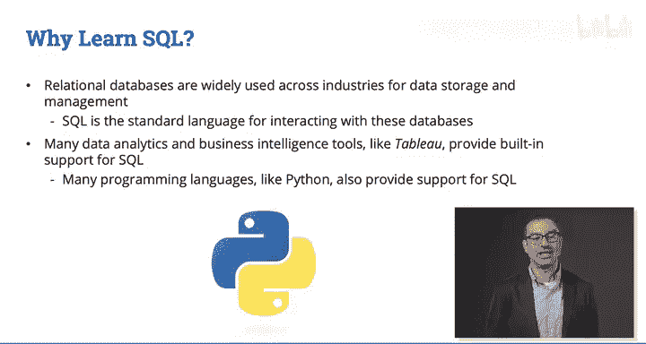
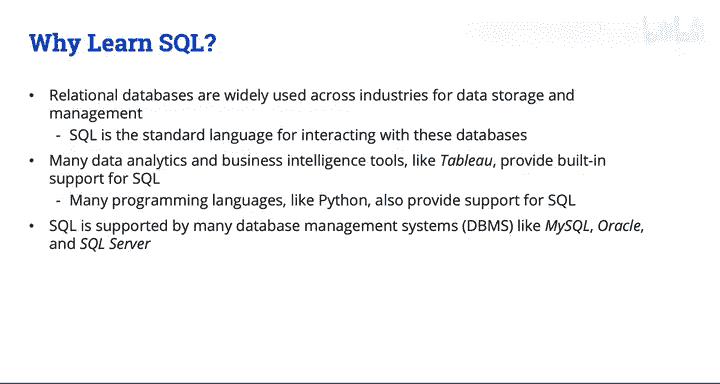
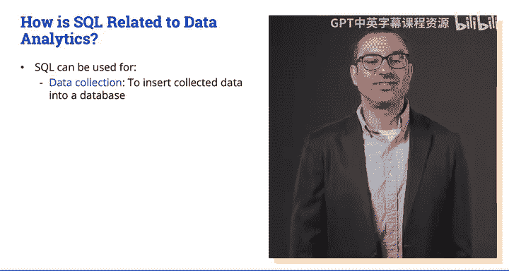

# uPenn《如何运用数据1（Python数据分析、SQL、EDA）｜How to Use Data》中英字幕 - P13：12_SQL入门.zh_en - GPT中英字幕课程资源 - BV1wKxJz3EFB

SQL stands for structured query language。 Some people pronounce it as SQL。

 Others insist that SQL is the only correct pronunciation。SQL is a language for managing， accessing。

 and updating relational databases。So why learn SQL？

Relational databases are widely used across industries for data storage and management。

 and SQL is the standard language for interacting with these databases。

Many data analytics and business intelligence tools like Tableau provide built in support for SQL。

 Many programming languages like Python also provide support for SQL。

SQL is supported by many database management systems like MySQL， Oracle， and SQL Server。

SQL is a highly sought after skill in the job market。

 Many organizations require professionals who can work with relational databases。

How is SQL related to data analytics？SQL can be used for data collection to insert collected data into a database。

 It can also be used for data preparation to clean and transform data or to filter。

 aggregate and join data from multiple tables。

It can also be used to help with data exploration by writing queries to retrieve specific data subsets or use aggregate functions to generate summary statistics。

😡，SQL also allows for efficiently working with big data sets。

