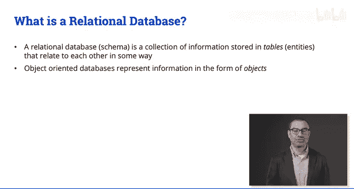
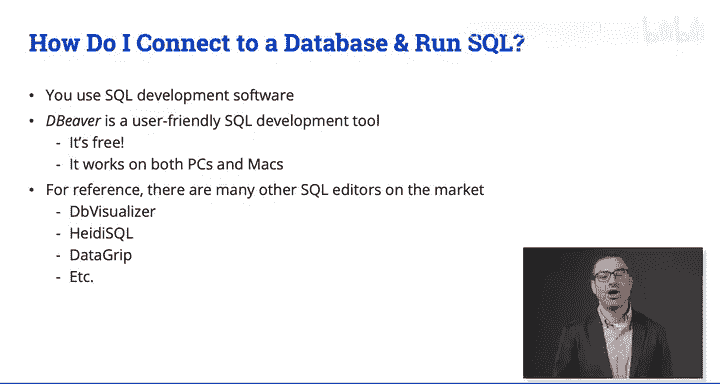
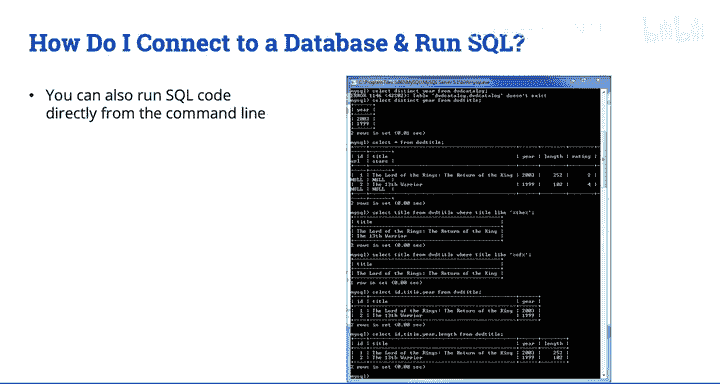

# uPenn《如何运用数据1（Python数据分析、SQL、EDA）｜How to Use Data》中英字幕 - P14：13_关系型数据库概述.zh_en - GPT中英字幕课程资源 - BV1wKxJz3EFB

A relational database or schema is a collection of information stored in tables or entities that relate to each other in some way。

 For reference， object oriented databases represent information in the form of objects。

 This module will focus on accessing a relational database using SQL。

Each table stores a particular type of thing， such as customers。

 A table consists of rows and columns。 A column or attribute is a set of data values of a particular type。

Each column defines a property of the entity， such as address。A row is a single record in a table。

 It contains a single instance of the entity， such as one individual customer。

 and a value is a single column attribute for a single row。

A relational database is sort of like Excel。 a database table can be compared to an Excel worksheet。

A database table， column， or attribute can be compared to an Excel worksheet column。

A database table row can be compared to an Excel worksheet row。😡。

And a database table value can be compared to an Excel worksheet value。😡，How do I open a database。

 You don't。 A database runs inside of a database management system or DBMS。

 You connect to a database。 My SQL and SQL light are commonly used open source DBMss。 They're free。

 and they run on a local computer or in the cloud。Orracle and SQL Ser are other commonly used commercial database systems。

 These are not free。 We'll connect to a SQL light database。To connect to a database and run SQL。

 you use SQL development software。 D Beaaver is a user friendly SQL development tool。 It's free。

 It works on both PCs and Macs。For reference， there are many other sequel editors on the market。

You can also run SQL code directly from the command line， but why？

