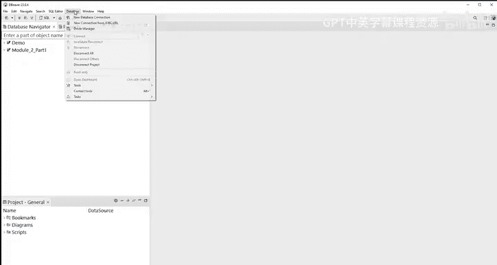
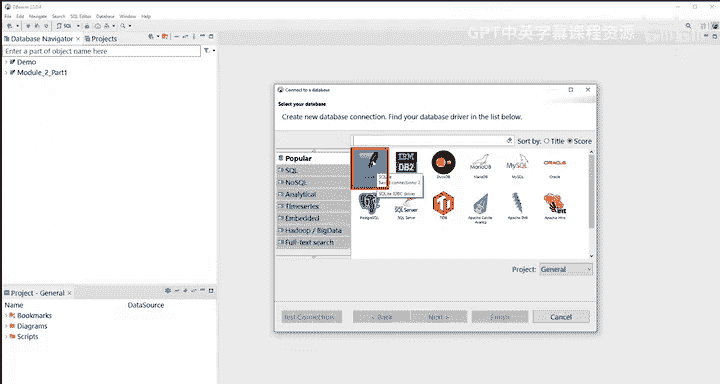
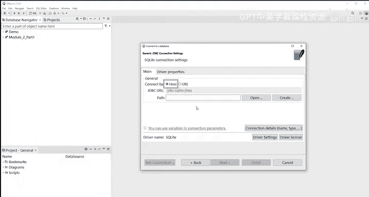
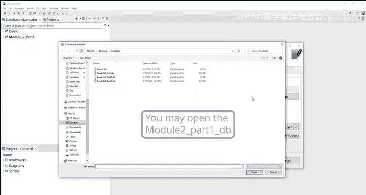
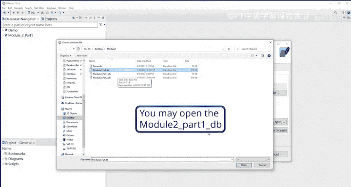
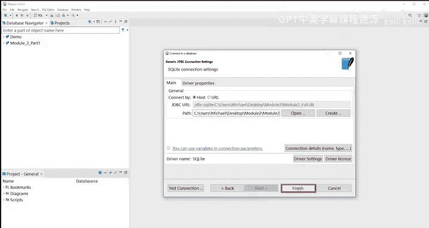
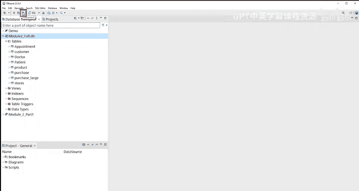

# uPenn《如何运用数据1（Python数据分析、SQL、EDA）｜How to Use Data》中英字幕 - P15：14_编程演示：在DBeaver中连接SQLite数据库.zh_en - GPT中英字幕课程资源 - BV1wKxJz3EFB

To connect to a SQLL database file， go to database new database connection， then under popular。

 select SQLL。

Then， next。You're going to want to connect by host。

Then click open， select the location of the database file。

Click， finish。

And your new database file will show up in the database Navigator。

You can click tables to display the tables in the database。

