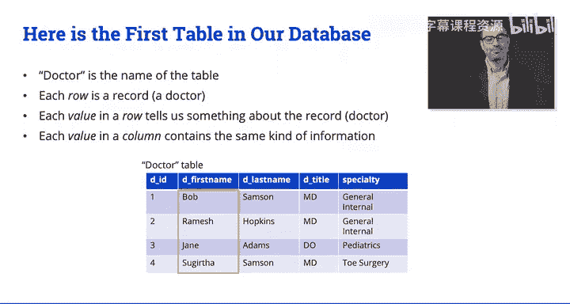
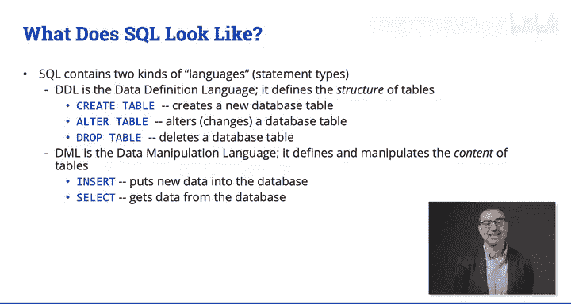

# uPenn《如何运用数据1（Python数据分析、SQL、EDA）｜How to Use Data》中英字幕 - P16：15_数据查询与筛选导论.zh_en - GPT中英字幕课程资源 - BV1wKxJz3EFB

Doctor is the name of the table。Each row is a record， a single doctor。

Each value in a row tells us something about the record， a doctor。

Each value in a column contains the same kind of information， for example， a doctor's first name。

In addition to the doctor table， which stores information about individual doctors。

 we have a patient table， which stores information about individual patients and an appointment table which stores information about individual appointments with a doctor and a patient。

😡，SQL contains two kinds of languages or statement types。 DDL is the data definition language。

 it defines the structure of tables。 for example， create table creates a new database table。😡。

Alter table alters or changes a database table， and D table deletes a database table。😡，DML。

 on the other hand， is the data manipulation language。

 it defines and manipulates the content of tables。Insert puts new data into the database。😡。

Select gets data from the database。😡。

Update， updates or changes data in the database， and delete removes data from the database。😡。

Let's start simple with DL statements。😡。