# uPenn《如何运用数据1（Python数据分析、SQL、EDA）｜How to Use Data》中英字幕 - P17：16_编程演示：基础SELECT语句.zh_en - GPT中英字幕课程资源 - BV1wKxJz3EFB

Let's take a look at the first name and last name of every doctor in the database。

 we'll select the doctor first name and the doctor last name from the doctor table。

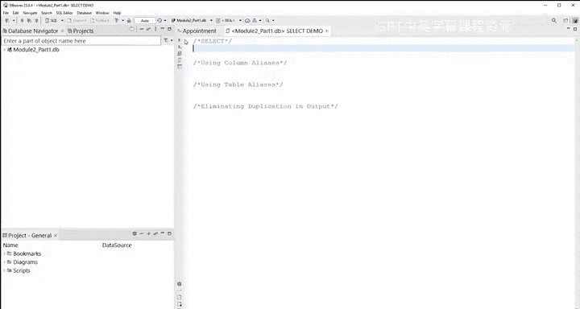

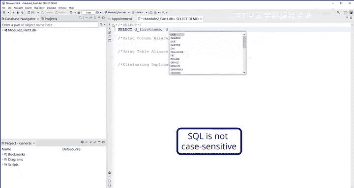

If we run that， this gives us the first name and last name of every doctor in the doctor table。

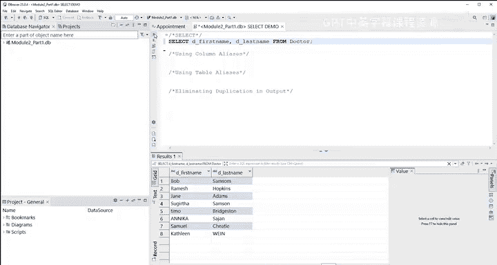

Now let's pull up the ID， last name， first name， and birth date of every patient。

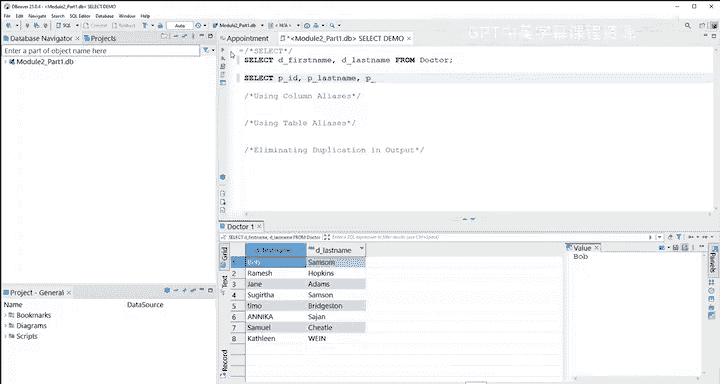

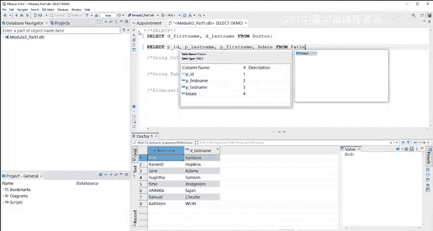

This gives us the ID， last name， first name， and birth date of every patient in the patient table。

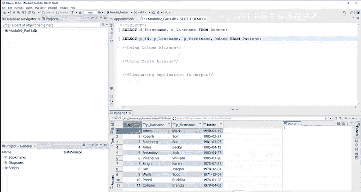

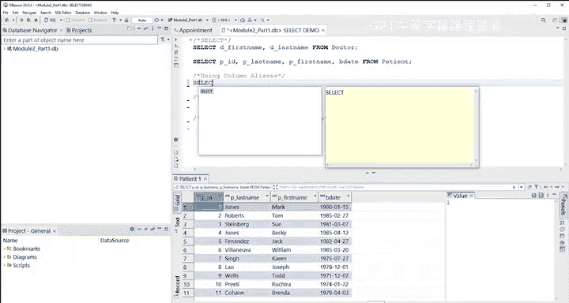

Let's take a look at the first name and last name of every doctor in the database。

 giving each column a different name or an alias。

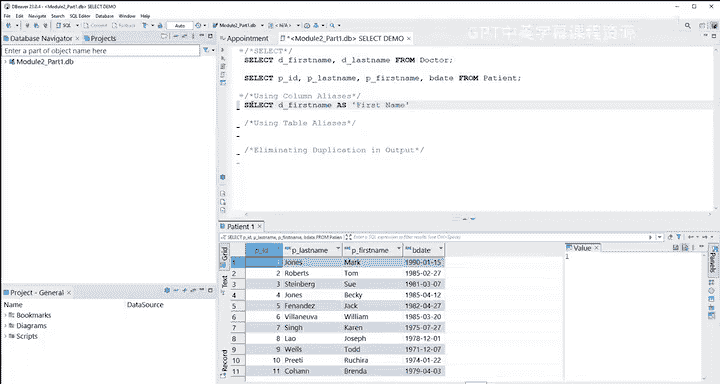

Using the AS keyword， give each selected column a different name or an alias。

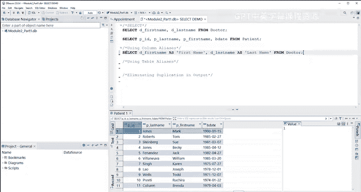

When we run this， we see the first name and last name of every doctor。

 but it changes the column headers to first name and last name respectively。

Let's do the same thing for every patient， giving the columns different names。

 The as keyword is optional。 So here we directly assign each selected column with a different name。

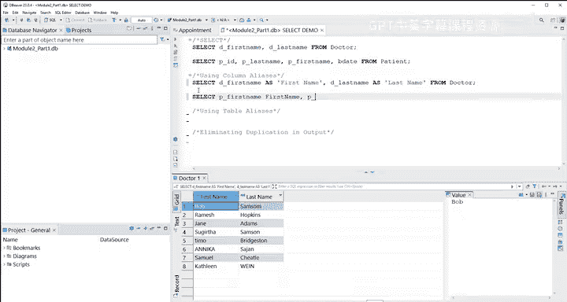

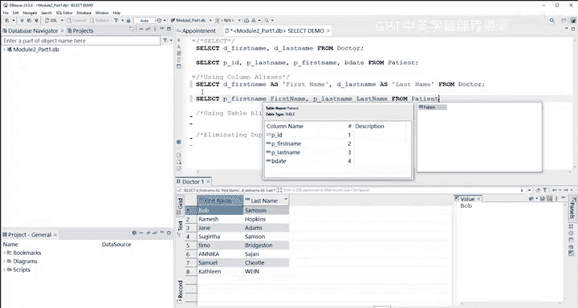

This gives us the first name and last name of every patient。 But again。

 the column headers have been renamed respectively。

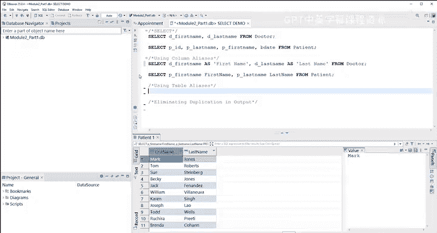

We can also give tables， alternate names or aliases。

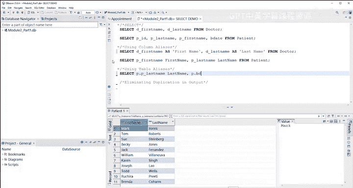

Let's query the patient table， giving it an alternate name or alias。

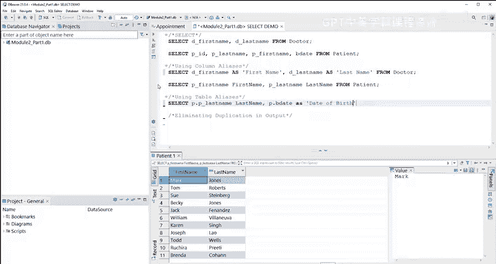

Use the as keyword to assign the patient table an alias of P。 Note。

 we can use that alias P elsewhere in our query when we specify specific columns to select。

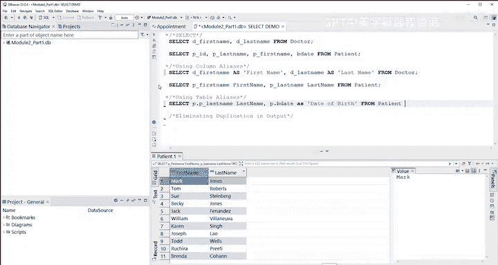

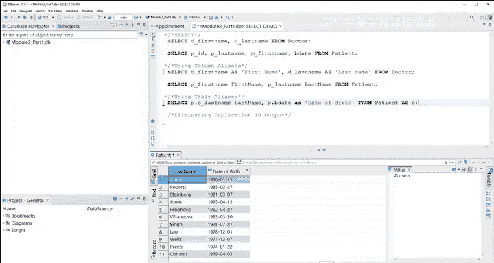

Let's query for the first name and last name of every doctor， giving the doctor table an alias of D。

 Again， we can use the alias D elsewhere in the query when we specify specific columns to select。

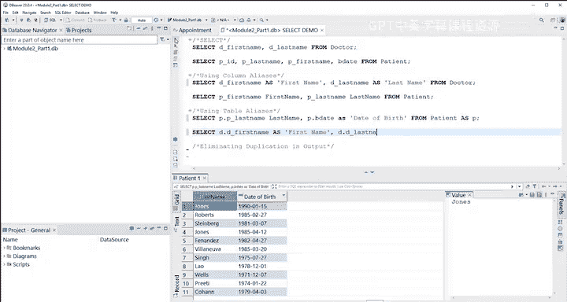

The as keyword is optional， so we can directly assign the doctor table in alias of D。

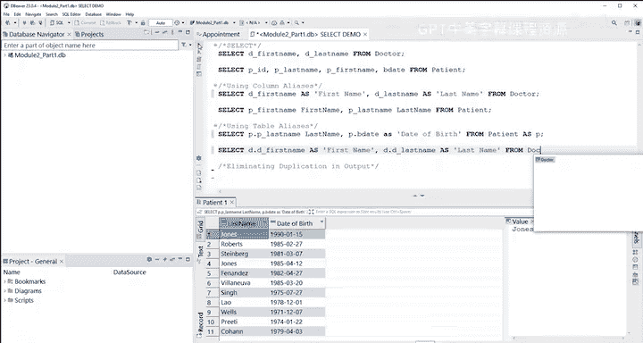

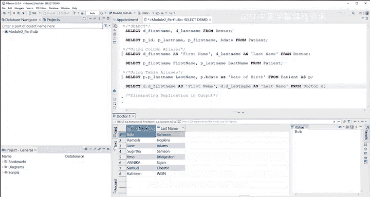

The distinct keyword returns only distinct or different values for a column。

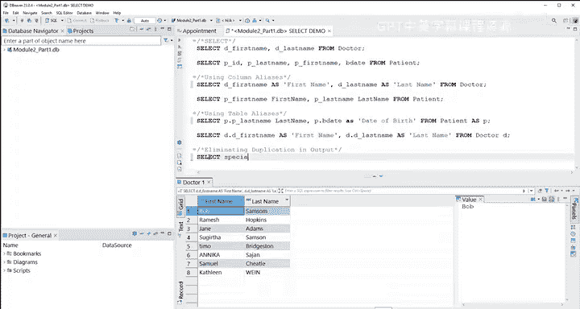

First， let's select all doctor specialties from the doctor table。

 but what are the different specialties a doctor can have。

 we'll use the distinct keyword to show the unique specialties for all doctors。

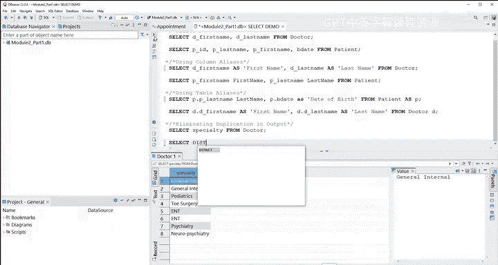

This shows the unique values in the specialty column。

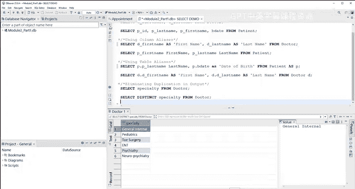

Let's pull a list of the unique last names of all patients。 Again， using the distinct key word。

 This shows the unique last names of patients in the database。

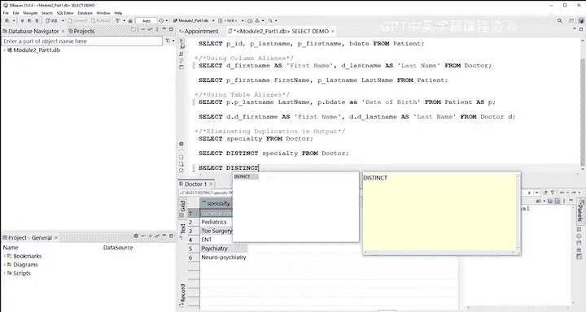

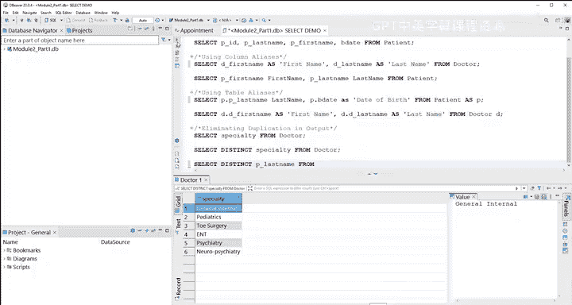