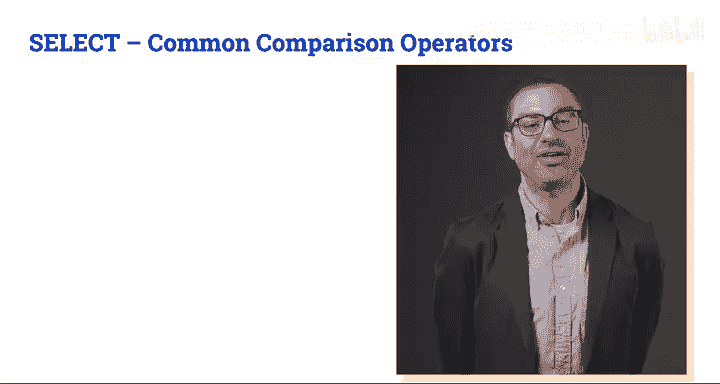
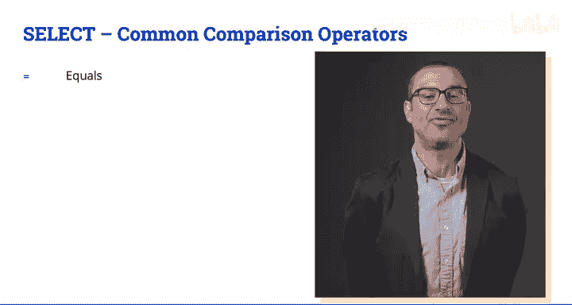
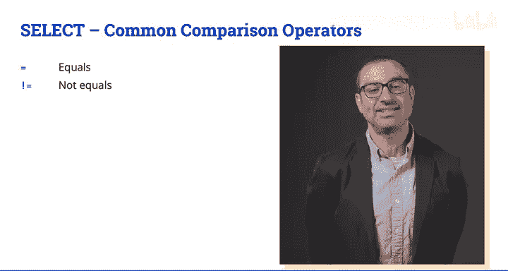
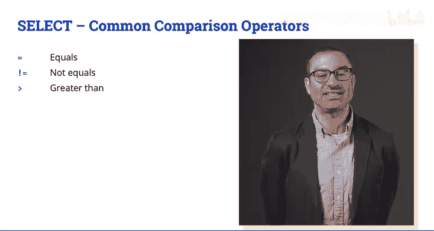
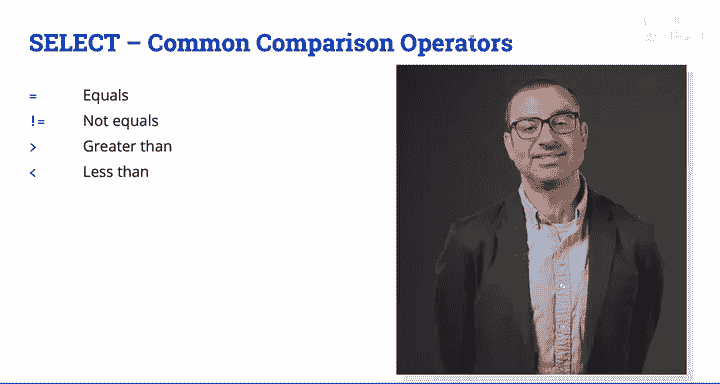
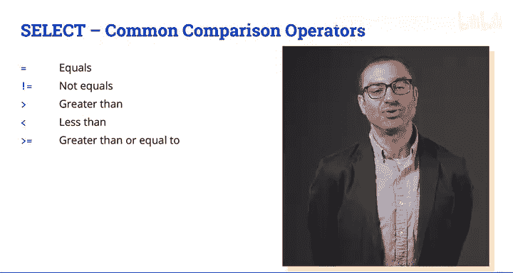
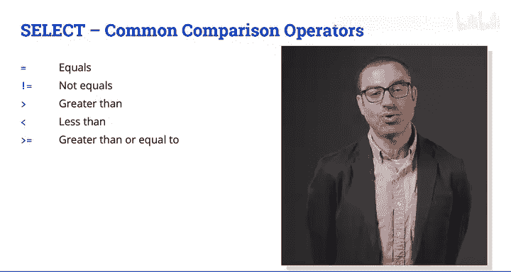

# uPenn《如何运用数据1（Python数据分析、SQL、EDA）｜How to Use Data》中英字幕 - P18：17_常用比较运算符.zh_en - GPT中英字幕课程资源 - BV1wKxJz3EFB

Comparison operators compare values and determine their relationship。

Use the equal sign to test if two values are equal to each other and use the exclamation equal sign to test if two values are not equal。

Use the greater than sign to test if one value is greater than another。

And use the less than sign to test if one value is less than another。

The greater than equal sign tests if one value is greater than or equal to another， and likewise。

 the less than equal sign tests if one value is less than or equal to another。

