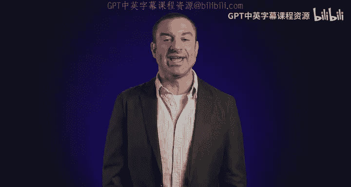
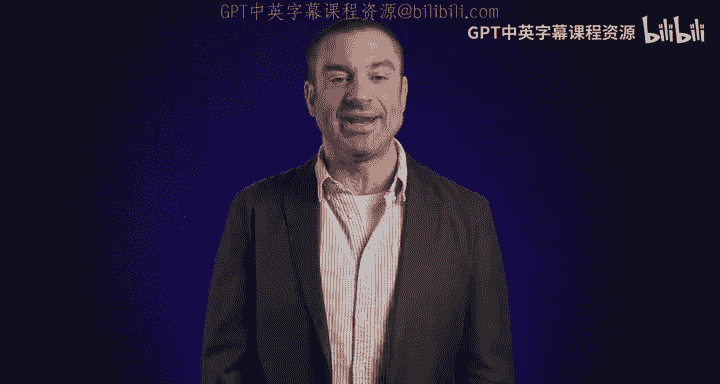
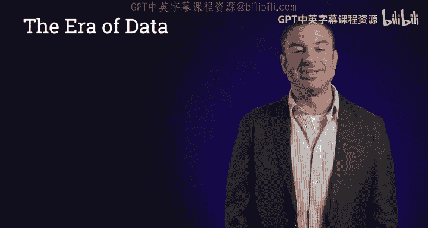

# uPenn《如何运用数据1（Python数据分析、SQL、EDA）｜How to Use Data》中英字幕 - P1：0_如何运用数据专项课程简介.zh_en - GPT中英字幕课程资源 - BV1wKxJz3EFB

诶。🎼嗯。🎼In the digital era， data is everywhere， shaping the decisions we make daily。

 It's transforming industries， driving innovation and creating new opportunities。

 Welcome to our Coursera specialization， how to use data。

 a pivotal gateway designed for anyone eager to harness the potential of data regardless of prior experience。

 The journey into data begins here。 where you unlock the fundamentals of data analysis。

 data science and data analytics。 This specialization is your comprehensive guide through the evolving landscape of data。

 offering practical skills and insights that remain relevant as technology progresses。

🎼We live in an era where data touches every corner of our existence from the way business is strategize to the smallest personal convenience。

 Data is the unseen force shaping our world， Yet despite its prevalence。

 The ability to navigate this vast sea of information is still not widespread。

 This specialization bridges that gap， offering you the tools to make data not just understandable but actionable。

 It's about turning information into insight and insight into impact。

Data analysis， predictive analytics and data visualization are not just contemporary buzzwords。

 but pillars of a modern skill set that will remain relevant far into the future as technology evolves。

 so too will the ways we interact with data， however。

 the core principles you'll learn here are immutable， providing a foundation that will support you。

 no matter how the digital landscape changes。Our specialization unfolds across three meticulously structured courses。

 each designed to build upon the previous， ensuring a comprehensive and cohesive learning experience。

 The first course lays the foundational stone of your data analytics journey and is structured into three pivotal modules Moule1 opens the gateway to the world of data。

 offering insights into data analysis， data science and data analytics。

 It covers the entire data analytics process introduces the programming languages and tools pivotal for this course and engages you with case studies that brings theoretical concepts into real worldorld context。

Module 2 dives into data wrangling with an emphasis on SQL you'll explore data storage and access。

 learn the fundamentals of SQL through the lens of relational databases and master data manipulation techniques This module is critical for those looking to understand SQL and how data is prepared for analysis。

Module 3 shifts the focus to exploratory data analysis using Python， where you'll learn to inspect。

 query and summarize data alongside visualizing information to unearth insights This module is geared towards equipping you with hands-on skills and data analysis libraries like pandas and visualization tools like Mattplloot Lib and Seabornour。

The second course takes your skills further into the predictive domain。

 divided into three enriching modules。Module1 introduces you to predictive analytics covering essential models such as linear and logistic regression This is where you start to learn how to forecast future trends from historical data。

Module2 expands your knowledge into decision trees and random forests。

 offering a deeper dive into more complex supervised learning models that enhance your predictive analytics capabilities Moule 3 explores unsupervised learning and clustering。

 guiding you through the nuances of model comparison and the art of identifying patterns without predefined labels。

The third course is where your data journey culminates。

 transforming analysis into action through three focus modules。

Module1 immerses you a data visualization using Tableau。

 where you'll grasp the concepts of principles behind creating impactful visual data stories。

 focusing on one dimensional and time series visualizations。

Module 2 introduces multidimensional visualizations and complex relationships。

 expanding your ability to analyze and visualize multitable data analysis。

 enhancing the depth and clarity of your data interpretations。

🎼Module 3 is dedicated to the presentation of insights and data storytelling here you'll learn how to synthesize your analysis into coherent and persuasive narratives。

 a crucial skill for communicating data insights effectively to stakeholders each course is interconnected。

 building upon the last to create a comprehensive understanding of data analytics。😡。

Completing all three courses in sequence is essential to earn the specialization certificate。

 a credential that signifies your commitment and expertise to potential employers。

 this specialization demands dedication with graded assignments。

 regular quizzes and practical exercises along the way allowing you to critically and creatively apply what you've learned to real worldorl scenarios。

It's more than just a specialization it's an investment in your future equipping you with evergreen skills that remain relevant as technology advances In summary。

 how to use data as a gateway to becoming a part of the next generation of data professionals by understanding data analytics。

 you're not just keeping pace with the digital age， you're helping to shape it。

🎼Join us on this exciting journey to unlock the full potential of data and transform your career。

 Welcome to the world of data analytics。 Let's start this transformative journey together。

