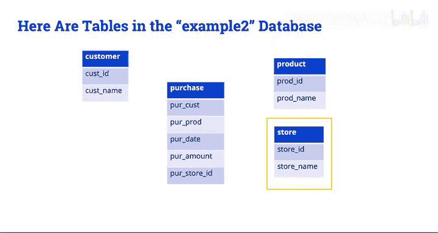

# uPenn《如何运用数据1（Python数据分析、SQL、EDA）｜How to Use Data》中英字幕 - P20：19_example2数据库表结构视频（作业参考）.zh_en - GPT中英字幕课程资源 - BV1wKxJz3EFB

Here are tables in the example2 database。 The customer table stores information about individual customers。

The purchase table stores information about individual purchases made by customers。

The product table stores information about the individual products being purchased。

And the store table stores information about individual stores where purchases take place。

