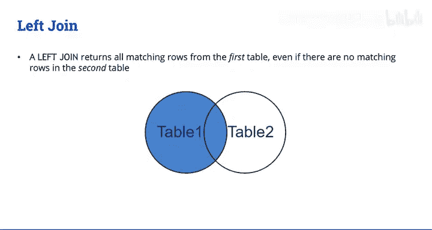

# uPenn《如何运用数据1（Python数据分析、SQL、EDA）｜How to Use Data》中英字幕 - P21：20_数据连接.zh_en - GPT中英字幕课程资源 - BV1wKxJz3EFB

A join lets you collect information from two or more tables and present it as a single table。

A join needs a way to uniquely identify each row in a table。

 A primary key is a column or a group of columns whose values uniquely identify each row。

 We'll look at three basic types of joins。 In join， left join and right join。

The primary key for the doctor table is D underscore ID。

 since it can be used to uniquely identify each row or doctor in the table。

We could also use the combination of D underscore first name and D underscore last name as the primary key for the doctor table。

 since no two doctors have the same first name and last name。

The primary key for the patient table is P underscore ID。

 since it can be used to uniquely identify each row or patient in the table。

We could also use the combination of P underscore first name and P underscore last name as the primary key for the patient table。

 since no two patients have the same first name and last name。

Each appointment has a reference to a doctor， D underscore I D and a patient P underscore I D。

 These are foreign key values because they point to the primary key values of other tables。

An inner join returns all rows from both tables where there is a match。

A left join returns all matching rows from the first table。

 even if there are no matching rows in the second table。😡。

No values will be displayed for the second table if there's no match。

