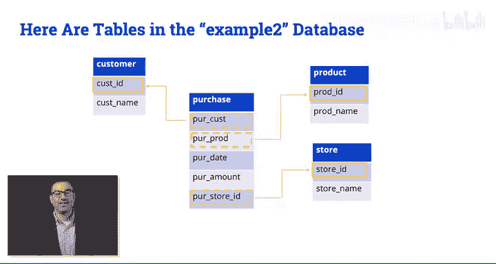

# uPenn《如何运用数据1（Python数据分析、SQL、EDA）｜How to Use Data》中英字幕 - P22：21_example2数据库主键与外键.zh_en - GPT中英字幕课程资源 - BV1wKxJz3EFB

Again， here are the tables in the example2 database。

 You can see the Cust underscore I is the primary key in the customer table。

 since it can be used to uniquely identify each row or customer in the table。 Likewise。

 the pro underscore Id is the primary key in the product table。

 and the store underscore Id is the primary key in the store table。😡。

Each purchase has a reference to a customer custom underscore I D and a product prod underscore I D and a store store underscore I D。

 These are all foreign key values because they point to the primary key values of other tables。

