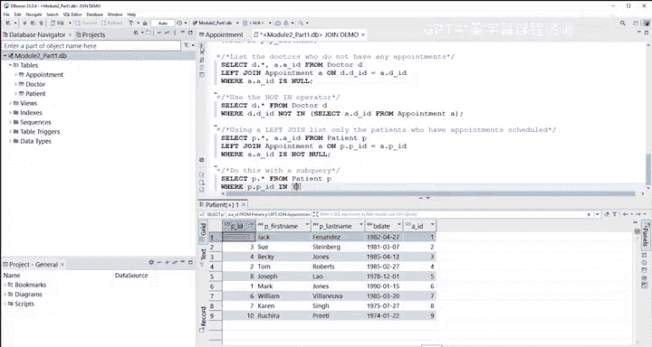

# uPenn《如何运用数据1（Python数据分析、SQL、EDA）｜How to Use Data》中英字幕 - P23：22_编程演示：内连接与左连接.zh_en - GPT中英字幕课程资源 - BV1wKxJz3EFB

Let's demonstrate in join， list each doctor with an appointment。

 along with the appointment date and time。😡，To do this。

 we're going to select information from the doctor table and join it with information from the appointment table。

 where the DD in the doctor table is equal to the DID in the appointment table。

 Since this is an implied inter joinin， we're only going to see doctors with matching appointments。😡。

List each doctor with an appointment along with the appointment date and time and patient name。

So first we're going to select information from the doctor table and join it with information from the appointment table。

😡，We'll do this where the DID in the doctor table is equal to the DID in the appointment table。😡。

And then we'll join that information with additional information from the patient table。

And we'll do that where the PID in the appointment table is equal to the PID in the patient table。😡。

And for this， we're only going to see doctors with matching appointments where the appointments also have matching patients。

Show the date and time and patient name for all appointments scheduled with Dr Hopkins。And for this。

 we're going to select information from the doctor table and join it with information in the appointment table based on matching DID values。

 then we'll join that information with additional information from the patient table based on matching PID values。

😡，Then we want to filter our data based on appointments with Dr。 Hopkins。

 so we're going to add a wear clause followed by the condition where the doctor's last name from the doctor's table is equal to Hopkins。

😡，This shows the corresponding appointment and patient information for appointments with Dr。 Hopkins。

Show all the information for appointments at 12 pm for patients with the last name starting with S。

We're going to select all the information from the doctor table and join it with information from the appointment table based on the DID column and then join that information with additional information from the patient table based on the PID column。

 and then we're going to filter our data by adding a where clause followed by the condition where the appointment date from the appointment table is equal to 2016 February 15。

 12 o'clock。We'll also have another condition where the patient's last name from the patient table is like S percent。

This will look for last names that start with S and are followed by any number of other characters。

This shows all of the information for the one appointment at 12 PM for the patient with the last name Sing。

Let's demonstrate left join， list all doctors， along with any appointments。

Select information from the doctor table。Left joined with information from the appointment table。

Again， this will be based on matching DID columns。And just for fun。

 let's order the results set by the doctor's last name from the doctor table。

Because this is a left join， we see all of the doctors listed along with their matching appointment dates for any doctor who doesn't have a matching appointment。

 we see a null value in the appointment date column。😡，List all patients along with any appointments。

We'll select information from the patient table left joined with information from the appointment table。

And this will be based on matching PID values。😡，And just for fun。

 let's order the results set by the patient's last name from the patient table。Again。

 because this is a left join， we see information for all of the patients on the left。

 along with their matching appointment information on the right for any patient who doesn't have an appointment。

 we see a null value in the appointment date column。😡。

List the doctors who do not have any appointments。For this query。

 we're going to select information from the doctor table and left join with information from the appointment table。

😡，And we're going to specifically be looking for those doctors who do not have a matching appointment。

Here's another way of doing it using the not in operator。 Select from the doctor table。

And query for those doctors who do not have a doctor ID and the result of a subquery。

That subquery in parentheses selects all of the doctor IDs from the appointment table。

So here we see the doctors who do not have a matching doctor ID in the appointment table。😡。

Using a left join list only the patients who have appointments scheduled。

So we'll select information from the patient table left joined with information from the appointment table。

Based on matching PID values。And we're going to filter out records where the appointment ID is null in the second table。

 meaning only show me the patients with a matching appointment in the second table。😡。

Here's another way to do it using a subquery。Select the patients from the patient table。

And then specifically look for those patient IDs that are in the result of a subquery that subquery and parentheses selects all of the patient IDs from the appointment table。

😡。

So overall， this query looks for patients with a matching patient ID in the appointment table。😡。

