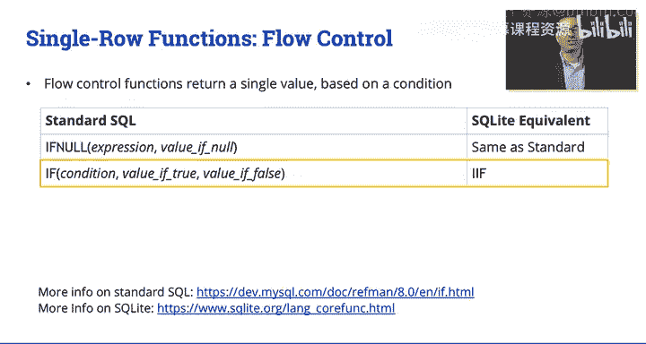
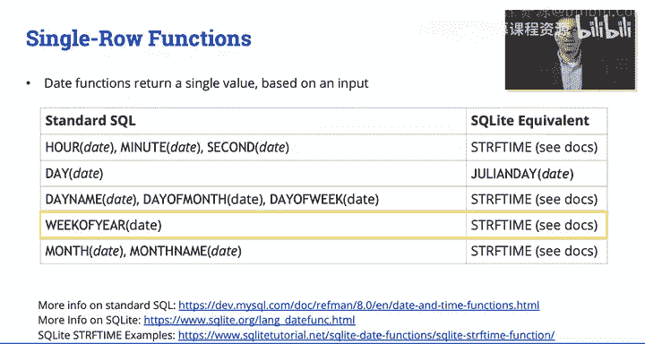
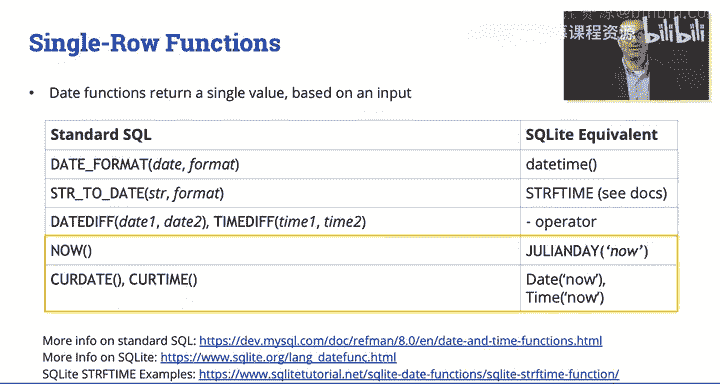

# uPenn《如何运用数据1（Python数据分析、SQL、EDA）｜How to Use Data》中英字幕 - P24：23_单行函数.zh_en - GPT中英字幕课程资源 - BV1wKxJz3EFB

Here are some common string functions that return a single string value based on an input。

The concat function concatenates a given list of strings。

The upper and lower functions take a single string argument and return it with all uppercase characters or with all lowercase characters。

The left， right， and mid functions return a substring from a string。The L trim。

 R trim and trim functions remove all white space characters from the beginning or the end or both of a string。

 The replace function replaces all occurrences of a specified string。

 and the length and locate functions return the length of a string or the index of a givend substring。

Here are some common flow control functions that return a single value based on a condition。

The if null function returns a specified value。 If the given expression is null， otherwise。

 returns the expression。And the if function returns a value if a condition is true or another value。

 if a condition is false。

Here are some common date functions that return a single value based on an input。😡，The hour。

 minute and second functions will return the hour， minute or second from a given date。The day。

 day name， day of month and day of week functions will return the day， name of the day。

 day of the month or day of the week from a given date。

The week of year function will return the week from a given date。

The month and month name functions will return the month or name of the month for a given date。

The date format function will change the format of a given date。

The string to date function will convert a string to a date in a particular format。😡。

The date diff and time di functions will return the difference between two dates or the difference between two times。

 and the now core date and core time functions will return the current date and or time。

