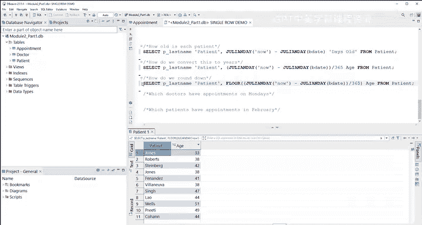

# uPenn《如何运用数据1（Python数据分析、SQL、EDA）｜How to Use Data》中英字幕 - P25：24_编程演示：单行函数应用.zh_en - GPT中英字幕课程资源 - BV1wKxJz3EFB

Show the full name and title of each doctor， along with their specialty。

 So the idea is that we want to take multiple column values for a single record and concatenate them together into a single value。

 SQL light doesn't support the concate function， but it does support a similar concatenation operator。

So here we select the doctor's first name， last name and title。

 and concatenate them together using the concatenation operator。

 and we give that an alias of doctor name， and we select the specialty value and give that an alias of specialty。

 all of this from the doctor table。This shows all of the doctors with their first name。

 last name and title concatenated into a single value and their specialty。

You could see there's a few small problems with this。 For example。

 the displayed concatenated name for the doctor in row 7 is completely no。

 and that's because the doctor's title has a null value， but we can fix that issue。

We'll start by writing the query the same way。 We'll select the doctor's first name。Concatenate that。

With the doctor's last name。And then concatenate that with the doctor's title。 But first。

 we're going to check to see if the doctor's title is null。If it's null。

 we're going to substitute an empty string。We'll call that entire concatenated value， doctor name。

We're also going to select the specialty， we'll call that specialty。All from the doctor table。

And if we run that， you could see that the displayed concatenated doctor name for the doctor in row 7 is Samuel Cheto。

 but there's no title because that's the empty string。 Well， we can fix that issue as well。Again。

 we'll start by writing the query the same exact way， select the doctor's first name。

 concatenate that with the doctor's last name。And then we're going to use SQL Lights I if function to check if the doctor's title is null。

Or if the doctor's title is an empty string。If it is。

Let's go ahead and just concatenate an empty string。Otherwise， let's concatenate with a comma。

 concatenated with the title itself。We'll call this entire value， doctor name。

And then we still want to select the specialty。We'll call that specialty。

And all of this from the doctor table。And if we run that。

 we'll see the displayed concatenated name for each doctor， and if a doctor has a title。

 we'll see the name followed by a comma and that title。Finally。

 I'd like to fix the case issue with the doctor's names。

 I'd like each first name and last name to begin with a capital letter。So inside my query。

 I'm going to get the first character of the doctor's first name using SQL light substring function。

 and then I'm going to convert that to uppercase using the upper function。

 and then I'm going to concatenate that with the rest of the characters in the doctor's first name converted to lowercase using the lower function。

And then I'll concatenate to the first character of the doctor's last name converted to uppercase。

 again， using the upper function。And then I'll concatenate to the rest of the characters in the doctor's last name converted to lowercase。

 again， using the lower function。And then I'll add my code to check if the doctor's title is null。

 or it's an empty string。If it is， use an empty string。Otherwise， use a comma。

 followed by the title itself。Will give this entire concatenated value an alias of doctor name。

And then of course， we're going to select the specialty。Give that an alias of specialty。

And all of this from the doctor table。And if we run that。

 we could see that all of the doctor's names have capitalized first names and capitalized last names。

How old is each patient？Let's select the patient's last name。We'll call that patient。

And then let's get the difference between today's date。And the patient's birth date。Note。

 we're using SQL Light's Julian Day function。 This gives us the number of days for a given date。

If we run that， we could see the number of days old for each patient。

But how do we convert this to years？Let's run the same exact query。

 But let's take the number of days old for each patient and divide by 365。We'll call that value age。

This gives us the age of each patient as a decimal。

 but we really want to express each patient's age as a year。So let's run that same exact query。

But let's round down the decimal version of each patient's birth date to an integer。

Now you can see the age of each patient as a single year。

Which doctors have appointments on Mondays？So let's select information from the doctor table。

And join that with information from the appointment table。We'll do this based on matching DID values。

And then we're going to filter our query using a wear clauses。

 and the condition will use SQL Lights string F time function to extract the day of the week from the given appointment date。

And we're going to compare that to the string1， meaning Monday。

This shows us the doctor's last name and appointment date for those appointments on Mondays。

Which patients have appointments in February。Again， let's select information from the doctor table。

And we'll join that with information from the appointment table based on matching DID values。

We'll filter our query。The condition will use SQL Light string F time function。To extract the month。

For the given appointment date。And we're going to compare that to the string02， meaning February。

And this shows appointment information for those appointments in February。

