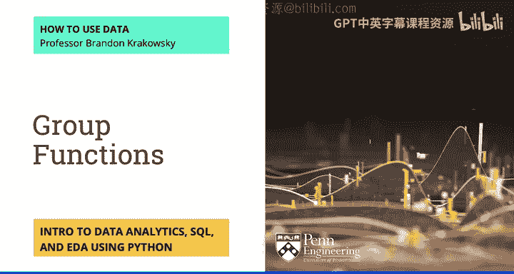
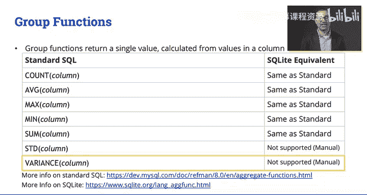

# uPenn《如何运用数据1（Python数据分析、SQL、EDA）｜How to Use Data》中英字幕 - P26：25_聚合函数.zh_en - GPT中英字幕课程资源 - BV1wKxJz3EFB

Here are some group functions that return a single value calculated from values in a column。

The count function will count the number of values in a given column。

The average function will calculate the average of values in a given column。

The max function will calculate the max from the values in a given column。

The min function will calculate the min from the values in a given column。

 The sum function will calculate the sum of values in a given column。

The standard deviation function will calculate the standard deviation of values in a given column。

And the variance function will calculate the variance of values in a given column。

