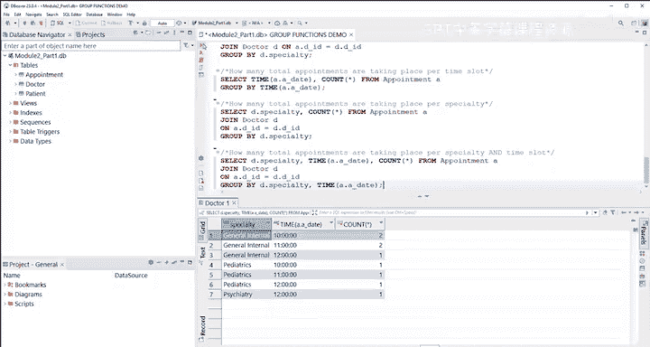

# uPenn《如何运用数据1（Python数据分析、SQL、EDA）｜How to Use Data》中英字幕 - P27：26_编程演示：聚合函数应用.zh_en - GPT中英字幕课程资源 - BV1wKxJz3EFB

How many doctors are there？We're going to use the count function and pass as an argument star。

 This will count all the rows in the doctor table。Group functions like count return a single aggregated value。

 calculated across rows。How many doctor titles are there Here we're going to use the count function。

 but pass as an argument， a single column D title。 This counts the values in that one column。

 How many different doctor specialties are there Here we're going to use count。

But provide the distinct keyword and a column name。

 so I want to count the distinct values in the specialty column。

How many appointments are in general internal medicine？So here I'm going to select。

 and I'm going to count all the rows in the appointment table。Joined。

With information from the doctor table。I'll join on the DID columns。

And then I'll filter my query and look for the doctors with a specialty of general internal。

This counts the appointments with doctors who have a specialty of general internal。

How many patients do not have an appointment scheduled？

We're going to count the patient IDs from the patient table。

 and then we're going to left join with the appointment table。🤢，Based on the patient ID columns。

And then we're going to filter our query to look for the patient IDs that are null。

 meaning the patients in the left table who do not have a matching appointment in the right table。

We're going to calculate the total number of appointments per doctor。

 so we'll start by selecting a column to group or collapse。

 and then we'll apply an aggregate function to another column or a set of columns。😡。

We'll give the aggregated value and alias of nu of appointments。

We're going to join with information from the appointment table based on matching DID columns。

And then we're going to group the joined rows by that first column we selected。

 which is the Doctor ID column。This shows us the total count of rows or number of appointments per doctor or doctor ID。

What time is each doctor's last appointment here again。

 we'll start by selecting a column to collapse or group Doctor ID D。

 and then we'll apply the aggregate max function to get the max time of all the appointment dates。

We'll give that Max time and alias of last appointment。

We'll join with information from the appointment table based on matching DID columns。

And then we're going to group the joined rows by that first column we selected。 Doctor I D。

 This shows the max time or last appointment time per doctor I D， or doctor。

How many doctors are there per specialty， So we'll select the specialty column to group。

 and then we're going to aggregate by counting the rows from the doctor table。

And then we're going to group by that same column we selected。Which is the specialty column。

This shows count of rows per specialty。Can you find the first and last appointment time per specialty。

 so we'll select the specialty column to group or collapse。

 Then we'll get the min time for all the appointment dates。We'll call that first appointment。

We'll also get the max time for all the appointment dates。We'll call that last appointment。

Select from the appointment table。Join with the doctor table， we need information from both tables。

We'll join on the matching DID columns。And then we're going to group by that first column we selected。

 the one to collapse， that's the specialty column， this shows the first and last appointment time for each specialty。

How many total appointments are taking place per time slot？

We'll select the column to group or collapse。 This is going to be the time value extracted from the appointment date。

 then we're going to aggregate by counting the rows for each group。

And then we'll group by the same thing we selected。

 which is the time value extracted from the appointment date。

This shows the number of rows or appointments for each unique time slot。

How many total appointments are taking place per specialty will select specialty。

We'll count the rows。From the appointment table， joined with information from the doctor table。

We'll join on matching D ID column values in both tables。And then we're going to group by specialty。

This shows the number of appointments per each unique specialty。

How many total appointments are taking place per specialty and time slot。

 So we're going to select two columns to group or collapse specialty and time for appointment。

 and then we'll count the rows for each specialty and time slot。

Join the appointment table with information from the doctor table based on matching DID column values in both tables。

And then we're going to group by those same columns we selected， which a specialty。

And time of appointment。This shows the count of rows or number of appointments per unique combination of specialty and time slot。

