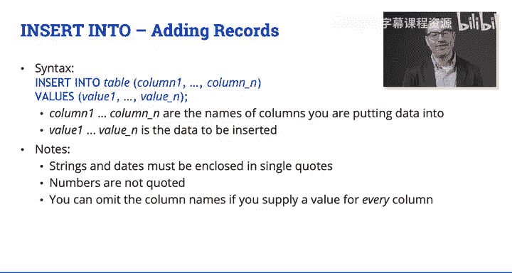

# uPenn《如何运用数据1（Python数据分析、SQL、EDA）｜How to Use Data》中英字幕 - P28：27_数据创建.zh_en - GPT中英字幕课程资源 - BV1wKxJz3EFB

。To create a new table， use the Create table statement。😡。

Give the table a new name and specify a comma separated list of column names and the respective data types inside of parentheses。

The data type for each column is the type of data to be stored in the column。

You can specify an optional column constraint for each column。

 which is a rule to allow or restrict values in the column。

And you can specify an optional table constraint， which is a rule to allow or restrict values in the row。

😡，Here are some common string data types when defining columns in a new table char。

 This is a fixed length character string with a given max size number of characters。😡。

Varchar is a variable length character string with a given max size number of characters。

 and text is a large character string with a given max size number of characters。

Here are some common numeric data types。Bit， which is a very small integer value and int。

 which is standard integer value。A big int， which is a big integer value and a decimal。

 which is a decimal number value with a given max size number of digits。

 including D digits to the right side of the decimal。Here are some common date time data types， date。

 which is a date displayed like this。A date time， which is a date time combination displayed like this。

And a timestamp， which is another date time combination displayed like this。

And here is a common large object or LOB data type， blob。

 which is a binary large object with a given max size in bytes。

To copy records from an existing table into a new table， start by using the insertst In statement。

 specify the new table into which you're inserting the records and a comma separated list of the new table columns you're putting the data into。

😡，Then select the records from the existing table to insert into the new table。😡。

Note you can omit the comma separated list of new table column names if you supply a value for every column and the order is not required and not all the fields are required。

😡，To insert records into a new table， start by using the Insert In statement。😡。

Specify the table into which you're inserting the records and a comma separated list of the new table columns you're putting the data into。

😡，Then use the values command followed by a comma separated list of values to be inserted。Again。

 note that you can omit the comma separated list of table column names if you supply a value for every column and the order is not required。

 and not all the fields are required。

