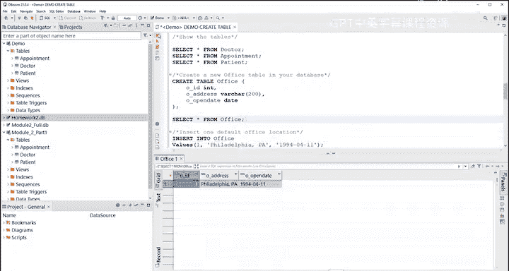

# uPenn《如何运用数据1（Python数据分析、SQL、EDA）｜How to Use Data》中英字幕 - P29：28_编程演示：CREATE TABLE与INSERT INTO.zh_en - GPT中英字幕课程资源 - BV1wKxJz3EFB

First， we'll create a new doctor table in our demo DB create table doctor。

 That's the name of the table。 Def a D ID column of type int default value 0。

A def first name column of type varchar， default value null。The last name column of type vchar。

 default value null。And a D title column of type varchar with a limit of 10 characters to fault value null。

And a specialty column of type var cha with a limit of 50 characters。 and the default value is no。

This will create the doctor table in the database。Let's also create a patient table。

Create Table patient。First column is PID of type int， default value will be 0。

P first name column of T varchar， Max 75 characters， default value null。

P last name column of type varchar， max character 75。

 default value of null and a B date column of type varchar， max characters 20， default value of null。

And that will create a patient table in the database。

In order to copy records from a table in another database in SQL light。

 we need to attach that other database。 Now， we can copy over the doctor records from the other example database。

 insertsert into the doctor table will specify the names of the columns that we're going to put the data into。

And then we'll select the data we want to copy from the same specific columns。

And we'll select that information from the doctor table in the other example database。

 This copies all of the records in one table， to another table。

Let's view the information in our new doctor table。You can see it contains all the same records。

Let's also copy all the patient records from the patient table in the other example database。

 insertsert into the patient table， specify the columns where we're going to put the data。

 select the data to copy， We'll specify the columns where the data is coming from。

And we're selecting that information from the patient table in the other example database。

Let's view the new information in the patient table。You can see this contains all the same records。

Now we're going to create and fill a new table with data from a table in our other example database。

 We'll do this in one query。 createate a new appointment table with information selected。

From the appointment table in the other example database。This creates an exact copy。

Let's view the information in the new appointment table。You can see it contains all the same records。

Using your name， insert a new doctor record into your doctor table。

 we're going to insert into the doctor table。😡，We'll list the columns that we're going to put the data into。

And then we're going to specify the values that we're going to put into those columns。

Dorctor ID D of9， first name Brandon， last name Kraowski。Title M。Specialty。Dermatology。

If we run this， it should have inserted one new record into that table。

Schedule two appointments for the new doctor on February 16， 2026， at 10 AM and 11 AM。

 so we're going to insert into the appointment table。

List the columns that we're going to put the data into。

And then specify the values for the first record and parentheses， appointment ID of 10。

 and then the date， which includes the time 10 AM， and then the doctor ID for that appointment。

 doctor ID 9， and then another record in parentheses， appointment ID 11。

 the date which includes the time 11 AM。That should insert two new records into the appointment table。

 Let's add a new patient to Elliot Graham Note， the birth date is unknown。

Insert into the patient table， list the columns we're going to put the data into。 Note。

 we'll leave out the birthday column。 specify the values for those columns。Patient I of 12。

 first name Elliot， last name Graham， and here we'll leave out the birth date as well。

 so the inserted values match the specified columns。Now。

 let's show the new information of the tables。Select the records from Doctor。

 I can see the new record at the bottom for Brandon Kraowski。

Select the records from appointmentpoint。I could see the two new records at the bottom note the missing P I D values because we never specified them。

And then select all the records from the patient table。

 and we can see the new patient record at the bottom。 and for the patient。

 the birth date is missing because we never specified it。Create a new office table in your database。

 We're going to create a new table called Office， specify the columns。 The office ID will be an int。

The office address will be a varchar with a max of 200 characters。

The office open date will be a date。This will create a new table in the database。

Let's select all the records from that new table。Should be empty。Which it is。

Now insert one default office location。Into the office table。Will specify the values。

Offfice ID of one address of Philadelphia。And the open date， which was 1994， April 11。

 that will insert one new record into the table。 and note we didn't specify the columns to put the data into。

 It just used the default， which is all the columns。

