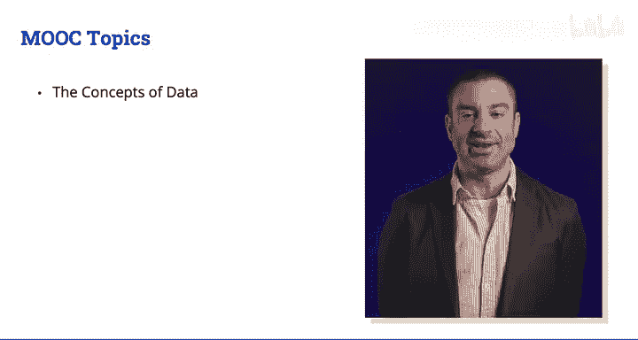
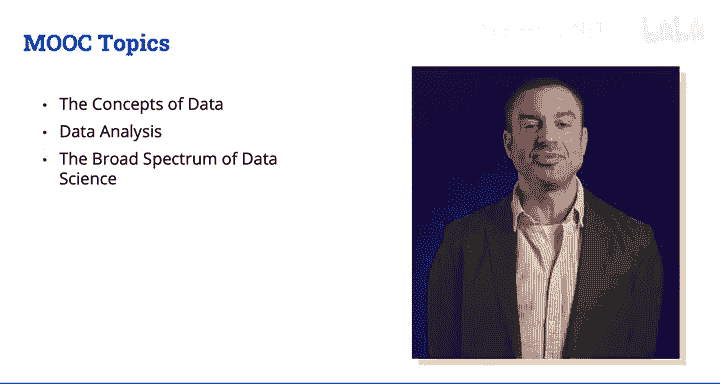
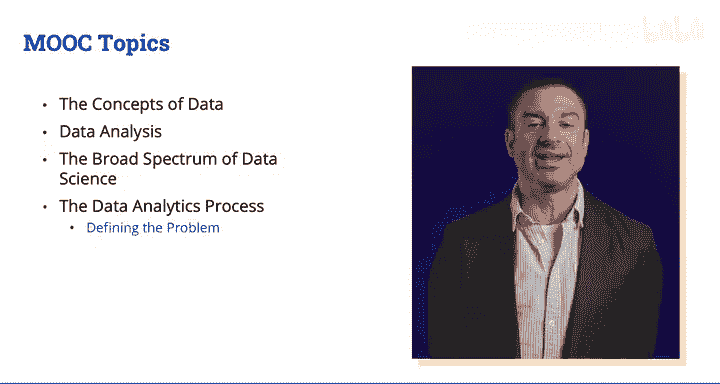
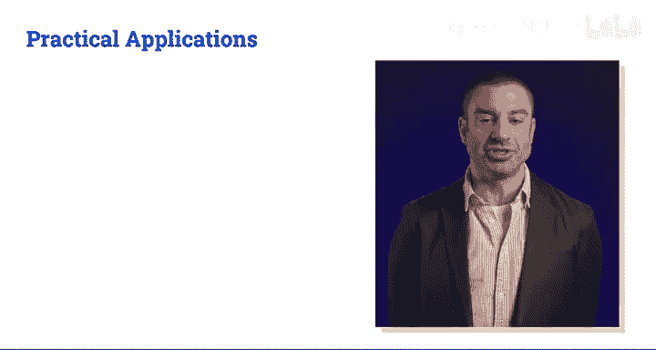
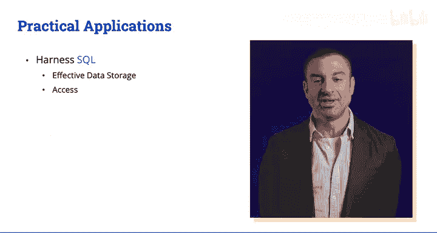
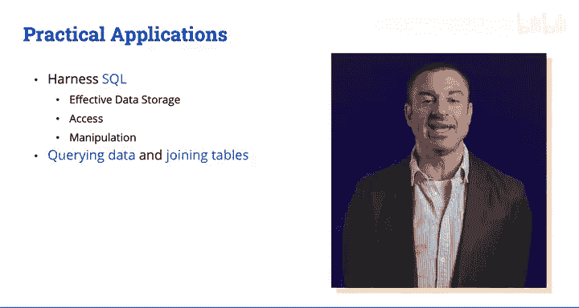
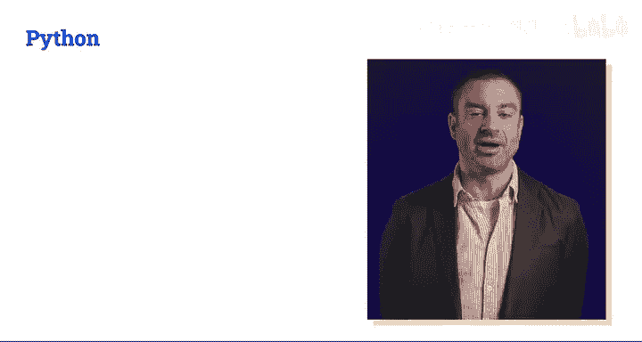
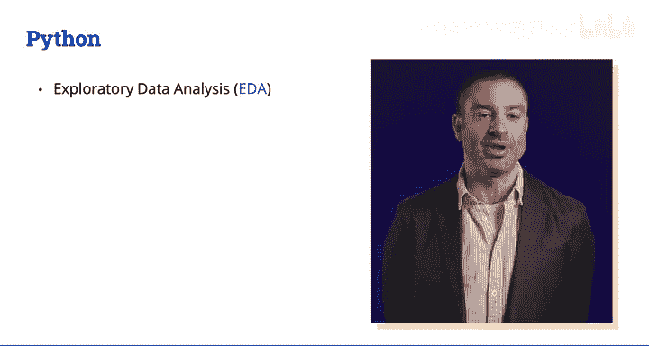
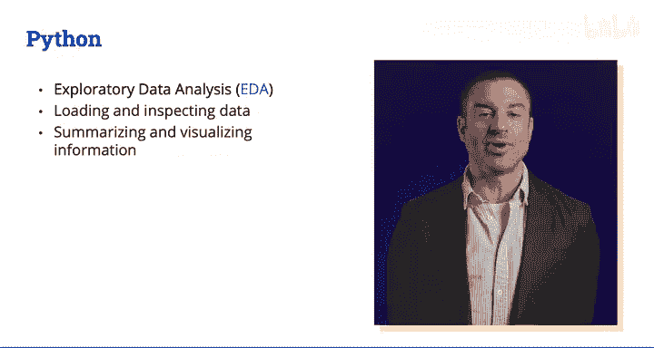

# uPenn《如何运用数据1（Python数据分析、SQL、EDA）｜How to Use Data》中英字幕 - P2：1_数据分析、SQL与Python探索性分析课程导论.zh_en - GPT中英字幕课程资源 - BV1wKxJz3EFB

Welcome to Inuction to data analytics， wrangling using SQL and EDA using Python。

 the gateway course in our specialization that demystifies the essentials of data analytics。

 This course begins with a solid foundation， introducing you to the concepts of data。

 data analysis and the broad spectrum of data science。

 It also navigates through the crucial steps of the data analytics process。

 including defining the problem and understanding the tools and languages pivotal for any data analyst。

As we progress， the course delves deeper into practical applications。

 teaching you how to harness SQL for effective data storage， access and manipulation。

 including operations like querying data， Jo tables and employing functions to refined data。

 transitioning into Python。 we explore its powerful capabilities in exploratory data analysis or ED。

 guiding you through loading and inspecting data， as well as summarizing and visualizing information to identify underlying patterns and insights。

😡。

By the end of the course， you'll be well versed in the foundational aspects of data analytics。

 ready to apply these skills to real world challenges and proceed to more complex topics in predictive analytics and more advanced data visualizations。

