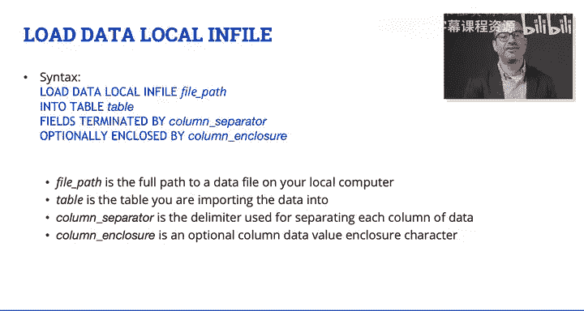
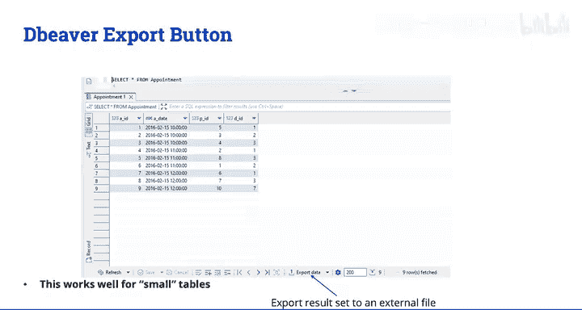

# uPenn《如何运用数据1（Python数据分析、SQL、EDA）｜How to Use Data》中英字幕 - P30：29_数据导入导出.zh_en - GPT中英字幕课程资源 - BV1wKxJz3EFB

One way to load data from a data file into a database table is by using the Low data Local In file statement。

 First， use Low data Local In file and specify the data file to load。😡。

Make sure to use the full path to the file on your local computer。

Then use the In table and specify the table you're importing the data into。😡。

Use fields terminated by to specify a column separator。

 which is the delimiter used for separating each column of data in the file。😡。

Use optionally enclosed by to specify a column enclosure。

 which is an optional column data value enclosure character in the file。😡。

Use lines terminated by to specify a new line indicator。

 which is the character used to denote a new line in the data file。😡。

And use ignore to specify a number of lines to skip。

 which is the first number of lines to skip and not load in the data file。 For example。

 you may want to skip the header in a file。One way to export a result set or table to an external file is to use the export option in D Beaavver or a similar feature in your preferred SQL development software。

😡，Note， this works well for small result sets or tables。

For exporting larger result sets or tables， you can use the select into out file statement。

 which writes the resulting rows to a specified file。 Note。

 this output file must be in a directory that your database system has permissions to write to。

For more information about select Into Out file， consult the following readings in this module。😡。

For other ways to export data from a database， consult the documentation for your database service setup。

😡。