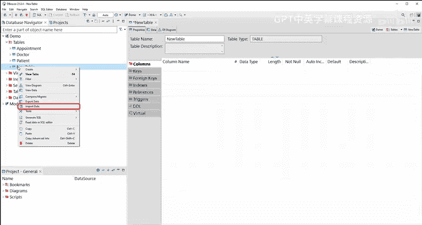
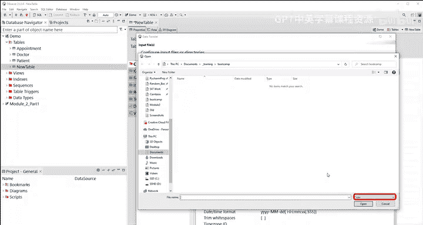
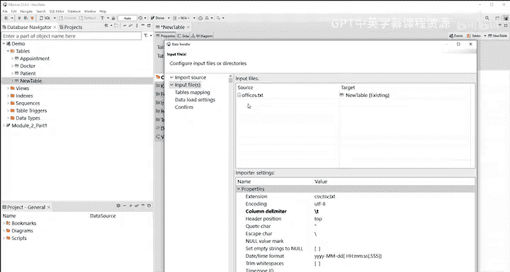
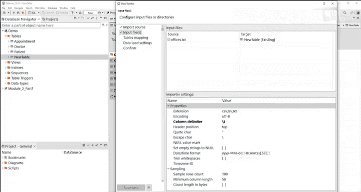
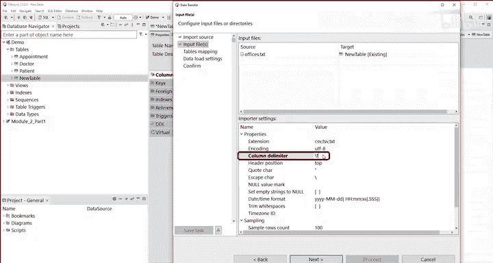
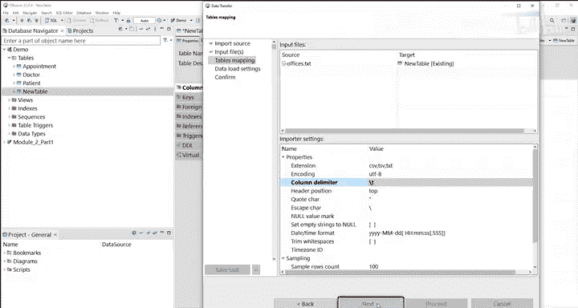
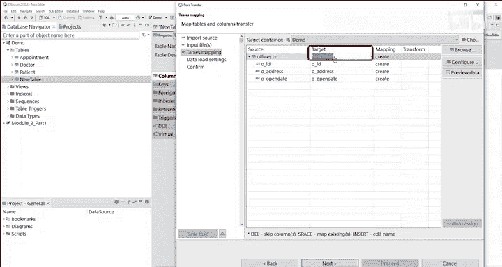
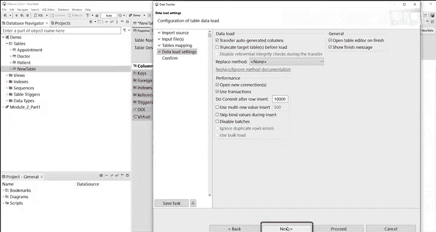
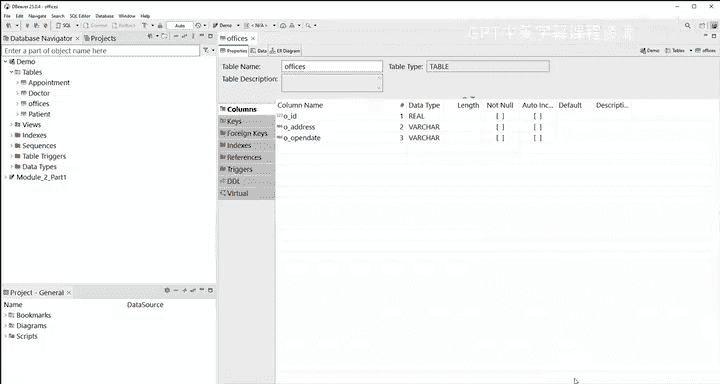
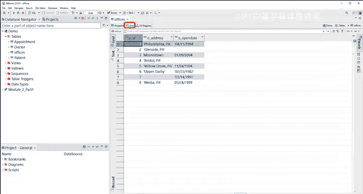

# uPenn《如何运用数据1（Python数据分析、SQL、EDA）｜How to Use Data》中英字幕 - P31：30_编程演示：SQLite数据加载.zh_en - GPT中英字幕课程资源 - BV1wKxJz3EFB

Let's demonstrate how to import data into an existing table， go to importm data。

We're going to import a file。

Go down to your file Explorer， let's locate the file that we want to import。

Let's take a look at the importer settings under properties。 Let's note the column delimiter。

 which is in bold。 This indicates what's used to separate each column of data in the file that we're importing here。

 it's set to back slash T， which is a tab character。 We'll go to tables mapping。

 Make sure the file is mapped correctly to the target table。

Let's set the table name to offices。

If we proceed， we could see all the columns that were created。

And we can see that the data has been imported successfully。

