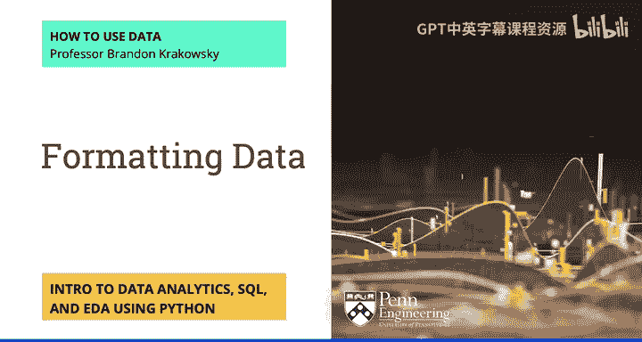
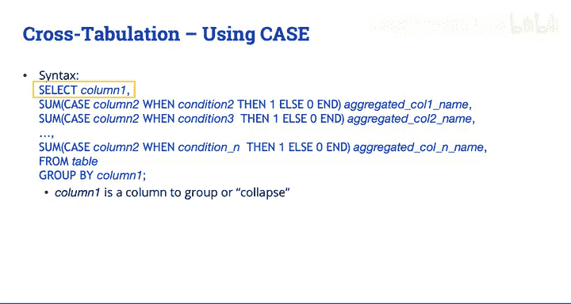
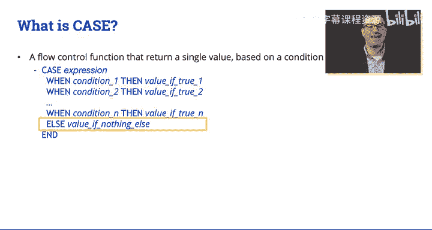

# uPenn《如何运用数据1（Python数据分析、SQL、EDA）｜How to Use Data》中英字幕 - P32：31_数据格式化.zh_en - GPT中英字幕课程资源 - BV1wKxJz3EFB

A crossss tabulation in SQL contains aggregate functions applied to multiple columns presented in tabular format。

Here's the syntax for creating a cross tab using if。 First， select the columns to group or collapse。

 then create new columns with aggregated values calculated from columns based on conditions using the if function。

😡，Specify the table to select from and group by the appropriate columns。😡。

To apply aggregate functions to columns based on conditions， you can use if。

 which is a flow control function that returns a single value based on a condition。

If returns of value if a given condition is true or another value， if a condition is false。

Here's the syntax for creating a cross tab using casese。First。

 select the columns to group or collapsese。

Then create new columns with aggregated values calculated from the columns based on conditions using case。

Specify the table to select from and group by the appropriate columns。😡。

To apply aggregate functions to columns based on conditions， you can also use case。

 which is another flow control function that returns a single value based on a condition。

Case evaluates a given expression and returns of value， depending on which condition is met。

 when it evaluates to the first condition， then it uses the first value。

 when it evaluates to the second condition， then it uses the second value and so on and so forth。

 until it reaches the else and then the end。

