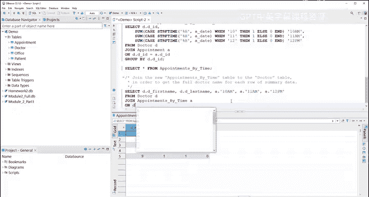

# uPenn《如何运用数据1（Python数据分析、SQL、EDA）｜How to Use Data》中英字幕 - P33：32_编程演示：数据格式化.zh_en - GPT中英字幕课程资源 - BV1wKxJz3EFB

Show the number of appointments each doctor has per time slot。

 Each time slot should be its own column。 Selectlect the doctor ID D， call it ID D。

The doctor's last name。Call it last name， and then we're going to calculate the sum for a new column。

We'll use SQL Lights IIF function to return a number to add to that new column based on the hour of the appointment。

We'll extract the hour from the appointment date。If it's equal to 10。

We're going to add one to the new column， otherwise add zero to the new column。

And then call the new column10 AM。 So if a particular doctor has an appointment at 10 AM。

 we'll add one to this column。 Otherwise， we'll add nothing。

 We're going to do the same thing for other time slots，11 AM。

And 12 PM will add one to those new columns If the doctor has an appointment at that time。

 Select the doctor information from the doctor table。

 joined with information from the appointment table。Here's the matching DID columns。

 and then we're going to group by Doctor ID。And Doctor last name。

 so we'll show the number of appointments at 10 a， 11 am and 12 pm for each doctor。

Now we're going to write the same query again， but instead of using IIF。

 we're going to use SQL's case function， so we'll select the Doctor ID， doctor last name。

 and then calculate the sum for a new column。We'll extract the hour from the appointment date。

And when the value is 10。Then we'll add one to the new column， else will add0 to the new column。

And then we'll call the new column 10 a。And we'll do the same thing for the other two time slots。

We'll do it for 11 a。And we'll do over 12 pm。The rest of the query is the same。

 Select the doctor information from the doctor table。

Joined with information from the appointment table based on matching DID column values。

And then group by the doctor information。Dorctor ID， Dr。 Last name。The results are the same。

 we see the number of appointments at 10 a。m， 11 am and 12 pm for each doctor。

Let's create a new table to store the cross tabulation data。

We'll call the table appointments by time。Let's define the columns。Doctor IDd， it's an int。10 AM。

 that's an int，11 AM， also an int and 12 PM。 That's an int as well。 Remember。

 those are the counts of appointments at those specific times。Run that to create the table。

Let's select everything from that table just to make sure it's empty。Select star。

From appointments by time。The table's empty。 Now， let's write the query to populate that table。

We're going to insert into the new table appointments by time。😡。

Specify the columns that we're going to put the data into。That's all the columns。

And the data will come from the following query。This is the same cross tabulation query we wrote above。

 using case。This will return the number of appointments each doctor has per time slot。If we run that。

It'll insert the results of that query into the new table， appointments by time。

Let's select all the records from the new table appointments by time。

 and we can see the number of appointments for each doctor per time slot。

Now let's join that new table to the doctor table in order to get the full doctor name for each row of the summary data。

The information we want to see is the doctor's first name and last name from the doctor table。

And the count of appointments at 10 AM from the appointments by time table。

 the count of appointments at 11 AM from the appointments by time table and the count of appointments at 12 PM from the appointments by time table。

 Select from the doctor table。Give it an alias of D joined with information from the appointments by time table。

 Give that an alias of a。 We use both of those aliases in the select part of the query。

And we'll join based on matching DID columns if we run that。

 we can see the total number of appointments per time slot for each doctor。

 including their first name and last name。