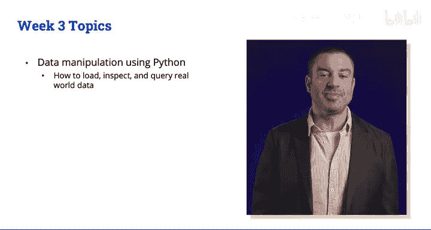
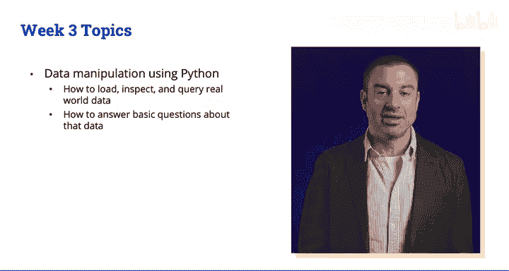
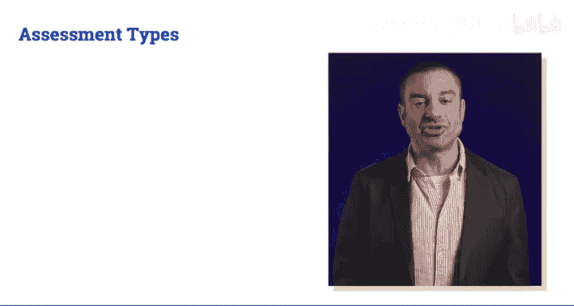
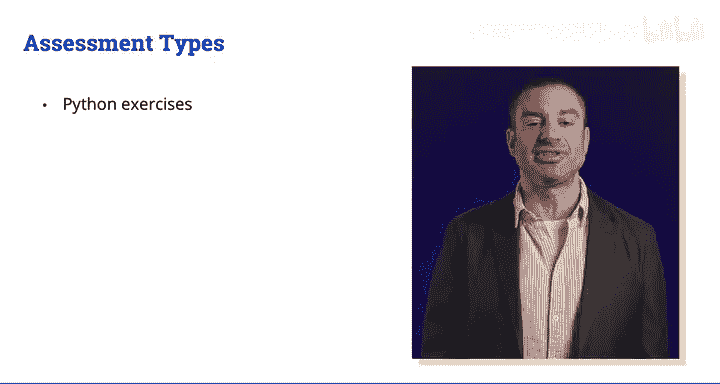
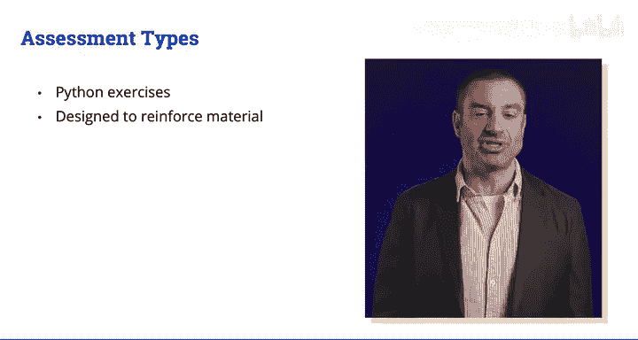
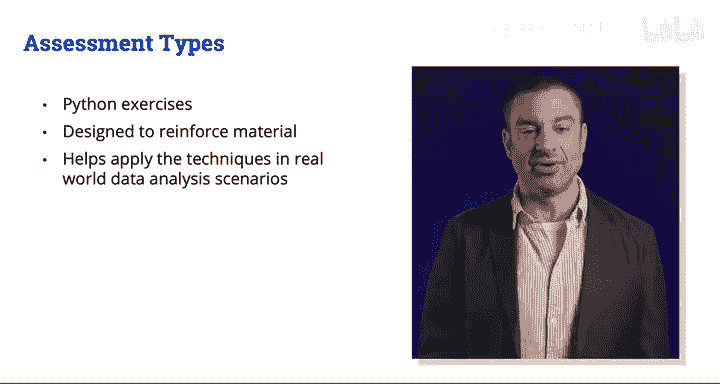

# uPenn《如何运用数据1（Python数据分析、SQL、EDA）｜How to Use Data》中英字幕 - P34：33_模块三导论：探索性数据分析(EDA)概述.zh_en - GPT中英字幕课程资源 - BV1wKxJz3EFB

This module focuses on exploratory data analysis or EDA。

 an approach to analyzing data to summarize its main characteristics and to extract basic insights will delve into the practical aspects of data manipulation using Python covering how to load inspect and query real world data and how to answer basic questions about that data。

 you'll gain skills in data aggregation and summarization， as well as data visualization。

 a crucial part of any data analysis。 In addition， you'll get experience using data analysis libraries like pandas and Nmpy and data visualization libraries like Matplotlibb and seaborn。

😡。

To ensure a comprehensive understanding and hands on experience with the concepts covered。

 this module includes a series of short Python exercises。

 These exercises are designed to reinforce the material and help you apply the techniques in real world data analysis scenarios。

 enhancing your ability to conduct exploratory data analysis effectively。

