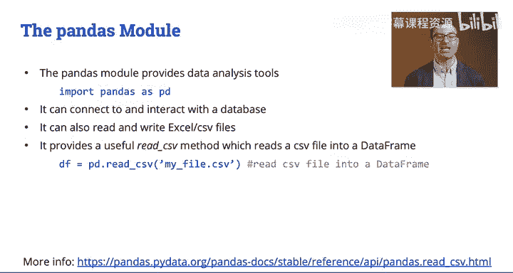
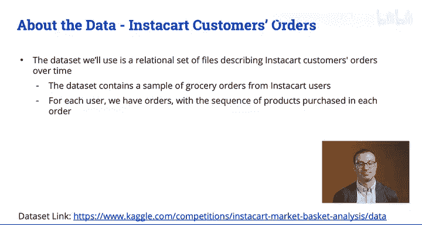
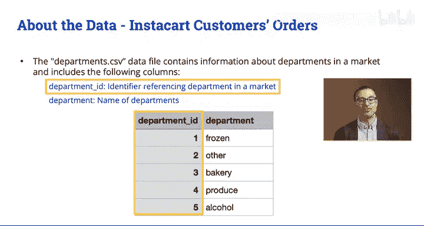
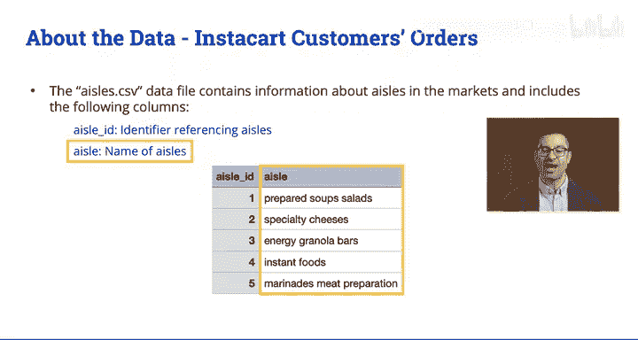
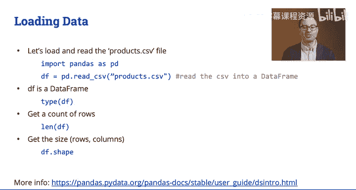
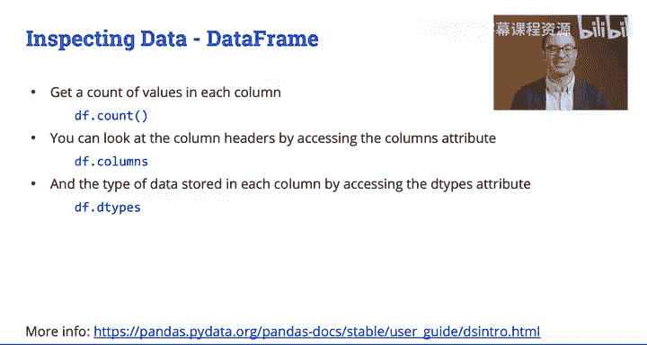
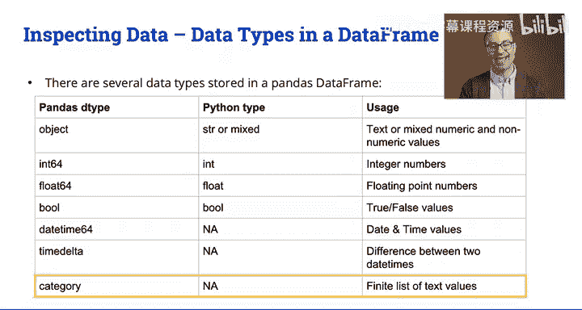
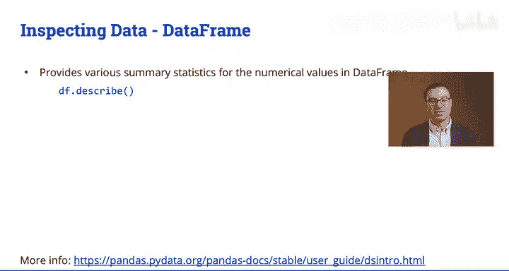
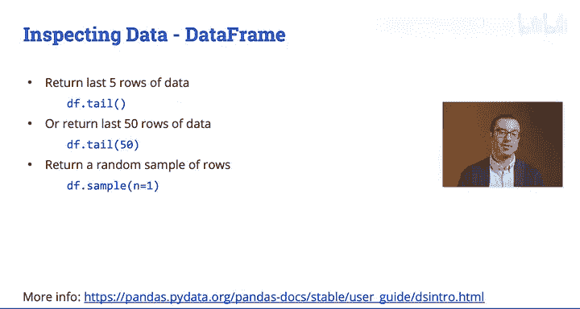

# uPenn《如何运用数据1（Python数据分析、SQL、EDA）｜How to Use Data》中英字幕 - P35：34_数据加载、审查与查询.zh_en - GPT中英字幕课程资源 - BV1wKxJz3EFB

嗯。The pandas module provides access to various data analysis tools it can connect to and interact with a database。

 It can also read and write Excel files and CSV files。After importing the Pans module。

 we have access to a useful Read CSV method which can read a CSV file into a data frame。😡。

A data frame is a two dimensional labeled data structure。

 You can think of it like a spreadsheet or database table。Before we get started。

 confirm you've downloaded the data files。😡，The data set well use is a relational set of files describing Instacart customers orders over time。

 The dataset set contains a sample of grocery orders from Instacart users。For each user。

 we have orders with the sequence of products purchased in each order。 and for each order。

 we have the week and hour of day the order was placed。

 as well as a relative measure of time between orders。

The product CSV data file contains information about the products being purchased。

 The product ID is an identifier referencing individual products。

The product name is the name of the products。 The I Id is an identifier referencing aisles in a market。

And the department ID is an identifier referencing departments for each product。

The department' CSV data file contains information about departments in a market。

The department ID is an identifier referencing departments。

 and the department is the name of the departments。

The IsL CSV data file contains information about aisleLs in the markets。

The IL ID is the identifier referencing ILs， and the IL is the name of the Is。

 The orderss CSv data file contains information about customers orders。

The order ID is an identifier referencing different orders。

The user ID is an identifier referencing users on the order。The order number is the number of orders。

 The order， D， O W is the day of week of the orders。

 and the order hour of day is the time of the orders。

 Days since prior order is the numbers of days since the prior orders。😡，Finally。

 the Order Product's prior CSV data file contains information about which products were purchased in each order。

As well as previous order contents for customers。The order ID is the identifier referencing different orders。

😡，The product ID is the identifier referencing products。

The add to cart order is the ID of items in the cart of an order。

 and reordered indicates whether a customer ordered this previously。

Let's load and read the product CSV data file， import pandas and use the Read CSV method to load the data into a data frame。

😡，We see that the type of DF is a data frame。We can get count of the rose。

And get the size or account of the rows and columns by accessing the shape attribute。

Get count of the values in each column。You can inspect the column headers by accessing the column's attribute。

😡，And get the type of data stored in each column by accessing the D typess attribute。😡。

Here's a useful table describing the different data types that can be stored in a data frame。😡。

A panda's object is a Python string or mixed type that contains text or mixed numeric and nonnumeric values。

An int 64 is a Python int or integer number。A float 64 is a Python float or a floating point or decimal number。

A bull is a true or false value。A date time 64 contains date and time values。

A time delta is the difference between two date times。

And a category contains a finite list of text values。

The De method provides various summary statistics for the numerical values in a data frame。

The head method displays the first five rows of data。If you provide an argument。

 it will display the given number of rows。This displays the first 50 rows of data。

You can drop the duplicates from a data frame by using the Drop duplicatelics method。By default。

 this will look at all columns to identify and drop duplicate rows in the data。

The tail method displays the last five rows of data。 If you provide an argument。

 it will display the last given number of rows。 This displays the last 50 rows of data。

And the sample method returns a given number of random rows。

