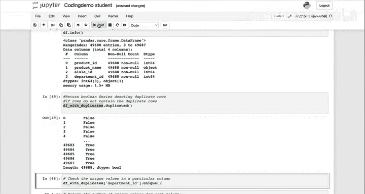
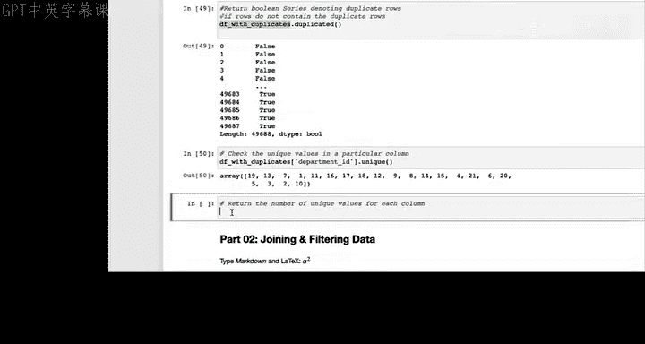
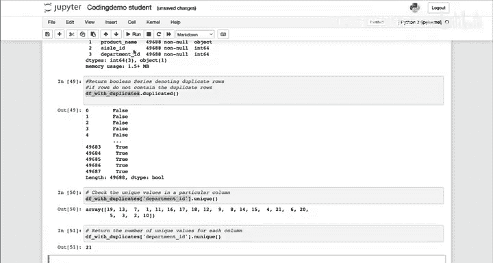
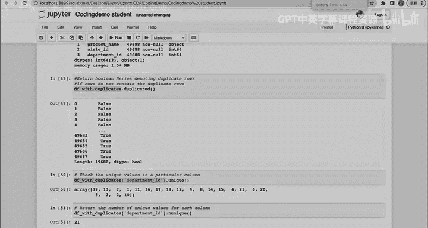

# uPenn《如何运用数据1（Python数据分析、SQL、EDA）｜How to Use Data》中英字幕 - P36：35_编程演示：数据加载与审查.zh_en - GPT中英字幕课程资源 - BV1wKxJz3EFB

Okay， let's start by loading the data。So the first thing we're going to do is import the pandas module。

 so we'll import pandas and give it an alias of PD。

We're going to be working with the Instacart data set。

 The first file we're going to load is the products。 CSv file， so let's use the read CSv method。

We'll create a data frame called DF。From the Pandas module， we'll use the Read CSV method。

Give it the path to the products。 CSv file。Run our code， and now we have a data frame called DF。

If we want to check the type of Df， we can use the type function， give it the DF。

Could see that the type of Df is data frame。We can check the number of rows in the data frame by using the L E N function。

 L N again， give it the data frame。49688 rows in the data frame that should match the rows in the product CSV file。

If we want to check the number of rows and the number of columns in the data frame。

 we can use the shape attribute from the data frame， get the shape。So this data frame has 49。

688 rows and four columns of data。So after we check some of the basic info for the data frame。

 let's look at some summary statistics for the numerical values in the data frame。

If we use the data frame's describe method， itll show some basic summary statistics like count， mean。

 standard deviation， min and Max for the numerical columns in the data frame。😡。

Now let's start looking at rows of data in the data frame。

We can use the head method to view the first five rows of data。

Here are the first five rows or products in the data set。If we want to see a specific number of rows。

 we can provide a numerical argument to the head method。 It'll show that number of rows。

Let's view the first 10 rows。Sometimes you might find duplicated rows in your data frame。

 In most cases， you want to remove those duplicate rows。

 Here we have a new data frame called D F with duplicates that shows the I I and department I D for every row。

 but there could be duplicates。 Let's drop the duplicates。 We'll take our new data frame。

 D F with duplicates。And we'll call the Drop duplicates method。By default。

 this is going to drop the duplicate rows based on all the columns。 And if we run this。

 it's going to return a new data frame with the duplicated rows removed。

 You could see there's only 134 rows left。 So there were many duplicate rows based on the IL I and department I。

😡，What if we want to see the last five rows from the data frame， well we can use the tail method。

This is the last five rows of data。And if we want to see a specific number of rows from the end of the data frame。

We can provide the tail method with a specified number。Let's look at the last 50 rows of data。

Here are the last 50 rows or products in the data。Another useful method is the infofo method。

 which gets a concise summary of the data frame。For each column in the data frame。

 it shows the column name， count of the non null values in that column。

 and then the data type for that column。Let's assume our data frame has duplicated rows。

 and we want to check which rows have duplicates before we remove them。

 The duplicated method will return a Boolean series， denoting duplicated rows。

If we take our data frame that we created， that definitely has duplicated rows。

And we called it duplicated method。This returns a series of true false values for each row that has a false value。

 That row is not duplicated for any row that has a true value。

 We know that that row is duplicated somewhere in the data frame。

Let's check the unique values in a particular column。 Again， take the data frame with duplicates。

Look at only the values in the department ID column。And then called the unique method。

This returns all the unique values or department IDs in that column。

And what if we want the number of unique values for a column？

Again， specify the data frame and the column。And then call the in unique method。

This shows 21 unique values or department IDs in the department ID column。

