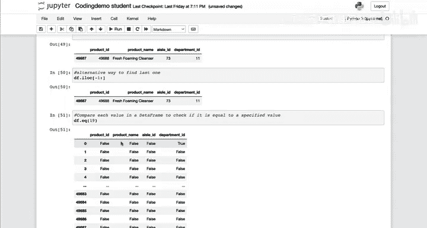

# uPenn《如何运用数据1（Python数据分析、SQL、EDA）｜How to Use Data》中英字幕 - P37：36_编程演示：数据查询.zh_en - GPT中英字幕课程资源 - BV1wKxJz3EFB

For this next part， we'll talk about how to query data。

We'll start with the same data frame containing all the products。 Let's take a look at it first。

 Here are the first five rows。 The very first column contains an auto assigned index for each row。

 The indices started 0。 Padas provides many ways to get a slice of rows based on the indices。

 Let's take a look at the second0 rows listed in the data frame。

We can use the eyelo function to get a slice of rows using a colon inside of square brackets。

 and then we need to specify the index range that we want to select。We'll type 100 to 200。

 The rules of the range and pandas are the same as the rules in Python。

 The index on the left side will be included， and the right side will not be included。

 Here's another way to do it。We can use square brackets directly with the data frame and provide an index range to get a slice of rows。

Again， this shows the second hundred rows in the data frame。

Let's get the name of the last product listed in the data。

 so we need to get the last index in our data frame。

We can calculate the last index using the length of the data frame-1。

 We'll create a variable last index and set it to the length of the data frame -1。

Then let's create another variable， last product， set that to the data frame， IO。

 provide our index range。We'll go from the last index up to the end of the data frame。

 This gives us a single row， and then let's display that row。 Fresh foaming cleanser。

Here's another very easy way to do the same thing。Using the IO function。

 you can specify negative1 up to the end of the data frame。

 Neative 1 is another way to indicate the last index in the data frame。Again。

 we get a slice with a single row， fresh foaming cleanser。

We can use the E Q function to compare each value in a data frame to see if it's equal to a specified value。

 For example， if I want to check the values in the data frame that equals 19。

 I could just apply the E Q function and provide an argument of 19。 This shows the entire data frame。

 And for any particular value that equals 19。 it shows true。 otherwise false。

