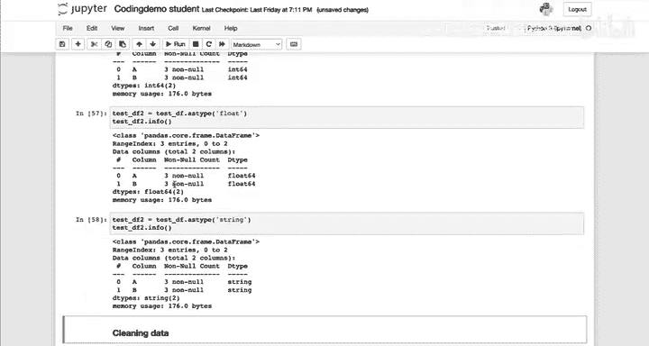

# uPenn《如何运用数据1（Python数据分析、SQL、EDA）｜How to Use Data》中英字幕 - P39：38_编程演示：数据类型转换.zh_en - GPT中英字幕课程资源 - BV1wKxJz3EFB

So let's look at casting data， pans applies and stores multiple data types in a data frame。

Sometimes the type of the values in a particular column is not what we expect or what we want。

 For example， if we look at the data frame that we created here called technologies。

 we could see that columns A and B have a very generic data type of object。

But we can convert these to a different type。 One way to do it is by using the as type function。

 Here， we're going to convert all the values in the data frame from the object type to another type int。

 If we run that and then inspect the data types for columns A and B。

 We could see that they now have a data type of int 64。 And， of course。

 this is useful if we ever wanted to do some sort of mathematical calculations with the values in those columns。

 And if we want to convert to some other data type， for example， float。 we can do that。

 we just specify float in the as type function。Now we can see the data type for columns A and B is float 64。

The string type is also acceptable， so here we're going to cast the values of the data frame to strings。

Now we can see the data type for columns A and B is string。

