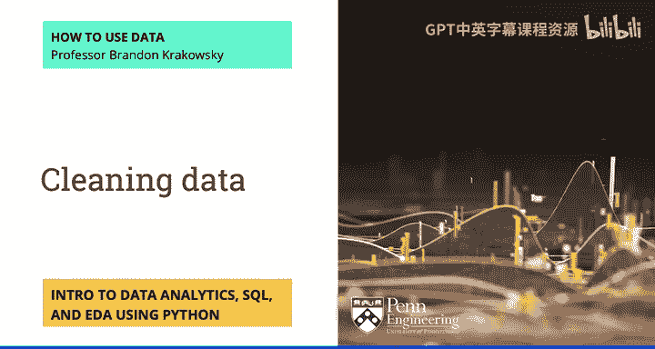
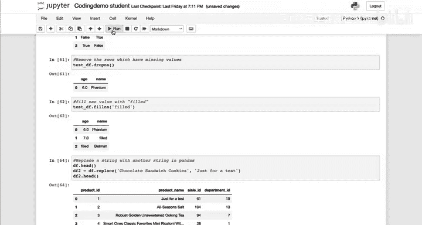

# uPenn《如何运用数据1（Python数据分析、SQL、EDA）｜How to Use Data》中英字幕 - P40：39_编程演示：数据清洗.zh_en - GPT中英字幕课程资源 - BV1wKxJz3EFB

Let's look at cleaning data。 A big part of cleaning data is detecting and handling missing values in a data frame。

Suppose I have this data frame， test DF with some missing values。

You can see in the age column there's an NN or not a number value on the third row。

 and in the name column there's a nu value in the second row。

So how can we detect these missing values， We can use the IN method。

 which shows a boolean for each value in the data frame。 If a value is N A N or none， it shows true。

 otherwise false。Here we call the INA method， and you can see the Boolean values in the data frame。

After checking for missing values， what if you want to drop them。

 The drop N A method can be used for that purpose。 Any rows containing missing values will be dropped。

 As we'll see here， the second and third rows have been dropped because there were some missing values somewhere in those rows。

 But what if we don't want to drop the missing values。 And we want to fill them with other values。

 The fill N A method can be used for this purpose。Let's fill the missing values with the string filled。

 This will replace all the missing values。And now we can see any missing values have been replaced with the string filled。

You can also change any value in a data frame using the replace method。

 Let's go back to the products's data frame we were using previously。

 We can see that the name of the product in the first row is chocolate sandwich cookies。

 Let's replace it with another name。 I'll create a new data frame D F2 to store the changes and then call the replace method on the data frame D F。

And I'm going to replace the value， chocolate sandwich cookies with another value。Just。For a test。

I'm going to run that， then I'll display the top five rows from DF2。

And I can see that the product name， Cholate sandwich cookies。

 has been replaced with just for a test。

