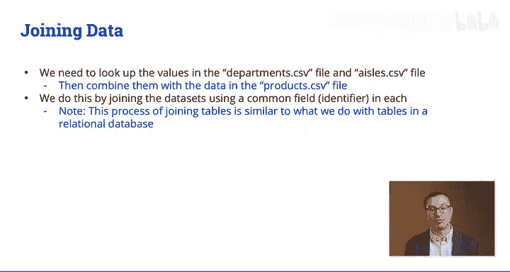
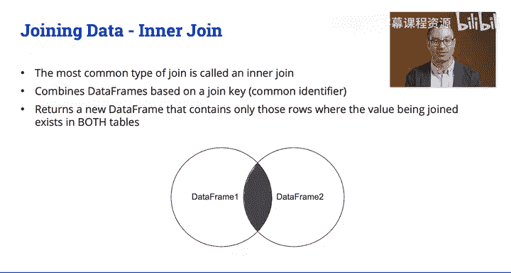
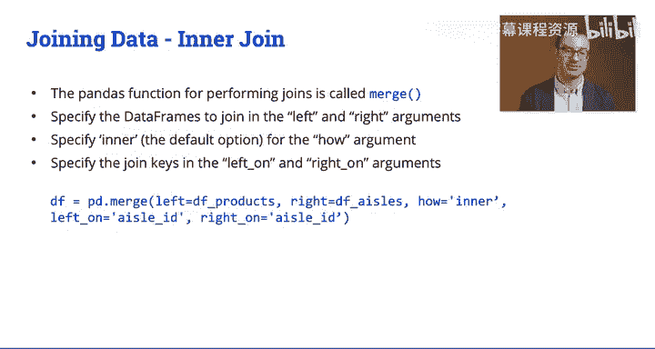

# uPenn《如何运用数据1（Python数据分析、SQL、EDA）｜How to Use Data》中英字幕 - P41：40_数据连接与筛选.zh_en - GPT中英字幕课程资源 - BV1wKxJz3EFB

We need to look up values in the department's data and ILs data and combine them with data in the products data frame。

 This will give us the market department and IL for each product。

We do this by joining the data sets using a common field or identifier in each table。

 This process of joining tables is similar to what we do with tables in a relational database。😡。

The department ID in the Product data will join to the department ID in the department's data。

 and the IL ID and the products data will join to the ILI in the ILS data。😡。

The most common type of join is called an inner join。

This combines data frames based on a join key or a common identifier and returns a new data frame that contains only those rows where the value being joined exists in both tables。

😡。

The pandas function for performing joins is called mergege。

Specify the data frames to join in the left and right arguments。

Specify enter the default option for the how argument。

And specify the join keys in the left on and right on arguments。

