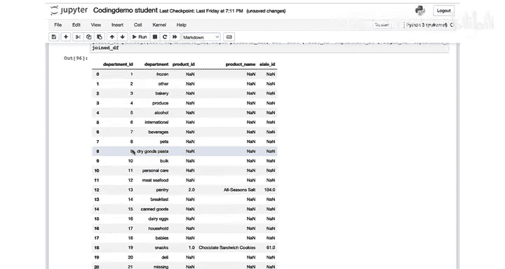

# uPenn《如何运用数据1（Python数据分析、SQL、EDA）｜How to Use Data》中英字幕 - P42：41_编程演示：数据连接.zh_en - GPT中英字幕课程资源 - BV1wKxJz3EFB

So let's demonstrate how to join different data sets。Suppose we have four tables， products， aisles。

 departments， and orders they're all related to each other in some way。

Let's quickly look at the products data frame and the department data frame。

The product data frame has four columns， and the department data frame has two columns。

 We can see there's a department I column in both data frames。

 We're going to use this column as an index to join the two data frames。

 After declaring a new data frame。 we're going to call the merge function in the pandas library。

 We'll specify the two data frames to join on the left we'll specify the products Df and on the right。

 will'll specify the departments Df。We're going to use an inner join to join the two data frames。

Well specify an index in the left table。That's going to be the department ID column。

And then we'll specify an index in the right table。That's also going to be the department ID column。

So when joining the two data frames， it's going to match the values in those two columns。

 once we run merge， let's display the join data frame。 where for each product。

 we can see the detailed department information。 Since we used an inner join We only see products from the products data frame with a matching department and the departments data frame。

 So what happens when we merge and use a left join。

 Let's rerun the merge but change the how parameter to be a left join。 If we run that。

 you can see that this follows the left table and maintains the order of the products from the left table。

 And then merges any matching department information from the right table。

 So what's the difference between a left join and an inner join。

 Sometimes they return the same merged information。

 But suppose we have a special situation where we only have two of the products。

 Let's see what happens when we use a left join。 So for this example。

 I'm going to select the first two products from the products data frame。

 I'll store that in products。😊，DF2， if we take a look at that。

 we could see two rows containing the information for two different products。 First。

 let's demonstrate an inner join to merge the department information with these two products。

 I'm going to call merge。 And this time I'm going to specify the department data frame on the left。

And on the right， I'm going to specify my new Product DF2 data frame。We'll use an inner join。

And the idea I'm going to use in the left table is the department I D。

And the ID I'm going to use in the right table is also the department ID。

If I run this and then display the join data frame。

 I only see departments in the left departments data frame with matching product information from the right products data frame。

Now， let's use a left join to merge the department information with the two products。

 We copy the code from this cell paste it here。 I'm going to do the same merge。

 but I'm going to change this to be a left join。 If I run this it display the join data frame。

 I can now see all the information from the left departments data frame。

 as well as any information from the right products data frame。

 And for any department on the left that doesn't have a matching product on the right。

 I see a null value or a N A N value。 This is because I did a left join and the department's data frame is on the left。

 So it maintains or keeps all the rows from that data frame。

