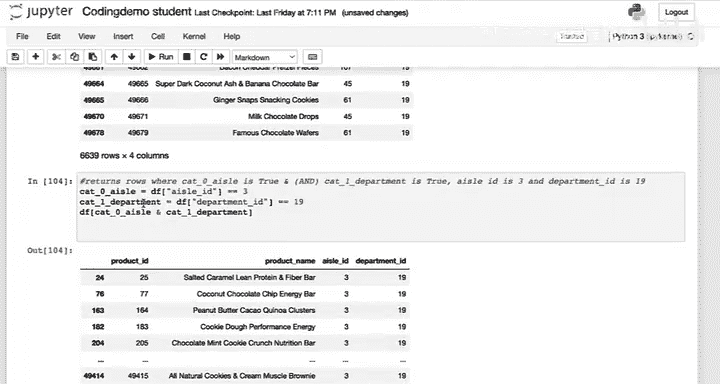

# uPenn《如何运用数据1（Python数据分析、SQL、EDA）｜How to Use Data》中英字幕 - P43：42_编程演示：数据筛选.zh_en - GPT中英字幕课程资源 - BV1wKxJz3EFB

Let's look at how to filter data using Boolean indexing。

 So we're going to search for specific rows in the data by creating a condition or a set of conditions。

 For example， I'm going to create a condition。 I'll store it in the variable cookies from the data frame Df。

 I'm going to look for rows where the product name column inside of square brackets is equal to。

Chocolate。Sandwich。Cookies。Here's my condition where the value in the product name column is equal to chocolate sandwich cookies。

 And if I display cookies， I could see this gives me a series of true false values。

 Each one corresponding to a row in the data frame indicating if the product name is equal to chocolate sandwich cookies。

 I can then use this series of true false values to filter my data。

 specify the cookies series inside of square brackets for the data frame。

 And this returns one row where the product name is equal to chocolate sandwich cookies。

 We can also use multiple conditions to filter our data。Here's an example。

 I'll create my first condition。 I'll call it cat zero aisle。In the data frame。Where the value。

In the IL IDd column。Is equal to 19。Then I'll create another condition， I'll call it Cat1 department。

😡，In the data frame。Where the value。In the department ID column。Is equal to 19。

So I have two conditions that I'm going to put together to filter my data from the data frame。

 Give me the rows where cat 0 aisle is true or。Cat 1 department is true。

 You indicate or by using the vertical bar。 These are all the rows where the I Id is 19 or the department I D is 19。

Here's another example where I put those conditions together in a different way。

 Let me copy the conditions， paste them here for the first condition。

 I'm going to change it to where the I I D is 3 for the second condition。

 I'll leave it the same from the data frame。 Give me the rows。

Where Cat 0 aisle is true and Cat 1 department is true。 You indicate and using a single ampersand。

 These are all the rows where the aisle I D is 3， and the department I D is 19。

