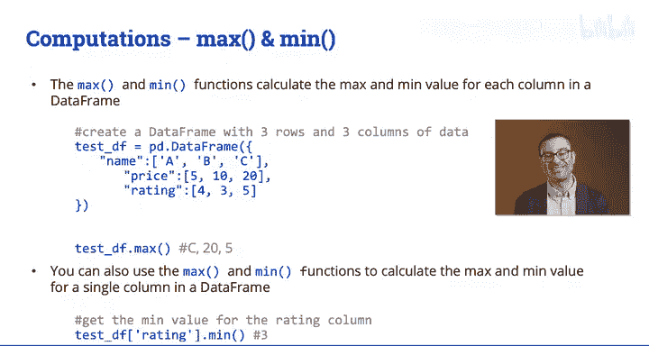

# uPenn《如何运用数据1（Python数据分析、SQL、EDA）｜How to Use Data》中英字幕 - P44：43_计算基础.zh_en - GPT中英字幕课程资源 - BV1wKxJz3EFB

Use the sum function to calculate the sum of values for each column in a data frame。

This first creates a data frame with three rows and three columns of data and then gets the sum of values for each column。

You can also use the sum function to calculate the sum of values for a single column in a data frame。

😡，This gets the sum of value specifically for the price column。

You can use the mean function to calculate the mean or average for a single column in a data frame。😡。

Again， this first creates a data frame with three rows and three columns of data。

 then gets the average price and rating。The max and min functions calculate the maxim min value for each column in a data frame。

This first creates a data frame with three rows and three columns of data and then gets the max value for each column。

You can also use the max and min functions to calculate the max and min values for a single column in a data frame。

 This gets the min value for the rating column。

