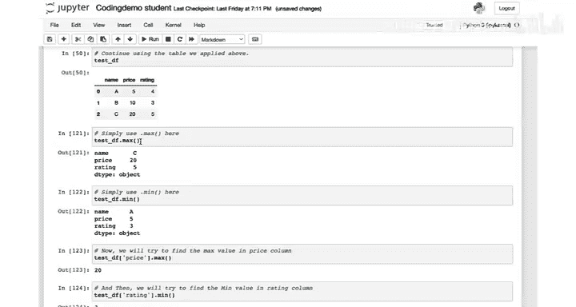

# uPenn《如何运用数据1（Python数据分析、SQL、EDA）｜How to Use Data》中英字幕 - P45：44_编程演示：数据计算.zh_en - GPT中英字幕课程资源 - BV1wKxJz3EFB

Let's do some aggregation over multiple rows。 We're going to use a data frame that contains information about which products were purchased in each order。

 We're going to calculate the total number of reorders from the orders's data frame。

Look at all the values in the reordered column。And then calculate the sum using the sum function。

Then， we'll display reorder numb。This gives me a total of over 19 million reorders。

To demonstrate the mean function， I have a test data frame here which contains product names。

 prices and ratings。Let's calculate the average price across all the products。

 I'll call it Av price from the test F。 Look at all the values in the price column。

 calculateulate the average by using the mean function。Then we'll display add price。

The average price is 11。666666， etc cetera。Now let's get the average rating。

I'll call it average rate。From the testF data frame。

 look at all the values in the rating column and then calculate the mean。

We'll display the average rate。Which is 4。0。Let's demonstrate Max and min。

We're going to use our test DF data frame again。First， let's use the max function。

From the data frame， get the max。 Since we' callinging max on the data frame itself。

 it gives us the max value of every column。 This is only meaningful for price and rating。

Let's call min for the data frame。This gives us the min for every column。 again。

 really only meaningful for price and rating。Now， let's get the max and min for a specific column。

 Let's get the max price。 Look at all the values in the price column。 Give me the max。20。And then。

 let's get the min rating。From the test data frame。Look at all the values in the rating column。

And then， give me the men。And that's three。

