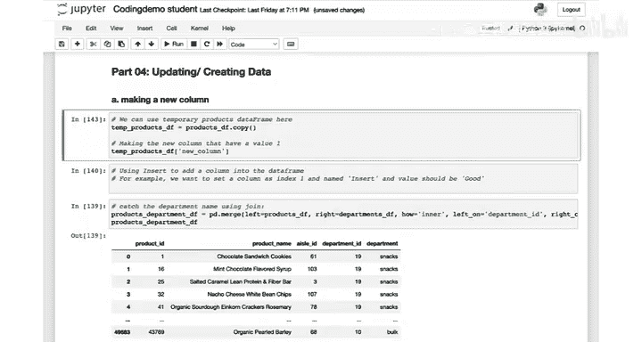
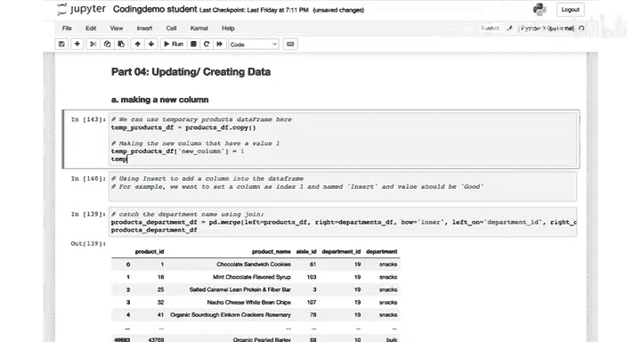
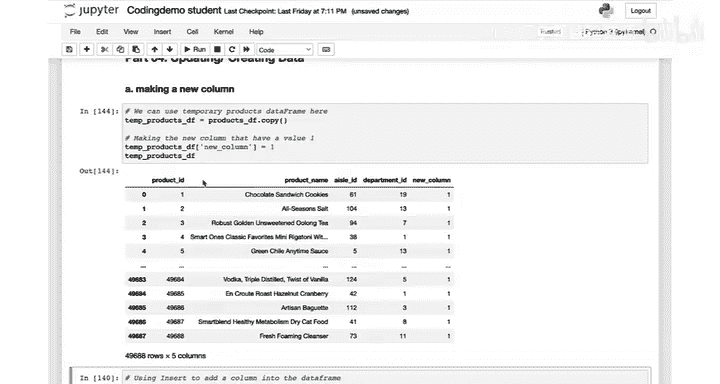
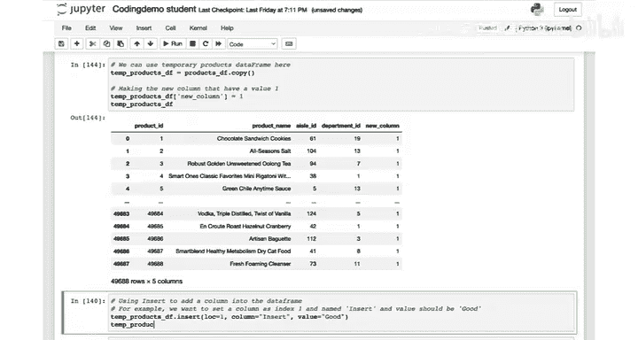
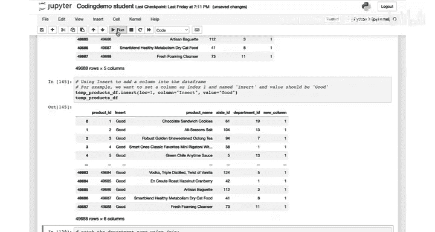
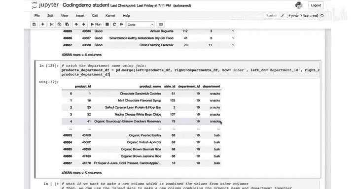
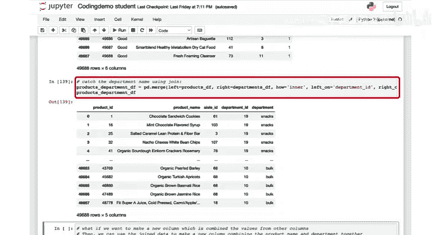
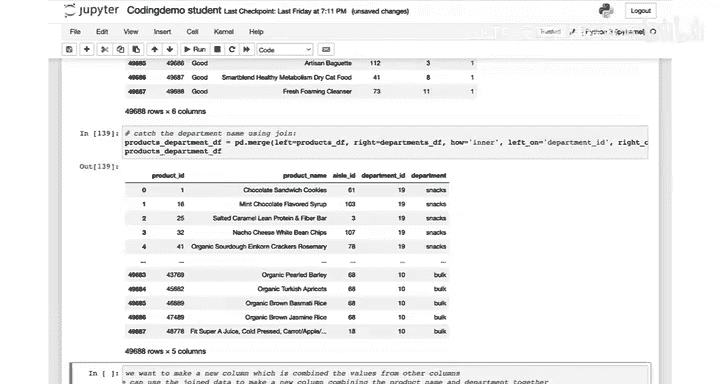
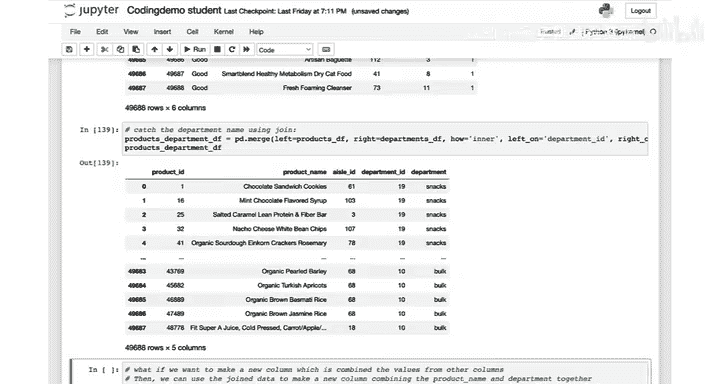

# uPenn《如何运用数据1（Python数据分析、SQL、EDA）｜How to Use Data》中英字幕 - P47：46_编程演示：数据更新与创建.zh_en - GPT中英字幕课程资源 - BV1wKxJz3EFB

Let's look at updating and creating data。😡，First， we'll learn how to make a new column in a data frame。

Suppose we have a data frame called Temp Products DF that's copied from Product DF。😡。

Let's make a new column。Temp， underscore products， underscore DF。

 I'm just going to specify a new column， new underscore column。

Equals1。 This means that every row will have the value of one in that column。

 If I display the data frame， I could see in the new column the value 1 for every row。

Let's create a new column a different way。 I'm going to use the insert function。 In this example。

 I want to create a new column in a specific location based on an index。😡，Temp underscore。

Products underscore Df dot insert。I'll specify the location for the column， index1。

The name of the column is insert。And the value for every row in this column。We'll be good。

If I display temp。Products。

Df。I could see the new column insert to the right of the product ID column because we used index 1。

 and I could see the value for every row is good。😡。

Suppose we want to combine the values in the product name column and the department column and then use that value in a new column。

😡。

Here we have our Products department DF。 This is a merge data frame from the Product Df and the department's Df。

I'm going to take Product department T F。Create a new column。We'll call it new name。

And I'm going to set it to。From the Product department Df。The values in the product name column。

Concateated。With the values。In the department column。For a separator between the concatenated values。

 I'm going to use a comma。

If I display the data frame， I can see the new column， new name。

 then the value for each row is a concatenated value of the product name and the department with a comm in between。

