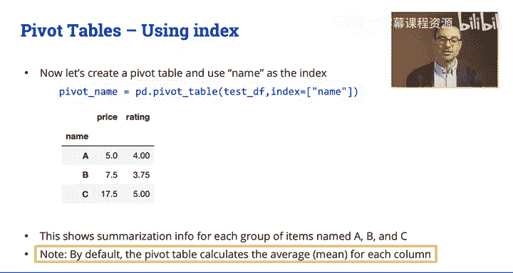

# uPenn《如何运用数据1（Python数据分析、SQL、EDA）｜How to Use Data》中英字幕 - P48：47_数据汇总.zh_en - GPT中英字幕课程资源 - BV1wKxJz3EFB

The group by method splits data into different groups based on variables of your choice。 Note。

 this process of grouping data is similar to what we do with group by in SQL。

Group I returns a group by object， which provides a dictionary whose keys are the computed unique groups and their corresponding values。

 For example， when we group by I， the keys will be all possible aisle names。

We can use the group's attribute to get a specific group of records。

 How many products are there in the specialty cheeses aisle。

But this kind of info in itself isn't actually all that useful。

 What we really want to be able to do is perform aggregate computations on the data within each group。

NoomePy is a popular Python library for scientific computing。

 It's often used for working with arrays and matrices and contains a large collection of high level mathematical methods to operate on these arrays。

Numpy has an array method which creates an array。After importing the Numpy library。

 we can use the array method to create a one dimensional array。

We can also create a two dimensional array。And the shape method returns the shape of a given array。

The Ag method allows us to perform aggregate computations on group data in a group by object。😡。

You can pass a list of aggregate functions as arguments to demonstrate。

 let's first create a data frame with five rows and three columns of data。Now， let's get the sum。

 mean and standard deviation for the price of each group of items named A， B， and C。First。

 we import nuumpy。Then we group our data on name and call the Ag method。As arguments。

 we pass Nmpy's sum method， mean method and standard deviation method。 Finally。

 we display the result of applying those aggregate computations to the price attribute。

A pivot table is a useful data summarization tool that creates a new table from the contents of a data frame。

😡，In order to pivot a data frame， we need at least one index column to group by。

 The index is just like the variables you group by in the group by method。😡。

The pivot table will provide useful summaries along that index， such as summation or average。Again。

 let's first create a data frame with five rows and three columns of data。😡。

Now let's create a pivot table and use name as the index。😡，Note， by default。

 the pivot table calculates the average or mean for each column。

