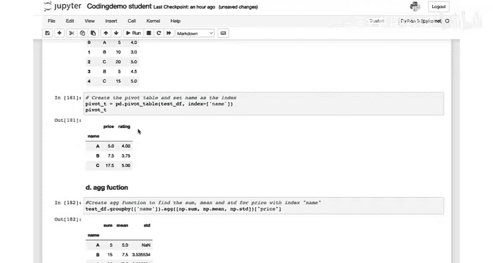

# uPenn《如何运用数据1（Python数据分析、SQL、EDA）｜How to Use Data》中英字幕 - P49：48_编程演示：数据汇总.zh_en - GPT中英字幕课程资源 - BV1wKxJz3EFB

Let's look at summarizing data using the group by function。😡。

Let's group the product data by the IL IDD， and the keys will be all aisles。

So I'll take the product data frame， I'll call Group by。

And I want a column or a set of columns to group by。 I'll specify that here。I'll get all the groups。

And then let me get the keys for those groups。 These are all the IL Ids from the product data frame。

We can use the group's attribute to get a specific group of records。😡。

What if we wanted to answer the question， how many products are in IL 19？

Let me get the length of the following。I'll take the product data frame。Again， I'll group by aisle。

 I D。And then I'll get the groups， but I want a specific group。I want the group with the key of 19。

There are 375 products associated with Group 19， or ILID 19。Let's demonstrate the Nmpy package。

 First， we want to just import the Ny library here。

Then we're going to initialize a numpy 1 dimensional array。 This is like a list of values。

 Take the Numpie library， Call the array method。 I want my array to include the values 1，2，3，4，5。

And here I have my nuier array。Now， let's initialize a nupy two dimensional array。

 It'll have two rows。Here we'll use the Numpy Library and the array method。

The first row in the two dimensional array will have 1，2，3。

 and the second row in the two dimensional array will have 4，5，6。And here I have my nu high。

 two dimensional array。Let's check the shape of this two dimensional array。From the Nie Library。

 let's check the shape of ARR2。2 rows， three columns。 So conceptually。

 a two dimensional array is a lot like a table。Let's take a look at how to create a pivot table。

 which is another way to group and summarize data from a data frame。

 Suppose we have a data frame called testF。There are three columns， name， price and rating。

 We want to create a pivot table and set the name as the index。

 So I'm going to call the pivot table pivot T。I'll use the pandas library。

 I'm going to call the pivotvo table method。I'll give it the data。

 That's the data in the test D F data frame。 The index will be the name column。

 So that means I want to group by name and show summary information for each unique name value。

 So here I can see for each name， A， B and C， the average price and average rating。

Let's look at the Ag function， which can perform aggregate computations on the data in each group in a group by object。

 You can pass a list of aggregate functions as arguments。 I want to find the sum。

 mean and standard deviation for price for each name from our test data frame Let's group by name。

And then we're going to calculate in the Ag function。The sum from the Numpy Library。

 the mean from the Numpy Library and the standard deviation from the Numpy Library。

And I want to display those。Just for price。So here we have the sum。

 the mean and standard deviation for each dame value。

We showed two ways to summarize information from this test data frame。A pivot table。

 which calculates averages by default and group by using the Ag function。

 where we can specify the aggregate functions to be applied。

