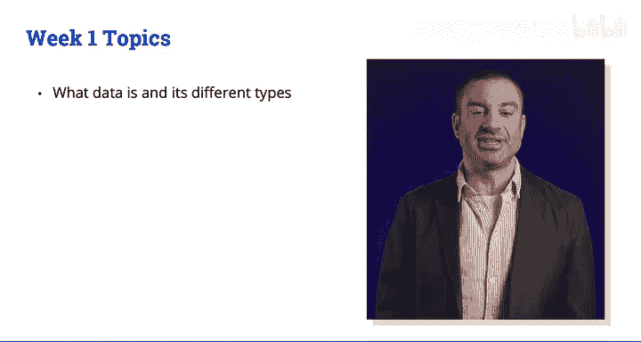
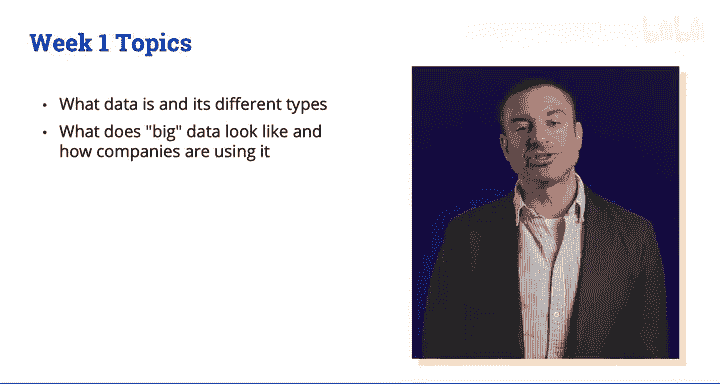
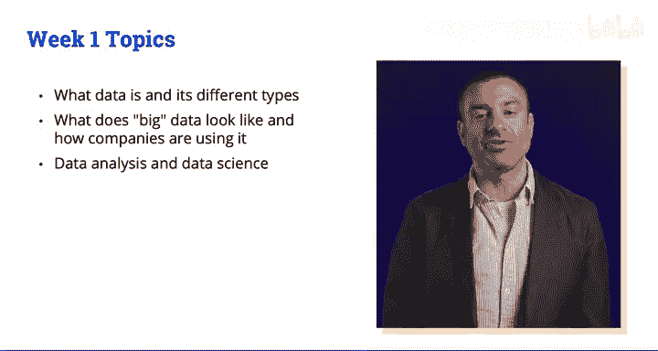
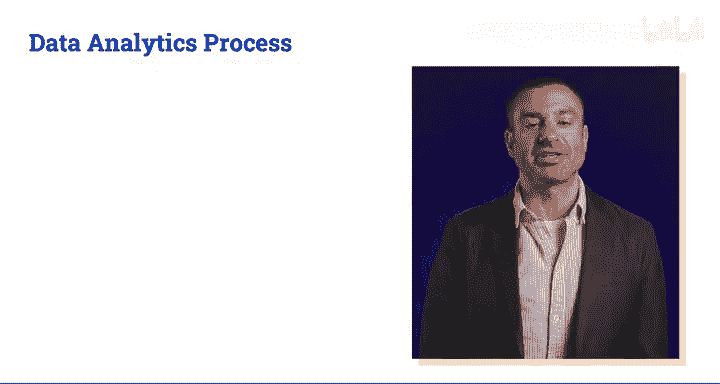
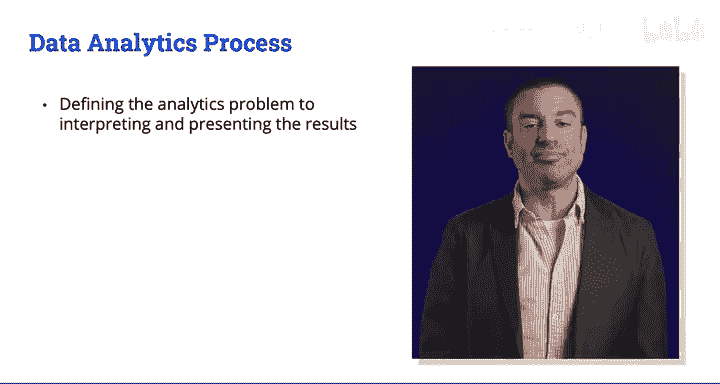
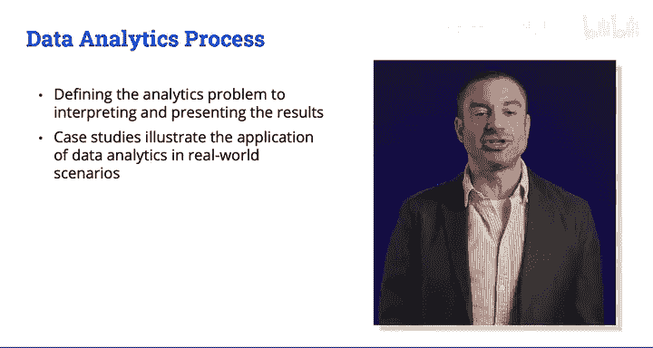

# uPenn《如何运用数据1（Python数据分析、SQL、EDA）｜How to Use Data》中英字幕 - P4：3_模块一导论：数据基础与问题定义.zh_en - GPT中英字幕课程资源 - BV1wKxJz3EFB

The ability to understand and work with data has become increasingly important in today's world。

 where data is ubiquitous and valuable。 This course covers a range of topics。

 including what data is and its different types， what big data looks like and how companies are using it。

 It also explores the fields of data analysis and data science and how the two come together to help form the field of data analytics。

We'll look at the entire data analytics process and how it works from defining the analytics problem to interpreting and presenting the results。

 we'll also look at some case studies which are presented to illustrate the application of data analytics in real world scenarios。

😡。

